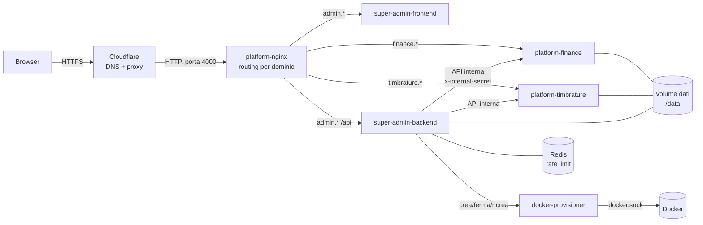
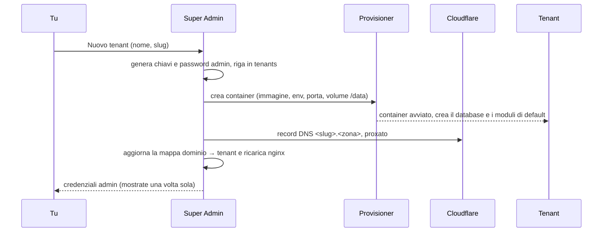
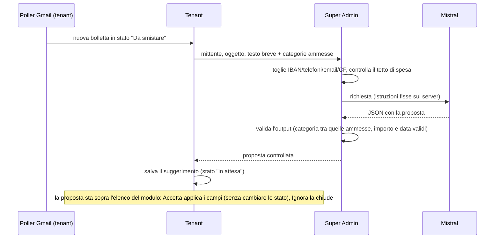

# Architettura

Come è fatto Platform 0.1. Per il perché vedi [`PLATFORM-VISIONE.md`](PLATFORM-VISIONE.md); per metterlo
online e mantenerlo vedi [`docs/OPERAZIONI.md`](docs/OPERAZIONI.md).

## In breve

Due tipi di processo:

- **Super Admin** (uno solo): crea e gestisce i tenant, ospita il Builder e la Libreria, fa i backup.
- **Tenant** (uno per progetto): la stessa immagine `platform-core` con un proprio database e i propri
  moduli. Finance è un tenant.

Un **provisioner** (piccolo servizio con accesso a Docker) è l'unico che crea e ferma i container dei tenant.



## Le parti

| Cartella | Cosa è | Tecnologia |
|---|---|---|
| `core/backend` | Il tenant: record, moduli, automazioni, utenti, backup, sito web | Node 22, Express, SQLite (better-sqlite3) |
| `core/frontend` | L'interfaccia del tenant: moduli, Builder, Libreria, impostazioni | React, Vite, Tailwind |
| `super-admin/backend` | Tenant, Libreria, backup, accessi, statistiche | Node 22, Express, SQLite |
| `super-admin/frontend` | Interfaccia di Super Admin | React, Vite, Tailwind |
| `super-admin/docker-provisioner` | Crea, ferma, ricrea i container dei tenant | Node 22, dockerode |
| `shared/` | Schema dei moduli (v3), rate limit, TOTP, utilità | JavaScript |
| `infra/nginx` | Router per dominio e mappa dominio → tenant | nginx |

L'immagine del tenant (`core/Dockerfile`) contiene nginx (serve il frontend e inoltra `/api`), il backend Node
e supervisord che li tiene su entrambi. Ascolta sulla porta 80 del container.

## I dati

Tutto vive nel volume `/data`, condiviso da Super Admin e dai tenant:

```
/data/super-admin-01.db        registro di Super Admin: tenant, Libreria, audit, backup
/data/<slug>.db                database di UN tenant (record, moduli, utenti)
/data/uploads/<slug>/          allegati del tenant (se non vanno su Google Drive)
/data/backups/<slug>/          copie di sicurezza del tenant
```

**Un tenant = un file SQLite.** I record stanno in una tabella `records` (`module_slug`, `data` JSON): la
struttura dei moduli sta in `modules.schema_json`, quindi cambiare un modulo non richiede migrazioni.

### Segreti di un tenant

Alla creazione Super Admin genera per ogni tenant una `ENCRYPTION_KEY` e un `JWT_SECRET`, li salva nel
proprio registro (`tenants.encryption_key`, `tenants.jwt_secret`) e li passa al container come variabili
d'ambiente. Non escono mai dalle API: l'elenco dei tenant li toglie e c'è un test che lo garantisce.

La chiave cifra i campi sensibili dei record (AES-256-GCM, valori che iniziano con `enc:`), con il nome
del tenant come sale. **Senza la chiave originale quei campi non si leggono più**: fa parte dei dati da
salvare insieme ai backup. Per riportare un tenant esistente sotto un nuovo Super Admin c'è "Registra
esistente", che importa il tenant con la sua chiave.

## Il ciclo di vita di un tenant



- **Stop / Start**: Start su un tenant senza container lo ricrea sullo stesso volume con le chiavi salvate.
- **Redeploy**: ricrea il container con l'immagine più recente; si ferma se qualcuno è collegato da meno di
  3 minuti (non forza).
- **Elimina**: backup di sicurezza, poi container e record DNS spariscono.
- **Registra esistente**: importa un tenant già esistente (da un vecchio `super-admin.db` o a mano).

## Moduli, Builder, Libreria

Un **modulo** è uno schema JSON (formato v3: una lista di blocchi `field`, `relation`, `workflow`,
`automation`, viste, permessi). Il motore (`core/backend/src/schema-v3.js`, condiviso con `shared/`) lo
interpreta; non c'è codice specifico per un tenant.

Il **Builder** modifica gli schemi. La **Libreria** (tabella `registry_modules` di Super Admin) conserva i
moduli con una versione: salvare di nuovo lo stesso modulo crea la versione successiva. **Installare = copiare**:
il tenant riceve una copia sua, ricorda da quale versione viene e mostra "Aggiorna" quando ne esiste una più
nuova (l'aggiornamento sovrascrive la copia locale, ed è avvisato prima).

## Parlare tra le parti

- **Browser → tenant**: JWT di sessione (24 ore), password con bcrypt, 2FA con TOTP facoltativo,
  limite ai tentativi di accesso (Redis).
- **Super Admin → tenant**: chiamate interne sulla rete Docker con `x-internal-secret`. Per il Builder e per
  "Apri →" Super Admin chiede al tenant un token amministrativo; il tenant firma da sé, Super Admin non
  conosce il suo `JWT_SECRET`.
- **Tenant → Super Admin**: lo stesso segreto interno, per elenco e installazione dei moduli della Libreria.
- Solo il **provisioner** ha accesso a `docker.sock`.

## Backup

Lo scheduler di Super Admin controlla ogni 15 minuti e fa una copia di ogni tenant secondo la sua frequenza
(di default ogni 24 ore, ne tiene 7) con `VACUUM INTO`: una copia coerente anche a container acceso.
Facoltativamente la copia viene sincronizzata fuori dal NAS (offsite) e verificata una volta a settimana.
Dal tenant, la voce **Export dati** scarica il database o un export JSON completo.

## Collegamenti esterni

Google (Gmail in lettura, Calendar, Drive) e WhatsApp (CallMeBot) si configurano per tenant da Impostazioni → Connessioni. Le **regole Gmail** stanno dentro
la riga Google (si vedono con Google collegato) e i **destinatari WhatsApp** e gli **ultimi invii** dentro la riga WhatsApp: sono impostazioni del sistema
(tabelle `gmail_rules`, `whatsapp_recipients`), non moduli. L'elenco mostra solo i collegamenti attivi o richiesti dai moduli installati. Le credenziali
Google (Client ID e Secret, token) stanno nella tabella `connections` del tenant.

**Regole Gmail** (`gmail-poller.js`, ogni 15 minuti): ogni regola ha mittente, **modulo di destinazione**, categoria e **tipo**. *Bolletta* cerca importo e
scadenza nel testo e nei PDF; *semplice* prende solo oggetto, data e allegati (ordini, contratti, documenti). La riga creata scrive solo i campi che il
modulo ha dichiarato (`costruisciRiga`, funzione pura e testata) e usa lo stato "nuovo" dichiarato dal modulo. Una regola senza modulo usa il primo che ha
dichiarato di poter ricevere righe dalle mail.

## Notifiche WhatsApp

L'invio passa da `core/backend/src/whatsapp.js`: legge la risposta di CallMeBot (che risponde 200 anche quando
rifiuta), riprova solo i problemi temporanei, manda i messaggi uno alla volta e registra l'esito vero per
destinatario; un messaggio non consegnato genera un avviso nell'app. Ogni invio finisce nel **registro** (`whatsapp_log`,
ultimi 200, rotta `GET /api/connections/whatsapp_callmebot/log`), visibile in Impostazioni → Connessioni → WhatsApp → "Ultimi invii".
Le automazioni dei moduli (`invia_notifica`, `invia_report_periodico`) usano lo stesso invio.

Cosa avvisare e con quali parole lo **dichiara il modulo** (Builder → Ruoli del modulo → "Avvisi", vedi sotto), non il codice:

- **Avviso su riga nuova** (`avvisi.js`, `scanNuove`): ogni minuto cerca le righe nello stato "nuovo" dei moduli con l'avviso acceso che non sono ancora state
  segnalate e le manda in un messaggio ("Bolletta da smistare: A2A · 44,00 € · scade 01/10/2026"; più righe dello stesso modulo = un solo messaggio con l'elenco,
  le prime 4 e "… e altre N"). Il controllo vale per **qualunque via di creazione** (mail Gmail, riga a mano, automazione, importazione): niente aggancio sul singolo punto.
  Tabella `avvisi_notificati`; alla prima volta le righe già presenti si segnano come viste senza avvisare. Le righe che nascono in un altro stato (le rate "da pagare") non avvisano.
- **Mail non riconosciute** (`gmail-unknown.js`): a ogni ciclo di Gmail si cercano, negli ultimi 3 giorni (solo intestazioni: mittente, oggetto, data; mai il corpo), le mail con parole da
  bolletta (bolletta, fattura, scadenza, "da pagare", "avviso di pagamento", "estratto conto"; senza promozioni) il cui mittente non ha una regola. Finiscono in una lista (Impostazioni →
  Connessioni → Google → "Mail non riconosciute", con «Crea regola» e «Ignora», tabella `gmail_unknown`) e partono in **un solo messaggio WhatsApp**. Un mittente ignorato non torna a
  segnalarsi; creando la regola le sue mail escono dalla lista.
- **Riepilogo del mattino** (`daily-digest.js`): lavoro a parte che gira ogni minuto e, all'ora italiana scelta, manda un solo messaggio con le
  scadenze di oggi, domani e in ritardo dei moduli che hanno acceso "scadenze nel riepilogo" e il numero di righe nello stato "nuovo". Spento di default.
  Senza moduli dichiarati non porta nessuna riga.

## Ruoli dei moduli: le funzioni non conoscono i nomi

Ogni modulo dichiara nel Builder (Proprietà → "Ruoli del modulo") a cosa serve; le funzioni leggono la dichiarazione invece di avere nomi di moduli e di
campi scritti nel codice (`module-roles.js`, tabella `module_roles`, rotte `/api/module-roles`; la dichiarazione sta fuori dallo schema per non toccarne la conversione v2/v3).

| Cosa si dichiara | A cosa serve |
|---|---|
| **Tipo** (spesa, entrata) e **usi** (riepiloghi, avvisi, mail) | Quali moduli entrano in "Come sta andando", nel riepilogo del mattino, tra le destinazioni delle regole Gmail |
| **Ruoli dei campi** (importo, data, scadenza, categoria, descrizione, stato, gruppo, fisso) | Quale campo del modulo è l'importo, la data... Un campo senza ruolo non viene letto né scritto |
| **Avvisi**: stato "nuovo", "da fare" e "fatto", piano a rate, avviso su riga nuova, scadenze nel riepilogo, come si chiamano le righe ("bolletta/bollette"), etichetta breve, tag destinatari | Parole e stati dei messaggi WhatsApp e della coda "Da smistare" |
| **Criteri dei riepiloghi** (entrate): categorie, gruppi e descrizioni escluse, categorie stipendio e risparmio, campo accantonamento | Cosa non conta come entrata, cosa è stipendio, cosa è risparmio |

I valori di Finance (`spese_personali`, `spese_casa`, `entrate`) sono dichiarati da una **migrazione** all'avvio (`seedIfEmpty`, una volta sola per modulo:
una scelta fatta dal Builder, anche "tutto spento", non si ripristina). Un modulo senza dichiarazione non entra in nessuna funzione. `GET /api/module-roles/queues`
(per qualunque utente collegato) elenca i moduli con uno stato "nuovo": serve alla coda in dashboard.

## Dashboard: widget

I widget sono dati (`dashboard_widgets`: tipo, configurazione, ruoli e utenti che li vedono). "Aggiungi widget" li elenca in gruppi: **Numeri** (KPI, KPI per periodo, numero da formula), **Elenchi** (tabella, checklist, coda), **Andamenti** (mesi dell'anno, per categoria, per settimana) e **Finanza** (riepilogo mensile, come sta andando), quest'ultimo solo se il progetto ha moduli dichiarati come spese o entrate. Ogni tipo ha sotto una riga che dice cosa fa. Oltre ai widget generici:

- **Coda da smistare** (`coda`, `QueueWidget.jsx`): le righe nello stato "nuovo" di tutti i moduli che lo hanno dichiarato. Il pulsante **Smista** apre un pannello
  (`SmistaPanel.jsx`) con importo, scadenza e categoria modificabili e tre scelte, eseguite dal server (`POST /api/smista/:modulo/:id`, `routes/smista.js`):
  **un pagamento** (da "nuovo" a "da fare"), **in rate** (crea il piano nel modulo dichiarato e lascia che la sua automazione generi le rate; le rate sostituiscono
  la riga e il PDF passa alla prima; se nessuna rata viene generata si annulla tutto) e **già pagata** (passa per "da fare" fino a "fatto", con la data di pagamento).
  Le transizioni devono esistere nel workflow del modulo; la risposta dice dove è finita la riga. L'AI non c'entra: è un click.
  Il modulo dichiara in Avvisi gli stati "nuovo", "da fare" e "fatto" e il **piano a rate** (modulo dei piani e i suoi cinque campi: nome, importo totale, numero rate,
  importo rata, data prima rata); senza piano dichiarato la scelta "in rate" non compare.
- **Come sta andando** (`come_sta_andando`): uno o più widget, ciascuno con la sua **vista** nella configurazione: moduli di spese, gruppi di entrate inclusi,
  se conta l'accantonamento, **solo spese** (per la casa: spese pagate e da pagare, fisse e variabili, categorie e confronti, senza entrate, saldo e risparmio).
  La vista la legge il server dal widget salvato (`GET /api/insights?widget=ID`), mai dal browser; la spiegazione salvata ha chiave per widget (`2026-09@w14`).
- Ogni widget può essere nascosto a un ruolo: su Finance sono tutti solo admin. La scelta moduli per utente (Utenti & Ruoli) nasconde i moduli dal menu ma non
  blocca l'API; per un blocco vero ci sono i permessi per ruolo nei moduli.

## Assistente AI (Mistral)

C'è un **interruttore generale** (Impostazioni → AI, `module-ai.js` `masterOn`, colonna `tenant_settings.ai_enabled`, spento di default): spento, nessun potenziamento
lavora e i pulsanti spariscono. Acceso, ogni modulo accende da solo i potenziamenti che vuole (Impostazioni → AI → "Potenziamenti per modulo", o Builder → Proprietà → "Potenziamenti AI";
tabella `module_ai`, rotte `/api/module-ai`). `can(modulo, potenziamento)` è l'unico punto che dice se è attivo: master acceso, potenziamento acceso **e** ruoli richiesti dichiarati
(smistare: importo, categoria, stato; spiegare e importare: importo, data). **«Accendi e potenzia»** (`POST /api/ai/power-up`) accende il master e, su ogni modulo, tutto ciò che i suoi ruoli
permettono. L'AI **propone o racconta**, non scrive mai da sola nei dati. La pagina mostra anche la chiave Mistral e la spesa del mese rispetto al tetto.

| Potenziamento | Cosa fa |
|---|---|
| **Smistare** (`triage`) | Per le bollette in arrivo da Gmail prepara categoria, importo, scadenza e fornitore. Apri «Smista» sulla riga e il pannello è **già compilato** («L'AI ha letto la bolletta: Elettricità, 44,00 €…», `POST /api/smista/:modulo/:id/proposta`); confermi con un clic, e la proposta si chiude come accettata. Anche sopra l'elenco del modulo; "Accetta" non cambia lo stato |
| **Spiegare** (`explain`) | Pulsante «Spiega con l'AI» nei report del modulo (`POST /api/ai/explain-report`) e sui widget «Come sta andando». Con l'AI accesa i widget sono spiegabili **di default**; si spegne dalla casella del widget (`config.explainable: false`) |
| **Importare** (`import`) | «Importa da PDF» nella pagina del modulo (`ImportPdf.jsx`): carichi una bolletta o una fattura (max 3 MB), l'AI legge il PDF e propone i campi (`POST /api/ai/import/:modulo/proposta`, non scrive); confermi e la riga nasce nello stato «nuovo» con il PDF allegato (`/crea`), poi passa dalla coda «Da smistare». A Super Admin va solo un estratto del testo, mai il file |

**Verificare una proposta senza conoscere i dati.** Ogni proposta porta la sua **fonte** (`payload.fonte`): se l'AI ha letto un PDF, per importo, scadenza e categoria c'è la **riga del PDF** in cui il valore
compare (la cerca il progetto con il suo codice, non il modello), e i valori che nel PDF non si trovano sono segnati in giallo; ci sono i pulsanti per aprire gli allegati. Senza PDF e senza un testo di mail
sostanzioso (almeno 80 caratteri) l'AI **non propone niente** e non viene chiamata (con il solo titolo indovinerebbe, e non si potrebbe controllare); il solo fornitore, senza un documento da cui leggerlo, non
basta a creare una proposta. Lo mostrano sia il pannello «Smista» sia le proposte sopra l'elenco (`AiSource.jsx`).

### Chiedi ai dati

Pulsante «Chiedi ai dati» in alto (solo admin, solo con l'AI accesa). Una domanda ("quanto ho speso di luce nel 2025?") diventa una **query strutturata, mai SQL**: il tenant manda a Super Admin
(`/api/tenant-ai/ask-data`) la domanda (ripulita dai dati personali) e il **catalogo** dei moduli con importo dichiarato (nomi, ruoli, categorie ammesse: nessun record). `lib/ai-ask.js` valida la risposta
del modello contro il catalogo (modulo e ruoli esistenti, calcolo tra somma/conteggio/media/massimo/minimo, filtri uguale/contiene/maggiore/minore, categoria tra quelle ammesse, periodo valido, al
massimo 4 filtri, la data solo come periodo). Il progetto la **rivalida** (`ask-data.js`) e la **esegue con il proprio codice**, rispettando i permessi del modulo; le righe nello stato «nuovo» e a data
incerta non contano e il risultato dice quante sono state escluse. La risposta mostra il numero, il dettaglio per mese/anno/categoria e **cosa è stato capito** (modulo, calcolo, filtri, periodo), così si controlla.

### Monitoraggio mensile

Ogni widget «Come sta andando» ha la casella «Invia ogni mese su WhatsApp» (`config.monitor`). Il giorno 2 alle 9 (ora italiana) `monitor.js` manda un messaggio per widget con l'ultimo mese concluso:
numeri della sua vista, cose da guardare e, con l'AI accesa e se risponde, il commento. Senza AI il messaggio parte lo stesso, coi soli numeri. Va ai destinatari con il tag «report»; ogni mese si invia
una volta sola (`monitor_sent`). Anteprima di sola lettura: `GET /api/insights/monitor-preview?widget=ID`.

Il flusso dello smistamento:



- Il **tenant non parla mai con Mistral** e non ha la chiave: chiede a Super Admin (`/api/tenant-ai/classify-bill`).
- I **dati personali** vengono tolti in un solo punto, in Super Admin (`lib/ai-redact.js`), prima di ogni invio.
- Le **istruzioni al modello** stanno sul server; il tenant manda solo dati.
- L'**output è controllato**: una categoria che non è tra le opzioni del modulo viene scartata, importi e date
  non validi diventano vuoti, una risposta che non è JSON viene rifiutata. All'accettazione la categoria è
  ricontrollata sul modulo.
- **Chiave per tenant** (`lib/ai-key.js`, tabella `tenant_ai_keys`): inserita dal Builder, nella sezione "Potenziamenti AI" quando se ne accende uno; cifrata in Super Admin, mai restituita; `MISTRAL_API_KEY` è il ripiego.
- **Tetto di spesa mensile per tenant** (`lib/ai-budget.js`): si sommano i token del mese dal registro, convertiti in euro
  (di default mistral-small: 0,13 € in ingresso e 0,51 € in uscita per milione di token), e a tetto raggiunto
  nessuna chiamata parte. Avviso per email all'80% e al 100%. Tetto di default 10 €, regolabile con
  `AI_MONTHLY_BUDGET_EUR`.
- **Spento di default**: un modulo senza interruttore acceso non ha AI. Su Finance "Smistare" è spento (il parser Gmail con le regole basta); "Spiegare" è acceso sui widget "Come sta andando".

### Commento e spiegazione dei report

Stesso schema dello smistamento bollette, con una verifica in più. Il tenant (`core/backend/src/report-ai.js`) manda a
Super Admin (`/api/tenant-ai/explain-report`) i soli totali per gruppo; Super Admin (`lib/ai-report.js`) ripulisce i nomi,
calcola le variazioni percentuali, chiede il testo a Mistral con istruzioni sue e **controlla che ogni numero scritto
esista nei dati**, altrimenti risponde errore e il tenant non mostra nulla.

- **Commento mensile**: `invia_report_periodico` con `periodo: 'mese'` e `raggruppa_per`, se il commento è acceso (`PUT /api/ai/settings {report_enabled}`; oggi senza schermata: la scheda Assistente AI è stata tolta). Il report parte comunque se il commento non arriva.
- **Spiega questo report**: pulsante nel pannello Report (`ReportPanel.jsx`), rotta `POST /api/ai/explain-report`, solo sui moduli con "Spiegare" acceso (403 `ai_off` altrimenti).

### "Come sta andando"

`core/backend/src/insights.js` calcola per un mese entrate (sul conto), spese, saldo, accantonato (trattenuto in busta, con stima dove
manca la riga), risparmio vero, confronti (mese prima, stesso mese dell'anno prima, media di 12 mesi), categorie con variazione e
anomalie (+25% e almeno 20 € sulla media dei 6 mesi), leggendo i record dei moduli dichiarati per i riepiloghi (vedi "Ruoli dei moduli"). `GET /api/insights` restituisce i numeri
senza AI (`?period=anno&year=AAAA` per da inizio anno; `?widget=ID` per la vista di un widget). Il default è neutro (nessun modulo, nessun criterio);
`insights_config` salva solo ciò che si cambia a mano. Con `view.solo_spese` il calcolo salta entrate, saldo e risparmio.

`POST /api/insights/explain` risponde solo se il widget ha la casella "Spiegabile": manda a Super Admin (`/api/tenant-ai/explain-insights`) solo i totali,
che li ripulisce, fa scrivere il testo a Mistral e lo restituisce solo se ogni numero esiste nei dati. La spiegazione si salva per mese e widget
(`insight_explanations`, con l'impronta dei numeri) e si rigenera solo se i numeri cambiano o la si chiede di nuovo. Le istruzioni al modello (tono: dai del tu,
frasi brevi, nessun giudizio bene/male per le viste di sole spese) stanno in `super-admin/backend/src/lib/ai-report.js`.

La vista **Da inizio anno** (`buildYearSnapshot`) va da gennaio all'ultimo mese concluso, con le stesse regole: mostra come si dividono le spese
(rate = righe collegate a un debito o categoria Rata; fisse; variabili) e il confronto con lo stesso periodo dell'anno prima.

## Movimenti bancari

`core/backend/src/bank-import.js`: si carica un estratto conto in PDF (`POST /api/bank/import`, solo admin), `pdftotext -layout` ne estrae il
testo (il PDF non si salva), `parseStatement` lo legge in movimenti, `classify` li classifica e `rematch` li abbina alle righe di Finance
(spese personali e di casa, entrate, *Contributo Casa*) con lo stesso importo e una data vicina. Tabelle `bank_accounts` e
`bank_movements` (un movimento ha `kind`, `merchant`, `category_hint`, l'eventuale abbinamento e `ignored`). La pagina
`MovimentiPage.jsx` mostra riepilogo del mese e movimenti da registrare; `insights.js` ne legge il riepilogo per la vista generale di "Come sta andando".
**Non è modulare**: usa i nomi dei moduli di Finance e le loro colonne. Su Finance è spento (`movimenti` non installato) e non serve.

## Capacità: il progetto si costruisce da zero

Tre strati. **Il motore** (utenti, moduli, record, Builder, Libreria, backup, Export dati) c'è sempre. Le **capacità** sono funzioni in più che un
progetto può avere (`core/backend/src/features.js`, tabella `tenant_features`, rotte `/api/features`, solo admin); i **moduli** sono quelli di business che costruisci tu.
Oggi **non c'è una schermata** per accenderle (la sezione "Capacità" della Libreria è stata tolta): si accendono con `PUT /api/features/<chiave>`.

| Capacità | Cosa porta |
|---|---|
| `whatsapp` | Destinatari WhatsApp (dentro Connessioni → WhatsApp), rotte `/api/whatsapp-recipients`, registro degli invii |
| `gmail` | Regole Gmail (dentro Connessioni → Google), rotte `/api/gmail-rules`, controllo periodico delle mail |
| `sito_web` | Scheda Sito Web e il suo editor (`/api/site-pages`); il sito pubblico resta spento finché non lo attivi |
| `movimenti` | Pagina Movimenti, rotte `/api/bank/*`, lettura degli estratti PDF (non modulare, spenta su Finance) |
| `analisi` | Widget "Come sta andando" disponibile in "Aggiungi widget", rotte `/api/insights/*` |
| `riepilogo_mattino` | Riepilogo WhatsApp del mattino (scheda Notifiche, rotte `/api/digest/*`) |

Un progetto **nuovo non ne ha nessuna**: le loro rotte rispondono 403 `feature_off` e le schede si adattano. Il valore di partenza di un progetto che già le usa
viene dai dati: `movimenti`, `analisi` e `riepilogo_mattino` partono accese se almeno un modulo ha dichiarato di essere una spesa o un'entrata; `whatsapp`,
`gmail`, `sito_web` se ci sono destinatari, regole o un sito attivo. `GET /api/tenant-info` (pubblico) dice quali sono accese. L'AI non è una capacità: la
decide ogni modulo (vedi sopra). **Export e Backup** stanno in Impostazioni → Dati.

**Onestà sul confine.** Il codice delle capacità sta ancora nel nucleo. I nomi dei moduli di Finance restano solo nella migrazione che dichiara i loro ruoli
(`module-roles.js`, `FINANCE`) e nei Movimenti bancari. Il parser Gmail estrae importo e scadenza con regole pensate per le bollette italiane; la regola può scegliere
il tipo "semplice" (solo oggetto, data e allegati) per mail che non sono bollette.

## Sicurezza, in sintesi

- Nessuna password fissa nel codice: la password admin iniziale è casuale o arriva da variabile d'ambiente.
- I segreti dei tenant non escono dalle API (test `tenant-import`).
- Gli endpoint interni richiedono il segreto condiviso e non sono esposti all'esterno (nginx risponde solo
  ai domini noti, il resto è chiuso con 444).
- I file `.env` e i database non entrano mai nel repository (`.gitignore`).
