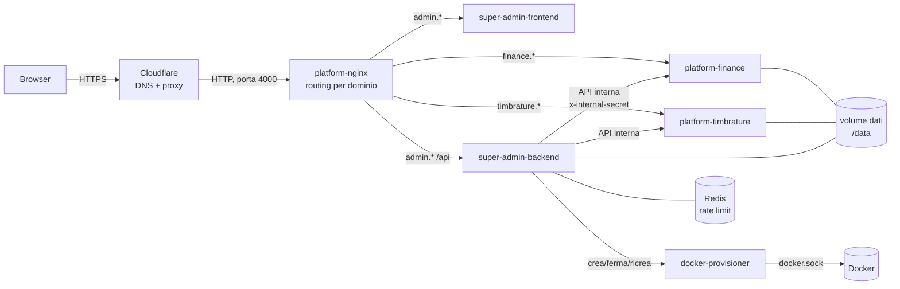
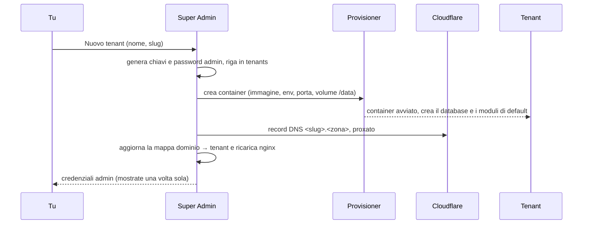
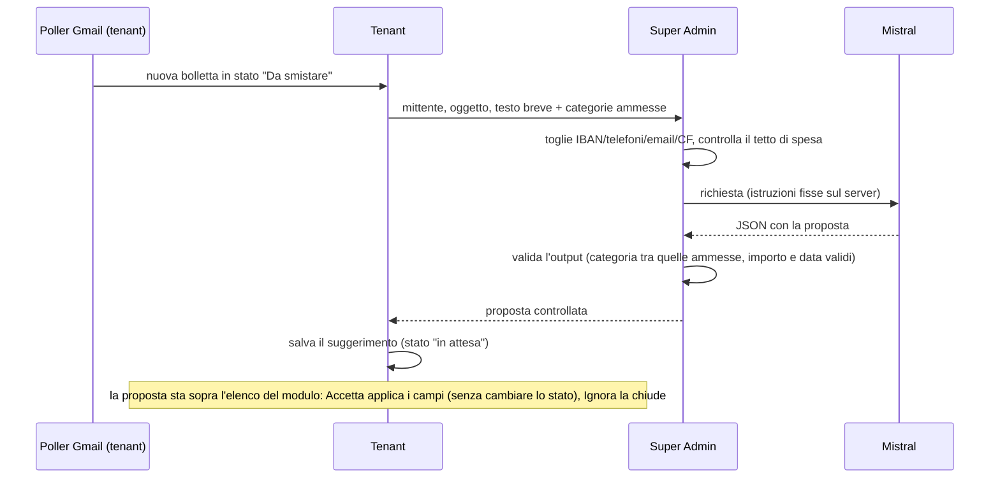

# Architettura

Come è fatto Platform 0.1. Per il perché vedi [`PLATFORM-VISIONE.md`](PLATFORM-VISIONE.md); per metterlo
online e mantenerlo vedi [`docs/OPERAZIONI.md`](docs/OPERAZIONI.md).

## In breve

Due tipi di processo:

- **Super Admin** (uno solo): crea e gestisce i tenant, ospita il Builder e la Libreria, fa i backup.
- **Tenant** (uno per progetto): la stessa immagine `platform-core` con un proprio database e i propri
  moduli. Finance è un tenant.

Un **provisioner** (piccolo servizio con accesso a Docker) è l'unico che crea e ferma i container dei tenant.



## Le parti

| Cartella | Cosa è | Tecnologia |
|---|---|---|
| `core/backend` | Il tenant: record, moduli, automazioni, utenti, backup, sito web | Node 22, Express, SQLite (better-sqlite3) |
| `core/frontend` | L'interfaccia del tenant: moduli, Builder, Libreria, impostazioni | React, Vite, Tailwind |
| `super-admin/backend` | Tenant, Libreria, backup, accessi, statistiche | Node 22, Express, SQLite |
| `super-admin/frontend` | Interfaccia di Super Admin | React, Vite, Tailwind |
| `super-admin/docker-provisioner` | Crea, ferma, ricrea i container dei tenant | Node 22, dockerode |
| `shared/` | Schema dei moduli (v3), rate limit, TOTP, utilità | JavaScript |
| `infra/nginx` | Router per dominio e mappa dominio → tenant | nginx |

L'immagine del tenant (`core/Dockerfile`) contiene nginx (serve il frontend e inoltra `/api`), il backend Node
e supervisord che li tiene su entrambi. Ascolta sulla porta 80 del container.

## I dati

Tutto vive nel volume `/data`, condiviso da Super Admin e dai tenant:

```
/data/super-admin-01.db        registro di Super Admin: tenant, Libreria, audit, backup
/data/<slug>.db                database di UN tenant (record, moduli, utenti)
/data/uploads/<slug>/          allegati del tenant (se non vanno su Google Drive)
/data/backups/<slug>/          copie di sicurezza del tenant
```

**Un tenant = un file SQLite.** I record stanno in una tabella `records` (`module_slug`, `data` JSON): la
struttura dei moduli sta in `modules.schema_json`, quindi cambiare un modulo non richiede migrazioni.

### Segreti di un tenant

Alla creazione Super Admin genera per ogni tenant una `ENCRYPTION_KEY` e un `JWT_SECRET`, li salva nel
proprio registro (`tenants.encryption_key`, `tenants.jwt_secret`) e li passa al container come variabili
d'ambiente. Non escono mai dalle API: l'elenco dei tenant li toglie e c'è un test che lo garantisce.

La chiave cifra i campi sensibili dei record (AES-256-GCM, valori che iniziano con `enc:`), con il nome
del tenant come sale. **Senza la chiave originale quei campi non si leggono più**: fa parte dei dati da
salvare insieme ai backup. Per riportare un tenant esistente sotto un nuovo Super Admin c'è "Registra
esistente", che importa il tenant con la sua chiave.

## Il ciclo di vita di un tenant



- **Stop / Start**: Start su un tenant senza container lo ricrea sullo stesso volume con le chiavi salvate.
- **Redeploy**: ricrea il container con l'immagine più recente; si ferma se qualcuno è collegato da meno di
  3 minuti (non forza).
- **Elimina**: backup di sicurezza, poi container e record DNS spariscono.
- **Registra esistente**: importa un tenant già esistente (da un vecchio `super-admin.db` o a mano).

## Moduli, Builder, Libreria

Un **modulo** è uno schema JSON (formato v3: una lista di blocchi `field`, `relation`, `workflow`,
`automation`, viste, permessi). Il motore (`core/backend/src/schema-v3.js`, condiviso con `shared/`) lo
interpreta; non c'è codice specifico per un tenant.

**Esistono solo moduli**, tutti uguali: visibili nel menu, nello Store e nel Builder, e che si parlano tra loro con le **relazioni** (un campo che punta a righe di un altro modulo) e con viste che
mostrano le righe collegate (per esempio i piani a rate dentro Spese). Non c'è più il "modulo di supporto" nascosto: la colonna `modules.support_module` resta solo per i database esistenti, viene azzerata
all'avvio e da un trigger a ogni scrittura (import, installazione, ripristino), e nessuna schermata la mostra.

Il **Builder** modifica gli schemi. La **Libreria** (tabella `registry_modules` di Super Admin) conserva i
moduli con una versione: salvare di nuovo lo stesso modulo crea la versione successiva. **Installare = copiare**:
il tenant riceve una copia sua, ricorda da quale versione viene e mostra "Aggiorna" quando ne esiste una più
nuova (l'aggiornamento sovrascrive la copia locale, ed è avvisato prima).

### Come si vede l'elenco di un modulo

`modules.list_view` ha tre valori: `table` (tabella, anche a schede su telefono), `card_grid` (card colorate) e `archive` (**archivio**, vedi sotto). Si sceglie nel Builder, proprietà del modulo, «Come si vede l'elenco».

### Documenti: la vista ad archivio

`ModulePage/ArchiveView.jsx`, generica: nessun nome di modulo o di campo. Le **cartelle** sono i valori del primo campo «scelta» del modulo (anche vuote, sbiadite), il file è il primo campo «file», il titolo il primo campo di testo. Si entra in una cartella con le briciole «Archivio › cartella › anno»; una cartella con almeno 8 file e almeno 2 anni si divide da sola in **sottocartelle per anno**, letto dal titolo (`ClientStatements_20190830…`, `CU-2021…`) o, se manca, dalla data del record. Schede con icona per tipo (miniatura per le immagini), elenco alternativo, **anteprima** a schermo intero (immagini e PDF con il visualizzatore del browser; il file è protetto, quindi si scarica con il token e si mostra da blob), ricerca piatta su tutto l'archivio.
I file stanno su **Google Drive** (`uploads.stored_name = 'drive:<id>'`) o in `/data/uploads/<tenant>`: `GET /api/uploads/:id` li serve dall'uno o dall'altro; senza il collegamento a Google i file su Drive non si aprono (l'anteprima lo dice).

**Cartelle modificabili**: una cartella è un valore del campo scelta, quindi `POST /api/field-options/:modulo/:campo` (`routes/field-options.js`) **rinomina** (schema pubblicato + tutte le righe, in una transazione, con una riga di cronologia), **aggiunge** o **toglie** (solo se vuota). Rifiuta nomi doppi (anche con maiuscole diverse), vuoti, oltre 60 caratteri, e la rinomina se il vecchio nome è citato in una regola del modulo (condizioni, automazioni). Può farlo chi ha il permesso di modifica sul modulo.
Nei moduli con archivio il modulo «Nuovo» mette il file in testa, compila il titolo dal nome del file e parte dalla cartella aperta; i collegamenti facoltativi stanno chiusi in fondo.

### Chi vede quali righe: permessi e proprietario

Il blocco `permissions` di un modulo dà una regola per ruolo (vedi, crea, modifica, elimina, **vede solo le proprie**). Una riga è «propria» se `records.user_id` è l'utente. Le righe che non le crea una persona (Gmail, estratto conto, rate generate da un'automazione) prendono un proprietario (`record-owner.js`): quello della riga che le genera, altrimenti il **proprietario predefinito** (`tenant_settings.default_owner_user_id`, scelto in Utenti → «Proprietario delle righe automatiche»). Le righe rimaste senza proprietario passano a lui all'avvio e quando lo si cambia; le righe esistenti si riassegnano con un'azione esplicita dell'admin (`routes/record-owner.js`, con anteprima: cambia solo `user_id`). L'admin vede sempre tutto.

## Parlare tra le parti

- **Browser → tenant**: JWT di sessione (24 ore), password con bcrypt, 2FA con TOTP facoltativo,
  limite ai tentativi di accesso (Redis).
- **Super Admin → tenant**: chiamate interne sulla rete Docker con `x-internal-secret`. Per il Builder e per
  "Apri →" Super Admin chiede al tenant un token amministrativo; il tenant firma da sé, Super Admin non
  conosce il suo `JWT_SECRET`.
- **Tenant → Super Admin**: lo stesso segreto interno, per elenco e installazione dei moduli della Libreria.
- Solo il **provisioner** ha accesso a `docker.sock`.

## Backup

Lo scheduler di Super Admin controlla ogni 15 minuti e fa una copia di ogni tenant secondo la sua frequenza
(di default ogni 24 ore, ne tiene 7) con `VACUUM INTO`: una copia coerente anche a container acceso.
Facoltativamente la copia viene sincronizzata fuori dal NAS (offsite) e verificata una volta a settimana.
Dal tenant, la voce **Export dati** scarica il database o un export JSON completo.

**Backup settimanale via mail** (`super-admin/backend/src/weekly-backup-mail.js`): acceso per tenant da Super Admin → Backup. Ogni lunedì dalle 08:00 ora italiana (o al primo controllo utile della settimana, se il NAS era spento) manda a `NOTIFY_EMAIL_TO` la copia del database, compressa (gzip) e cifrata con la passphrase del tenant (AES-256-CBC, PBKDF2-SHA256, formato `openssl enc`: si riapre con un comando da Terminale, scritto nella mail). La passphrase si crea alla prima accensione, sta cifrata nel registro di Super Admin e non cambia mai (si legge con «Mostra passphrase», azione registrata nel log). Contiene solo il database, **non i file caricati**. Un errore manda una mail di errore e non si ripete ogni 15 minuti.

## Collegamenti esterni

Google (Gmail in lettura, Calendar, Drive) e WhatsApp (CallMeBot) si configurano per tenant da Impostazioni → Connessioni. Le **regole Gmail** stanno dentro
la riga Google (si vedono con Google collegato) e i **destinatari WhatsApp** e gli **ultimi invii** dentro la riga WhatsApp: sono impostazioni del sistema
(tabelle `gmail_rules`, `whatsapp_recipients`), non moduli. L'elenco mostra solo i collegamenti attivi o richiesti dai moduli installati. Le credenziali
Google (Client ID e Secret, token) stanno nella tabella `connections` del tenant.
Il collegamento a Google (`connections.integration_id = 'google'`) serve a Gmail (lettura delle bollette), Calendar e Drive. Con l'app Google in modalità «Test» il token di rinnovo **scade dopo 7 giorni** (errore `invalid_grant`): serve pubblicare l'app «In produzione» o ricollegare. Scollegare cancella i token ma conserva Client ID/Secret, «Salva su Drive» e la cartella.

**Regole Gmail** (`gmail-poller.js`, ogni 15 minuti): ogni regola ha mittente, **modulo di destinazione**, categoria e **tipo**. *Bolletta* cerca importo e
scadenza nel testo e nei PDF; *semplice* prende solo oggetto, data e allegati (ordini, contratti, documenti). La riga creata scrive solo i campi che il
modulo ha dichiarato (`costruisciRiga`, funzione pura e testata) e usa lo stato "nuovo" dichiarato dal modulo. Una regola senza modulo usa il primo che ha
dichiarato di poter ricevere righe dalle mail.

## Notifiche WhatsApp

L'invio passa da `core/backend/src/whatsapp.js`: legge la risposta di CallMeBot (che risponde 200 anche quando
rifiuta), riprova solo i problemi temporanei, manda i messaggi uno alla volta e registra l'esito vero per
destinatario; un messaggio non consegnato genera un avviso nell'app. Ogni invio finisce nel **registro** (`whatsapp_log`,
ultimi 200, rotta `GET /api/connections/whatsapp_callmebot/log`), visibile in Impostazioni → Connessioni → WhatsApp → "Ultimi invii".
Le automazioni dei moduli (`invia_notifica`, `invia_report_periodico`) usano lo stesso invio.

Cosa avvisare e con quali parole lo **dichiara il modulo** (Builder → Ruoli del modulo → "Avvisi", vedi sotto), non il codice:

- **Avviso su riga nuova** (`avvisi.js`, `scanNuove`): ogni minuto cerca le righe nello stato "nuovo" dei moduli con l'avviso acceso che non sono ancora state
  segnalate e le manda in un messaggio ("Bolletta da smistare: A2A · 44,00 € · scade 01/10/2026"; più righe dello stesso modulo = un solo messaggio con l'elenco,
  le prime 4 e "… e altre N"). Il controllo vale per **qualunque via di creazione** (mail Gmail, riga a mano, automazione, importazione): niente aggancio sul singolo punto.
  Tabella `avvisi_notificati`; alla prima volta le righe già presenti si segnano come viste senza avvisare. Le righe che nascono in un altro stato (le rate "da pagare") non avvisano.
- **Mail non riconosciute** (`gmail-unknown.js`): a ogni ciclo di Gmail si cercano, negli ultimi 3 giorni (solo intestazioni: mittente, oggetto, data; mai il corpo), le mail con parole da
  bolletta (bolletta, fattura, scadenza, "da pagare", "avviso di pagamento", "estratto conto"; senza promozioni) il cui mittente non ha una regola. Finiscono in una lista (Impostazioni →
  Connessioni → Google → "Mail non riconosciute", con «Crea regola» e «Ignora», tabella `gmail_unknown`) e partono in **un solo messaggio WhatsApp**. Un mittente ignorato non torna a
  segnalarsi; creando la regola le sue mail escono dalla lista.
- **Report** (`reports.js`, scheda Impostazioni → **Report**, rotte `/api/reports/*`): ogni report è una **definizione** (un TIPO + i suoi parametri: stato delle righe, giorno e ora, frequenza, titolo, simbolo, frase finale, righe mostrate) salvata in `tenant_settings.report_settings`. I tipi sono primitive generiche: `riepilogo_periodo` (totale di un periodo), `coda` (righe in uno stato), `in_ritardo` (scadute), `ore_periodo` (ore lavorate dalle timbrature, per persona), `ore_settimana` (riepilogo ore + mese finora + **straordinario** oltre la soglia settimanale, stessa regola del grafico «ore per settimana»). Se ne aggiungono quanti se ne vogliono dalla stessa scheda (nascono spenti); ognuno ha i suoi destinatari (`utenti` su Telegram, vuoto = tutti i telefoni collegati; `tag` su WhatsApp); l'id è anche il comando del bot (`/id`, e `/report` li elenca). I tre report storici qui sotto sono tre definizioni di partenza (stessi id: un messaggio già mandato non si ripete). Ogni messaggio **non parte se non c'è niente da dire** (salvo `invia_se_vuoto`, acceso nel mensile: «Niente da pagare»). Un controllo ogni minuto, ora italiana; ogni invio si segna **prima** di partire (tabella `report_sent`: un report già mandato = una riga `kind + chiave`),
  quindi un errore non diventa un messaggio al minuto, e se il NAS era spento all'ora esatta il report parte appena torna entro la finestra (5 ore, o fino al giorno-paga per il mensile).
  - **«Quanto devo pagare»** (definizione `pagare`, tipo `riepilogo_periodo`): ogni 27 alle 18:00, se il 27 cade di sabato o domenica il **venerdì prima**. Tutto ciò che è «da pagare» dal giorno del report al **26 del mese dopo**, più le voci scadute
    (non oltre 45 giorni: oltre sono residui), con il totale, la divisione per modulo, le scadute in una riga (l'elenco sta nel loro messaggio, se è acceso: non si ripetono due volte) e le prime 8 voci «in arrivo» per data (poi «+ altre N»). Messaggi compatti: migliaia con il punto, centesimi solo se servono nelle righe. Facoltativa la riga «ultimo stipendio → ti restano» (entrata più recente nelle categorie
    dichiarate come stipendio in Builder → Riepiloghi).
  - **«Da smistare»**: ogni sera alle 19:00 le righe nello stato «nuovo» (bollette da Gmail…), **finché la coda non è vuota**; il primo avviso, entro un minuto dall'arrivo, resta quello di `avvisi.js`.
  - **«Voci scadute»**: ogni lunedì alle 19:00, solo se ce ne sono, con «da N giorni». Si spengono da sole spuntando le voci nella Checklist.
  Quali moduli contano e cosa significa «da pagare» o «nuovo» lo dichiarano i moduli (Builder → Avvisi, `scadenze` acceso): nel codice non ci sono nomi. Le impostazioni (acceso, giorno, ora) stanno in `tenant_settings.report_settings`
  (JSON); i destinatari sono quelli con il tag `scadenza`. Con almeno un report acceso gli avvisi `invia_notifica` con tag `scadenza` dei moduli restano muti (stesso accorgimento del vecchio riepilogo).
  Sostituisce il «Riepilogo del mattino» (08:00) e i report settimanale/mensile automatici dei moduli, che contavano le spese per data senza guardare lo stato di pagamento: la scheda **Report** elenca le
  automazioni vecchie ancora nei moduli e le toglie con un pulsante (`/api/reports/legacy`, con cronologia del modulo).

### Bot Telegram

`telegram.js`, `routes/telegram.js`, scheda Impostazioni → **Connessioni → Telegram (bot)** (collegare il bot, admin; in Report restano solo le scelte) e **Il mio account** (collegare il proprio telefono, ogni utente). È un secondo canale dei report e un bot a doppio senso, **senza scritture libere**: legge con comandi fissi (`/pagare`, `/scadute`, `/smistare`) e scrive solo con un tocco su un bottone.

- **Collegamento del bot**: l'admin incolla il codice segreto di BotFather; l'app lo controlla con `getMe`, registra il webhook (`/api/telegram/webhook`) con un **segreto** e lo salva **cifrato** (riga `telegram` di `connections`). Il token non esce mai dalle API.
- **Il webhook** risponde solo se l'header `X-Telegram-Bot-Api-Secret-Token` è giusto (confronto a tempo costante), altrimenti 403; risponde sempre 200 a Telegram dopo l'elaborazione. Solo chat **private**, al massimo **20 messaggi al minuto** per chat.
- **Una chat conta solo se è collegata a un utente** (`telegram_links`), con un **codice monouso di 10 minuti** generato dall'app da loggato (`telegram_link_codes`); si scollega dall'app o con `/scollega`. Una chat sconosciuta riceve solo le istruzioni per collegarsi, mai dati.
- **Cosa vede e fa un utente** è ciò che vede e fa nell'app: moduli assegnati (`user_modules`), permessi del ruolo, regola «solo propri» (`reports.js` legge le righe con `filterViewable`), e per le scritture le stesse regole di `runTransition` (`routes/records.js`: permessi, workflow, validazioni, automazioni come «Registra data pagamento»), condivisa con la rotta `/:slug/:id/transition`. Ogni azione finisce nel registro attività (`telegram.pay`, `telegram.undo`, `telegram.link`…).
- **Il bottone «✅ Pagata»** (`pay:<modulo>:<id>`) sui messaggi delle scadute porta la voce da «da pagare» a «pagato» (gli stati li dichiara il modulo) e diventa «↩ Annulla» (`undo:…`, se il workflow ammette il ritorno). Premerlo due volte non fa danni; un dato manomesso, un modulo non assegnato o una riga non «da pagare» si rifiutano.
- **I report** (`reports.js`) vanno su **tutti i canali accesi** (impostazioni `canali`): WhatsApp con il messaggio completo, ogni telefono Telegram con la **sua** versione (solo ciò che può vedere), in HTML (testo sempre «escapato») e con i bottoni «Pagata» e «Apri l'app».
- **Frasi libere e azioni** (`bot-ai.js`, `bot-actions.js`, `lib/internal-api.js`, regole in `shared/ai-bot-intent.js`): una frase va a Super Admin (`POST /api/tenant-ai/bot-intent`: testo ripulito dai dati personali, budget, **nessun record e nessun id verso il modello**, solo la frase e i moduli di spesa con le categorie) che la traduce in **UNA azione di un elenco chiuso**: `domanda`, `elenco`, `segna_pagata`, `riapri`, `smista`, `nuova_spesa`, `altro`. La risposta è **validata due volte** con le stesse regole (Super Admin e tenant): un'azione fuori elenco diventa «altro», importi/date/categorie/moduli inventati si scartano. La **riga** a cui ci si riferisce la trova il tenant da sé (corrispondenza di parole e importo tra le righe che l'utente vede), mai un id dato dal modello.
- **Ogni scrittura è una proposta**: il bot descrive in chiaro cosa farebbe e mostra «✅ Conferma / ✖ Annulla» (o i candidati, se più voci somigliano). La proposta (`telegram_pending`) vale **15 minuti, una volta sola, solo per la chat e l'utente che l'hanno originata**, e lo stato della riga si ricontrolla al momento dell'esecuzione. L'esecuzione passa dall'**API dell'app come quell'utente** (`lib/internal-api.js`, token da 2 minuti, nessuna sessione): permessi, «solo propri», validazioni, automazioni e registro sono quelli del browser, senza una seconda copia della logica.
- **Foto di scontrini** (`bot-actions.js` → `proponiScontrino`, `bot-ai.js` → `leggiScontrino`, Super Admin `POST /api/tenant-ai/receipt`, regole in `shared/ai-receipt.js`): la foto (JPEG, PNG o WebP, max 3 MB; il tipo si riconosce dai byte, non dal nome) va a Mistral **tramite Super Admin** (chiave, tetto di spesa e registro dei consumi come le altre funzioni AI; l'immagine non si salva lì) con le sole categorie ammesse dal modulo. Il modello restituisce **pochi campi** (esercente, data, totale, valuta, categoria, confidenza) che si validano due volte: totale tra 0 e 100.000, solo euro, data valida e plausibile (non futura, non oltre due anni fa), categoria tra quelle ammesse, esercente ≤ 80 caratteri; il testo scritto nello scontrino è trattato come dato (il prompt lo dice e, comunque, nessun campo libero del modello diventa un'azione). Il bot mostra cosa ha letto, **avvisa se esiste già una spesa con stesso importo e data (±2 giorni)**, e propone «✅ Aggiungi (pagata)» / «🕓 Da pagare» / «✖ Annulla»: **solo il tocco crea la riga** (via API dell'app come l'utente), con la **foto allegata come prova** (`record_attachments.tipo = 'scontrino'`). Serve «Importare» acceso sul modulo (Builder → Potenziamenti AI) e l'AI accesa; si può inviare come foto o come file immagine. Il modello per la visione è `MISTRAL_VISION_MODEL` (di partenza lo stesso del testo, `mistral-small-latest`): **da verificare dal vivo** che la chiave in uso lo ammetta. **Privacy**: l'immagine dello scontrino (negozio, voci, a volte ultime cifre della carta) arriva a Mistral; il testo delle frasi è ripulito dai dati personali, un'immagine non si può ripulire.
- **Cosa sa fare**: rispondere a domande sui dati («Chiedi ai dati»: query strutturata, mai SQL, con i permessi di chi chiede e solo i moduli che vede); segnare pagata o riaprire una voce; smistare una bolletta (un pagamento, rate, già pagata); registrare una spesa nuova (pagata o da pagare, con categoria se è del modulo); **importare un PDF** mandato in chat (l'AI legge, mostra i campi, tu confermi: la riga nasce «da smistare» con il PDF allegato). **Cosa NON può fare, di proposito**: eliminare, modificare campi liberi, utenti, impostazioni, backup. Le foto non si leggono (solo PDF). Limite di 8 frasi al minuto per chat che passano dall'AI.
- **Timbrature** (`bot-timbrature.js`): moduli con `kind: presenze` e ruoli `data`/`inizio`/`fine`. Entrata = nuova riga, uscita = chiude l'ultima entrata aperta di quell'utente; esecuzione immediata via API come l'utente, con «↩ Annulla» (proposta monouso 15 min); `ore` calcola dalle stesse regole del modulo (differenza tra orari, a cavallo della mezzanotte +24h).
- **Limiti dichiarati**: il bot non ha il 2FA (il telefono collegato e sbloccato basta: per questo le azioni sono pochissime e si revocano dall'app); i messaggi stanno sui server di Telegram (non cifrati end-to-end); le **domande libere con l'AI non ci sono ancora**.

## Ruoli dei moduli: le funzioni non conoscono i nomi

Ogni modulo dichiara nel Builder (Proprietà → "Ruoli del modulo") a cosa serve; le funzioni leggono la dichiarazione invece di avere nomi di moduli e di
campi scritti nel codice (`module-roles.js`, tabella `module_roles`, rotte `/api/module-roles`; la dichiarazione sta fuori dallo schema per non toccarne la conversione v2/v3).

| Cosa si dichiara | A cosa serve |
|---|---|
| **Tipo** (spesa, entrata, presenze) e **usi** (riepiloghi, avvisi, mail, estratto) | Quali moduli entrano in "Come sta andando", nei report, tra le destinazioni delle regole Gmail e nell'abbinamento con l'estratto conto |
| **Ruoli dei campi** (importo, data, scadenza, categoria, descrizione, stato, gruppo, fisso, data di pagamento, note, data incerta, debito, inizio/fine) | Quale campo del modulo è l'importo, la data... Un campo senza ruolo non viene letto né scritto |
| **Avvisi**: stato "nuovo", "da fare" e "fatto", piano a rate, avviso su riga nuova, scadenze nel riepilogo, come si chiamano le righe ("bolletta/bollette"), etichetta breve, tag destinatari | Parole e stati dei messaggi WhatsApp e della coda "Da smistare" |
| **Criteri dei riepiloghi**: categorie, gruppi e descrizioni escluse, categorie stipendio e risparmio, campo accantonamento (entrate); categorie «rata» (spese) | Cosa non conta come entrata, cosa è stipendio, cosa è risparmio, cosa è una rata |
| **Estratto conto** (spese): categorie che sono un giro tra conti propri, «qui si registrano le uscite dell'estratto», categoria predefinita | Abbinamento dei movimenti bancari alle righe e registrazione delle uscite mancanti (`bank-import.js`) |

I valori di Finance sono **dati**, non codice (`core/backend/src/seeds/finance-roles.json`) e li dichiara una **migrazione** all'avvio (`seedIfEmpty`, una volta sola per modulo e per versione della dichiarazione:
una scelta fatta dal Builder, anche "tutto spento", non si ripristina). Un modulo senza dichiarazione non entra in nessuna funzione. `GET /api/module-roles/queues`
(per qualunque utente collegato) elenca i moduli con uno stato "nuovo": serve alla coda in dashboard.

## Dashboard: widget

I widget sono dati (`dashboard_widgets`: tipo, configurazione, ruoli e utenti che li vedono). "Aggiungi widget" li elenca in gruppi: **Numeri** (KPI, KPI per periodo, numero da formula), **Elenchi** (tabella, checklist, coda), **Andamenti** (mesi dell'anno, per categoria, per settimana) e **Finanza** (riepilogo mensile, come sta andando), quest'ultimo solo se il progetto ha moduli dichiarati come spese o entrate. Ogni tipo ha sotto una riga che dice cosa fa. Oltre ai widget generici:

- **Coda da smistare** (`coda`, `QueueWidget.jsx`): le righe nello stato "nuovo" di tutti i moduli che lo hanno dichiarato. Il pulsante **Smista** apre un pannello
  (`SmistaPanel.jsx`) con importo, scadenza e categoria modificabili e tre scelte, eseguite dal server (`POST /api/smista/:modulo/:id`, `routes/smista.js`):
  **un pagamento** (da "nuovo" a "da fare"), **in rate** (crea il piano nel modulo dichiarato e lascia che la sua automazione generi le rate; le rate sostituiscono
  la riga e il PDF passa alla prima; se nessuna rata viene generata si annulla tutto) e **già pagata** (passa per "da fare" fino a "fatto", con la data di pagamento).
  Le transizioni devono esistere nel workflow del modulo; la risposta dice dove è finita la riga. L'AI non c'entra: è un click.
  Il modulo dichiara in Avvisi gli stati "nuovo", "da fare" e "fatto" e il **piano a rate** (modulo dei piani e i suoi cinque campi: nome, importo totale, numero rate,
  importo rata, data prima rata); senza piano dichiarato la scelta "in rate" non compare.
- **Come sta andando** (`come_sta_andando`): uno o più widget, ciascuno con la sua **vista** nella configurazione: moduli di spese, gruppi di entrate inclusi,
  se conta l'accantonamento, **solo spese** (per la casa: spese pagate e da pagare, fisse e variabili, categorie e confronti, senza entrate, saldo e risparmio).
  La vista la legge il server dal widget salvato (`GET /api/insights?widget=ID`), mai dal browser; la spiegazione salvata ha chiave per widget (`2026-09@w14`).
- **Riepilogo mensile** (`riepilogo_mensile`, `components/RiepilogoMensile.jsx`): riquadri animati con lo **spendibile** in grande e un anello, entrate, uscite, pagato/da pagare, fissa/variabile e **previsto carta/conto (sempre visibili, anche a zero)**. Le **uscite** sono il mese di calendario; le **entrate** sono quelle dello stipendio di fine mese precedente (finestra dal giorno di cutoff meno 5 del mese prima al giorno prima del cutoff meno 5: lo stipendio può arrivare prima del 27). Il mese è **sempre quello della Checklist** (che riporta le frecce al widget), quindi il giorno del cambio mese si decide in un posto solo: il cutoff del widget Checklist. Calcolato dal browser dai record che l'utente può vedere (un modulo «solo propri» senza righe proprie non entra nel conto).
- **Layout**: il Riepilogo e la coda sono a tutta larghezza, «Come sta andando» a due colonne su schermo largo, la Checklist a tutta larghezza; su telefono «Come sta andando» e Checklist partono chiusi (stato in `localStorage`). L'ordine è `sort_order`, modificabile con le frecce in «Modifica layout».
- **Smista, quarta scelta «Sposta in un altro modulo»** (`GET /api/smista/:modulo/:id/destinazioni` e `modo: 'sposta'`): la riga cambia modulo di spesa (stessi id e allegati; se non aveva proprietario diventa di chi la sposta) e resta «da smistare» lì. Destinazioni = moduli con lo stesso `kind` e gli avvisi dichiarati; i campi si abbinano per **ruolo**, gli altri solo con stessa chiave e tipo (e stesso modulo collegato per le relazioni, valore ammesso per le scelte); ciò che non passa viene mostrato prima e scritto nella cronologia.
- Ogni widget può essere nascosto a un ruolo: su Finance sono tutti solo admin. La scelta moduli per utente (Utenti & Ruoli) nasconde i moduli dal menu ma non
  blocca l'API; per un blocco vero ci sono i permessi per ruolo nei moduli.

## Assistente AI (Mistral)

C'è un **interruttore generale** (Impostazioni → AI, `module-ai.js` `masterOn`, colonna `tenant_settings.ai_enabled`, spento di default): spento, nessun potenziamento
lavora e i pulsanti spariscono. Acceso, ogni modulo accende da solo i potenziamenti che vuole (Impostazioni → AI → "Potenziamenti per modulo", o Builder → Proprietà → "Potenziamenti AI";
tabella `module_ai`, rotte `/api/module-ai`). `can(modulo, potenziamento)` è l'unico punto che dice se è attivo: master acceso, potenziamento acceso **e** ruoli richiesti dichiarati
(smistare: importo, categoria, stato; spiegare e importare: importo, data). **«Accendi e potenzia»** (`POST /api/ai/power-up`) accende il master e, su ogni modulo, tutto ciò che i suoi ruoli
permettono. L'AI **propone o racconta**, non scrive mai da sola nei dati. La pagina mostra anche la chiave Mistral e la spesa del mese rispetto al tetto.

| Potenziamento | Cosa fa |
|---|---|
| **Smistare** (`triage`) | Per le bollette in arrivo da Gmail prepara categoria, importo, scadenza e fornitore. Apri «Smista» sulla riga e il pannello è **già compilato** («L'AI ha letto la bolletta: Elettricità, 44,00 €…», `POST /api/smista/:modulo/:id/proposta`); confermi con un clic, e la proposta si chiude come accettata. Anche sopra l'elenco del modulo; "Accetta" non cambia lo stato |
| **Spiegare** (`explain`) | Pulsante «Spiega con l'AI» nei report del modulo (`POST /api/ai/explain-report`) e sui widget «Come sta andando». Con l'AI accesa i widget sono spiegabili **di default**; si spegne dalla casella del widget (`config.explainable: false`) |
| **Importare** (`import`) | «Importa da PDF» nella pagina del modulo (`ImportPdf.jsx`): carichi una bolletta o una fattura (max 3 MB), l'AI legge il PDF e propone i campi (`POST /api/ai/import/:modulo/proposta`, non scrive); confermi e la riga nasce nello stato «nuovo» con il PDF allegato (`/crea`), poi passa dalla coda «Da smistare». A Super Admin va solo un estratto del testo, mai il file |

**Verificare una proposta senza conoscere i dati.** Ogni proposta porta la sua **fonte** (`payload.fonte`): se l'AI ha letto un PDF, per importo, scadenza e categoria c'è la **riga del PDF** in cui il valore
compare (la cerca il progetto con il suo codice, non il modello), e i valori che nel PDF non si trovano sono segnati in giallo; ci sono i pulsanti per aprire gli allegati. Senza PDF e senza un testo di mail
sostanzioso (almeno 80 caratteri) l'AI **non propone niente** e non viene chiamata (con il solo titolo indovinerebbe, e non si potrebbe controllare); il solo fornitore, senza un documento da cui leggerlo, non
basta a creare una proposta. Lo mostrano sia il pannello «Smista» sia le proposte sopra l'elenco (`AiSource.jsx`).

### Chiedi ai dati

Pulsante «Chiedi ai dati» in alto (solo admin, solo con l'AI accesa). Una domanda ("quanto ho speso di luce nel 2025?") diventa una **query strutturata, mai SQL**: il tenant manda a Super Admin
(`/api/tenant-ai/ask-data`) la domanda (ripulita dai dati personali) e il **catalogo** dei moduli con importo dichiarato (nomi, ruoli, categorie ammesse: nessun record). `lib/ai-ask.js` valida la risposta
del modello contro il catalogo (modulo e ruoli esistenti, calcolo tra somma/conteggio/media/massimo/minimo, filtri uguale/contiene/maggiore/minore, categoria tra quelle ammesse, periodo valido, al
massimo 4 filtri, la data solo come periodo). Il progetto la **rivalida** (`ask-data.js`) e la **esegue con il proprio codice**, rispettando i permessi del modulo; le righe nello stato «nuovo» e a data
incerta non contano e il risultato dice quante sono state escluse. La risposta mostra il numero, il dettaglio per mese/anno/categoria e **cosa è stato capito** (modulo, calcolo, filtri, periodo), così si controlla.

### Monitoraggio mensile

Ogni widget «Come sta andando» ha la casella «Invia ogni mese su WhatsApp» (`config.monitor`). Il giorno 2 alle 9 (ora italiana) `monitor.js` manda un messaggio per widget con l'ultimo mese concluso:
numeri della sua vista, cose da guardare e, con l'AI accesa e se risponde, il commento. Senza AI il messaggio parte lo stesso, coi soli numeri. Va ai destinatari con il tag «report»; ogni mese si invia
una volta sola (`monitor_sent`). Anteprima di sola lettura: `GET /api/insights/monitor-preview?widget=ID`.

Il flusso dello smistamento:



- Il **tenant non parla mai con Mistral** e non ha la chiave: chiede a Super Admin (`/api/tenant-ai/classify-bill`).
- I **dati personali** vengono tolti in un solo punto, in Super Admin (`lib/ai-redact.js`), prima di ogni invio.
- Le **istruzioni al modello** stanno sul server; il tenant manda solo dati.
- L'**output è controllato**: una categoria che non è tra le opzioni del modulo viene scartata, importi e date
  non validi diventano vuoti, una risposta che non è JSON viene rifiutata. All'accettazione la categoria è
  ricontrollata sul modulo.
- **Chiavi, tre livelli** (`lib/ai-key.js`, tabella `tenant_ai_keys`, impostazione `ai_settings.tenant_fallback`): la chiave di ogni **tenant** (da Impostazioni → AI del tenant; cifrata in Super Admin, mai restituita); la chiave di **Super Admin**, solo sua (riga riservata `__super_admin__`; da Super Admin → Impostazioni → Chiavi AI; per costruire tenant e analizzare i processi; non la usa mai un tenant); la chiave **generale** (`MISTRAL_API_KEY`), ripiego dei tenant senza chiave propria se l'interruttore «ripiego» è acceso (di partenza sì) e di Super Admin se non ha una chiave sua. Con il ripiego spento un tenant senza chiave sua non ha AI. I consumi di Super Admin (senza tenant) sono già un conto a parte.
- **Tetto di spesa mensile per tenant** (`lib/ai-budget.js`): si sommano i token del mese dal registro, convertiti in euro
  (di default mistral-small: 0,13 € in ingresso e 0,51 € in uscita per milione di token), e a tetto raggiunto
  nessuna chiamata parte. Avviso per email all'80% e al 100%. Tetto di default 10 €, regolabile con
  `AI_MONTHLY_BUDGET_EUR`.
- **Spento di default**: un modulo senza interruttore acceso non ha AI. Su Finance "Smistare" è spento (il parser Gmail con le regole basta); "Spiegare" è acceso sui widget "Come sta andando".

### Commento e spiegazione dei report

Stesso schema dello smistamento bollette, con una verifica in più. Il tenant (`core/backend/src/report-ai.js`) manda a
Super Admin (`/api/tenant-ai/explain-report`) i soli totali per gruppo; Super Admin (`lib/ai-report.js`) ripulisce i nomi,
calcola le variazioni percentuali, chiede il testo a Mistral con istruzioni sue e **controlla che ogni numero scritto
esista nei dati**, altrimenti risponde errore e il tenant non mostra nulla.

- **Commento mensile**: `invia_report_periodico` con `periodo: 'mese'` e `raggruppa_per`, se il commento è acceso (`PUT /api/ai/settings {report_enabled}`; oggi senza schermata: la scheda Assistente AI è stata tolta). Il report parte comunque se il commento non arriva.
- **Spiega questo report**: pulsante nel pannello Report (`ReportPanel.jsx`), rotta `POST /api/ai/explain-report`, solo sui moduli con "Spiegare" acceso (403 `ai_off` altrimenti).

### "Come sta andando"

`core/backend/src/insights.js` calcola per un mese entrate (sul conto), spese, saldo, accantonato (trattenuto in busta, con stima dove
manca la riga), risparmio vero, confronti (mese prima, stesso mese dell'anno prima, media di 12 mesi), categorie con variazione e
anomalie (+25% e almeno 20 € sulla media dei 6 mesi), leggendo i record dei moduli dichiarati per i riepiloghi (vedi "Ruoli dei moduli"). `GET /api/insights` restituisce i numeri
senza AI (`?period=anno&year=AAAA` per da inizio anno; `?widget=ID` per la vista di un widget). Il default è neutro (nessun modulo, nessun criterio);
`insights_config` salva solo ciò che si cambia a mano. Con `view.solo_spese` il calcolo salta entrate, saldo e risparmio.

`POST /api/insights/explain` risponde solo se il widget ha la casella "Spiegabile": manda a Super Admin (`/api/tenant-ai/explain-insights`) solo i totali,
che li ripulisce, fa scrivere il testo a Mistral e lo restituisce solo se ogni numero esiste nei dati. La spiegazione si salva per mese e widget
(`insight_explanations`, con l'impronta dei numeri) e si rigenera solo se i numeri cambiano o la si chiede di nuovo. Le istruzioni al modello (tono: dai del tu,
frasi brevi, nessun giudizio bene/male per le viste di sole spese) stanno in `super-admin/backend/src/lib/ai-report.js`.

La vista **Da inizio anno** (`buildYearSnapshot`) va da gennaio all'ultimo mese concluso, con le stesse regole: mostra come si dividono le spese
(rate = righe collegate a un debito o categoria Rata; fisse; variabili) e il confronto con lo stesso periodo dell'anno prima.

## Analisi dei processi (Super Admin)

`routes/analyses.js`, `lib/analysis.js`, `lib/tenant-config-from-analysis.js`, tabella `process_analyses`, pagina **Analisi**. Un'analisi è un documento di Super Admin: il racconto di un'attività, un profilo, e i **processi** (scopo, evento che lo fa partire, input/output, ruoli coinvolti di tipo utente/sistema/esterno, passaggi in ordine «step» o «decisione», eccezioni, documenti, sistemi, KPI, note, **modulo della Libreria che lo copre** e copertura: da valutare / coperto / da costruire).

- **L'AI propone, mai scrive**: `suggest-processi` (da una descrizione) e `suggest-processo` (da un nome) ritornano bozze; tutto passa da `sanitizeProcesso` (campi noti, lunghezze, tipi) e un **modulo inventato diventa null** (deve esistere nella Libreria). Il modello vede solo il testo dell'analisi, ripulito dai dati personali (`ai-redact.js`), e nome/descrizione dei moduli: nessun dato di altri tenant. Costa sulla chiave AI di Super Admin.
- **Salvataggio** automatico dalla pagina (PATCH ripulito server-side). Il manuale (`Manuale.jsx`) si stampa o si salva in PDF dal browser.
- **I moduli generici** (`lib/moduli-generici.js`, `seeds/moduli-generici.json`, rotte `GET /api/registry/generici` e `POST /api/registry/import-generici`): 52 mattoncini senza settore con nome e descrizione, importabili nella Libreria senza sovrascrivere (origine `generici`). `withDependencies` aggiunge i moduli richiesti dalle relazioni (a catena) quando si crea il tenant.
- **Proposte dei tenant alla Libreria** (tabella `registry_proposals`, rotte `public/proposals` con secret interno e `proposals` per Super Admin, `POST /api/modules/:slug/propose-to-registry` nel tenant): coda con approvazione; lo schema è validato (si legge, ha campi, sotto i 90 KB), una proposta in attesa per modulo e tenant, l'approvazione crea la versione successiva con l'origine del tenant.
- **Suggerimenti** (core: `suggestions.js`, `routes/suggestions.js`, tabella `suggestions`, funzione `suggerimenti` spenta di partenza): `osservaModulo` è una funzione pura sui numeri d'uso (campo poco usato, testo da strutturare, righe ferme, stato mai usato); `scansiona` apre, aggiorna e chiude da sola le voci e non riapre le ignorate; `notifica` al massimo ogni 7 giorni. «Spiega e proponi» passa da Super Admin (`POST /api/tenant-ai/suggestion`, `lib/ai-suggestion.js`): solo struttura e conteggi, redazione dei dati personali, risposta validata con azione da un elenco chiuso. Nessuna applicazione automatica.
- **«Fai tutto»** (`POST /api/analyses/auto`, `faiTuttoInBackground`, colonna `process_analyses.auto`): crea l'analisi e in background fa proporre i processi (`analizzaAttivita`: nome dell'attività + processi, con modulo abbinato validato), poi li completa tutti con `suggestProcesso` + `applicaSuggerimento` (solo campi vuoti), tre richieste alla volta. L'avanzamento (`fase`, `fatti/totale`, `errori`) si legge da `GET /:id`; non crea mai il tenant (quello è un tocco dal riepilogo). Non si elimina un'analisi mentre si compila.
- **Ruoli, report e AI dei tenant dell'analisi**: i moduli generici portano la dichiarazione dei ruoli (`registry_modules.ruoli`, dai dati in `seeds/moduli-generici.json`); `proposte()` deduce da quelle dichiarazioni i report (`riepilogo_periodo`, `in_ritardo`, `coda`, `ore_settimana`) e i potenziamenti AI adatti; l'utente toglie ciò che non vuole (`process_analyses.scelte`); alla creazione `pacchettoTenant` va al tenant (`POST /api/internal-setup/apply`, solo secret interno), che COMPLETA senza sovrascrivere: ruoli dei moduli mai dichiarati, potenziamenti mai scelti, report spenti, funzioni accese mai spente. Nuovo `kind: pratica` in `module-roles.js`: righe con stati e scadenza senza denaro, per avvisi e report (un report non scrive importi dove il modulo non ha un campo importo).
- **Creazione in background**: `POST /:id/create-tenant` risponde 202 e lavora in `creaTenantInBackground` (fasi container, database, dominio, moduli, ruoli con i secondi di ognuna in `process_analyses.creazione`); la pagina legge `GET /:id/creazione`, che consegna UNA volta l'accesso admin (tenuto solo in memoria). `createTenant` accetta `skipDefaults` e `onStep` e avvia il DNS in parallelo all'attesa del database.
- **Crea il tenant** (`POST /:id/create-tenant`): `createTenant` + installazione dei moduli scelti + `applyAnalysisConfigToTenant` (ruoli degli utenti e stati del flusso dai passaggi, **senza sovrascrivere** un modulo che ha già il suo flusso o i suoi permessi). Fuori dal perimetro, di proposito: clienti, preventivi, prezzi, licenze, e leggere dati dai tenant (privacy).

## Movimenti bancari

`core/backend/src/bank-import.js`: si carica un estratto conto in PDF (`POST /api/bank/import`, solo admin), `pdftotext -layout` ne estrae il
testo (il PDF non si salva), `parseStatement` lo legge in movimenti, `classify` li classifica e `rematch` li abbina alle righe di Finance
(spese personali e di casa, entrate, *Contributo Casa*) con lo stesso importo e una data vicina. Tabelle `bank_accounts` e
`bank_movements` (un movimento ha `kind`, `merchant`, `category_hint`, l'eventuale abbinamento e `ignored`). La pagina
`MovimentiPage.jsx` mostra riepilogo del mese e movimenti da registrare; `insights.js` ne legge il riepilogo per la vista generale di "Come sta andando".
**Non è modulare**: usa i nomi dei moduli di Finance e le loro colonne. Su Finance è spento (`movimenti` non installato) e non serve.

## Capacità: il progetto si costruisce da zero

Tre strati. **Il motore** (utenti, moduli, record, Builder, Libreria, backup, Export dati) c'è sempre. Le **capacità** sono funzioni in più che un
progetto può avere (`core/backend/src/features.js`, tabella `tenant_features`, rotte `/api/features`, solo admin); i **moduli** sono quelli di business che costruisci tu.
Oggi **non c'è una schermata** per accenderle (la sezione "Capacità" della Libreria è stata tolta): si accendono con `PUT /api/features/<chiave>`.

| Capacità | Cosa porta |
|---|---|
| `whatsapp` | Destinatari WhatsApp (dentro Connessioni → WhatsApp), rotte `/api/whatsapp-recipients`, registro degli invii |
| `gmail` | Regole Gmail (dentro Connessioni → Google), rotte `/api/gmail-rules`, controllo periodico delle mail |
| `sito_web` | Scheda Sito Web e il suo editor (`/api/site-pages`); il sito pubblico resta spento finché non lo attivi |
| `movimenti` | Pagina Movimenti, rotte `/api/bank/*`, lettura degli estratti PDF (non modulare, spenta su Finance) |
| `analisi` | Widget "Come sta andando" disponibile in "Aggiungi widget", rotte `/api/insights/*` |
| `riepilogo_mattino` | Report su WhatsApp (scheda Report, rotte `/api/reports/*`); la chiave tecnica è rimasta quella del vecchio riepilogo del mattino |

Un progetto **nuovo non ne ha nessuna**: le loro rotte rispondono 403 `feature_off` e le schede si adattano. Il valore di partenza di un progetto che già le usa
viene dai dati: `movimenti`, `analisi` e `riepilogo_mattino` partono accese se almeno un modulo ha dichiarato di essere una spesa o un'entrata; `whatsapp`,
`gmail`, `sito_web` se ci sono destinatari, regole o un sito attivo. `GET /api/tenant-info` (pubblico) dice quali sono accese. L'AI non è una capacità: la
decide ogni modulo (vedi sopra). **Export e Backup** stanno in Impostazioni → Dati.

**Onestà sul confine.** Il codice delle capacità sta ancora nel nucleo. I nomi dei moduli e dei campi di Finance stanno solo nel file di dati `seeds/finance-roles.json` (e nei moduli di esempio di `db.js`): non più nel codice di Movimenti bancari, Gmail, riepiloghi e bot. Il parser Gmail estrae importo e scadenza con regole pensate per le bollette italiane; la regola può scegliere
il tipo "semplice" (solo oggetto, data e allegati) per mail che non sono bollette.

## Sicurezza, in sintesi

- Nessuna password fissa nel codice: la password admin iniziale è casuale o arriva da variabile d'ambiente.
- I segreti dei tenant non escono dalle API (test `tenant-import`).
- Gli endpoint interni richiedono il segreto condiviso e non sono esposti all'esterno (nginx risponde solo
  ai domini noti, il resto è chiuso con 444).
- I file `.env` e i database non entrano mai nel repository (`.gitignore`).
- **Segreti cifrati a riposo** (`core/backend/src/secrets-at-rest.js`, `super-admin/backend/src/secrets-at-rest.js`): le credenziali dei collegamenti (Google con token e segreto, chiave CallMeBot, bot Telegram con il segreto del webhook, e ogni altro collegamento) e i **segreti del 2FA** stanno nel database cifrati con la chiave del progetto (`ENCRYPTION_KEY`, AES-256-GCM), non in chiaro. Chi ottiene il file del database o una sua copia non legge più token e chiavi. Ogni punto che li legge o li scrive passa dal modulo; la lettura accetta ancora il vecchio formato in chiaro e `migrate()` lo riscrive cifrato **all'avvio** (idempotente, verifica che si rilegga identico prima di scrivere; una riga illeggibile non si tocca). Un segreto che non si decifra (chiave diversa) risulta assente, mai un testo di errore usato come valore. **Conseguenza**: senza la chiave del progetto (che sta nel registro di Super Admin) i collegamenti vanno rifatti e il 2FA riconfigurato; i backup contengono i valori cifrati, quindi la chiave va conservata con i backup (già prescritto).
- **Non cifrati (scelta dichiarata)**: le chiavi dei tenant (`encryption_key`, `jwt_secret`) nel registro di Super Admin, perché servono a ripristinare e ricreare i tenant; cifrarle con una chiave dello stesso server aggiungerebbe complessità al ripristino senza proteggere da chi ha il server.
- **Librerie**: si controllano con `npm audit --omit=dev` in ogni pacchetto. Il 11/10/2026 core e frontend a 0 avvisi; Super Admin e provisioner a 2 moderati, `dockerode`→`uuid` («buffer bounds» in v3/v5/v6 con buffer passato: codice non usato da noi), che `npm audit fix` non può chiudere senza riportare `dockerode` a una versione con un problema più serio (`tar-fs`). **Non lanciare `npm audit fix` nel provisioner e in Super Admin senza controllare che `dockerode` resti ≥ 4.0.5.**
