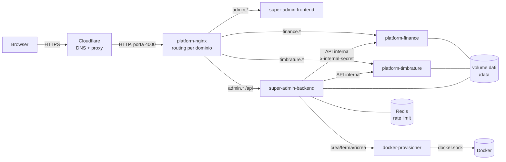
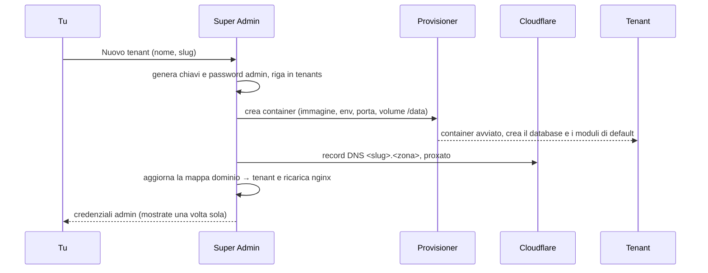
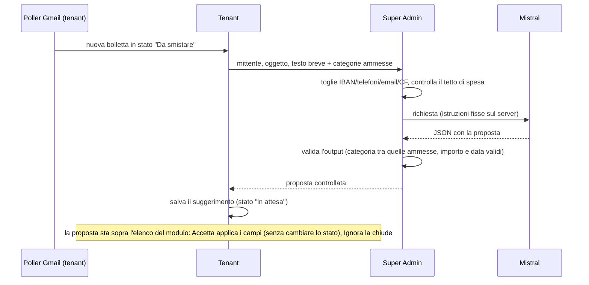

# Architettura

Come è fatto Platform 0.1. Per il perché vedi [`PLATFORM-VISIONE.md`](PLATFORM-VISIONE.md); per metterlo
online e mantenerlo vedi [`docs/OPERAZIONI.md`](docs/OPERAZIONI.md).

## In breve

Due tipi di processo:

- **Super Admin** (uno solo): crea e gestisce i tenant, ospita il Builder e la Libreria, fa i backup.
- **Tenant** (uno per progetto): la stessa immagine `platform-core` con un proprio database e i propri
  moduli. Finance è un tenant.

Un **provisioner** (piccolo servizio con accesso a Docker) è l'unico che crea e ferma i container dei tenant.



## Le parti

| Cartella | Cosa è | Tecnologia |
|---|---|---|
| `core/backend` | Il tenant: record, moduli, automazioni, utenti, backup, sito web | Node 22, Express, SQLite (better-sqlite3) |
| `core/frontend` | L'interfaccia del tenant: moduli, Builder, Libreria, impostazioni | React, Vite, Tailwind |
| `super-admin/backend` | Tenant, Libreria, backup, accessi, statistiche | Node 22, Express, SQLite |
| `super-admin/frontend` | Interfaccia di Super Admin | React, Vite, Tailwind |
| `super-admin/docker-provisioner` | Crea, ferma, ricrea i container dei tenant | Node 22, dockerode |
| `shared/` | Schema dei moduli (v3), rate limit, TOTP, utilità | JavaScript |
| `infra/nginx` | Router per dominio e mappa dominio → tenant | nginx |

L'immagine del tenant (`core/Dockerfile`) contiene nginx (serve il frontend e inoltra `/api`), il backend Node
e supervisord che li tiene su entrambi. Ascolta sulla porta 80 del container.

## I dati

Tutto vive nel volume `/data`, condiviso da Super Admin e dai tenant:

```
/data/super-admin-01.db        registro di Super Admin: tenant, Libreria, audit, backup
/data/<slug>.db                database di UN tenant (record, moduli, utenti)
/data/uploads/<slug>/          allegati del tenant (se non vanno su Google Drive)
/data/backups/<slug>/          copie di sicurezza del tenant
```

**Un tenant = un file SQLite.** I record stanno in una tabella `records` (`module_slug`, `data` JSON): la
struttura dei moduli sta in `modules.schema_json`, quindi cambiare un modulo non richiede migrazioni.

### Segreti di un tenant

Alla creazione Super Admin genera per ogni tenant una `ENCRYPTION_KEY` e un `JWT_SECRET`, li salva nel
proprio registro (`tenants.encryption_key`, `tenants.jwt_secret`) e li passa al container come variabili
d'ambiente. Non escono mai dalle API: l'elenco dei tenant li toglie e c'è un test che lo garantisce.

La chiave cifra i campi sensibili dei record (AES-256-GCM, valori che iniziano con `enc:`), con il nome
del tenant come sale. **Senza la chiave originale quei campi non si leggono più**: fa parte dei dati da
salvare insieme ai backup. Per riportare un tenant esistente sotto un nuovo Super Admin c'è "Registra
esistente", che importa il tenant con la sua chiave.

## Il ciclo di vita di un tenant



- **Stop / Start**: Start su un tenant senza container lo ricrea sullo stesso volume con le chiavi salvate.
- **Redeploy**: ricrea il container con l'immagine più recente; si ferma se qualcuno è collegato da meno di
  3 minuti (non forza).
- **Elimina**: backup di sicurezza, poi container e record DNS spariscono.
- **Registra esistente**: importa un tenant già esistente (da un vecchio `super-admin.db` o a mano).

## Moduli, Builder, Libreria

Un **modulo** è uno schema JSON (formato v3: una lista di blocchi `field`, `relation`, `workflow`,
`automation`, viste, permessi). Il motore (`core/backend/src/schema-v3.js`, condiviso con `shared/`) lo
interpreta; non c'è codice specifico per un tenant.

**Esistono solo moduli**, tutti uguali: visibili nel menu, nello Store e nel Builder, e che si parlano tra loro con le **relazioni** (un campo che punta a righe di un altro modulo) e con viste che
mostrano le righe collegate (per esempio i piani a rate dentro Spese). Non c'è più il "modulo di supporto" nascosto: la colonna `modules.support_module` resta solo per i database esistenti, viene azzerata
all'avvio e da un trigger a ogni scrittura (import, installazione, ripristino), e nessuna schermata la mostra.

Il **Builder** modifica gli schemi. È **uno solo**, in `shared/frontend/builder/`: tenant e Super Admin lo importano con gli alias Vite `@shared` (la cartella condivisa) e `@app` (Icon, Select, useApi di ciascuna app). Ogni app lo avvolge in `pages/BuilderPage/index.jsx` e gli passa `moduleActions` per i bottoni di promozione: sul tenant «Proponi alla Libreria» (coda con approvazione), su Super Admin «Salva nella Libreria». La **Libreria** (tabella `registry_modules` di Super Admin) conserva i
moduli con una versione: salvare di nuovo lo stesso modulo crea la versione successiva. **Installare = copiare**:
il tenant riceve una copia sua, ricorda da quale versione viene e mostra "Aggiorna" quando ne esiste una più
nuova (l'aggiornamento sovrascrive la copia locale, ed è avvisato prima).

**Tipi campo** (`FIELD_TYPES`, `shared/frontend/builder/constants.js`): l'unico elenco che conta per il picker del Builder — non c'è una seconda lista di validazione, il backend tratta ogni tipo non speciale (tutti tranne `computed`/`soglia`/`soglia_data`, derivati, ed `encrypted`, cifrato) come stringa opaca. `barcode` (26/10/2026, richiesto per archiviare oggetti in magazzino) si comporta esattamente come `text` — stesso salvataggio, stessa riga nel Builder — con in più un pulsante che apre la fotocamera (`BarcodeScanModal.jsx`, API nativa `BarcodeDetector`, mai una libreria npm): `shared/` non ha un proprio `node_modules` (stesso motivo per cui `Icon.jsx` riceve `lucide-react` già importato dal chiamante invece di importarlo da sé, vedi quel file) — se in futuro servisse una libreria di decodifica vera, va iniettata dal chiamante con lo stesso meccanismo, non importata direttamente in un file di `shared/`.

### Libreria: installazione multipla, modelli, collegamenti

- **Installazione multipla** (`POST /api/modules/registry/bulk-install`, tenant): `ids` di moduli della Libreria (al massimo 100); ognuno non ancora presente si installa come uno singolo (`installRegistryModuleById`), con le dipendenze (`findMissingDependencies`) cercate nella Libreria; i presenti si saltano (stesso slug o `registry_slug`), niente si sovrascrive. Risposta: `{ installati, saltati, falliti }`. La Libreria del tenant (`LibreriaPage.jsx`) ha le caselle sui moduli disponibili e la barra «Installa N»; dopo l'installazione ricarica anche il menu (`onRefresh`).
- **Modelli / verticali** (Super Admin: tabella `registry_verticals`, `lib/verticali.js`, dati iniziali `seeds/verticali.json`): un verticale è un nome, un'icona, una descrizione e un elenco di **slug** di moduli (dato puro, nessun settore nel codice). `elenco()` li risolve sull'ultima versione di ogni slug in Libreria, salta i moduli che non esistono, non propone un verticale con meno di due moduli e allega la **guida all'uso** (ordine in cui inserire i dati, ricavato dalle relazioni degli schemi; campi, stati e collegamenti di ogni modulo, da `lib/guida.js → scheda`). Rotte: `GET /api/registry/public/verticals` (secret interno, per il tenant) e, per Super Admin, `GET/POST/PATCH/DELETE /api/registry/verticals` e `POST /api/registry/verticals-ripristina` (rimette solo i predefiniti mancanti, per nome). Il tenant le legge da `GET /api/modules/registry-verticals` (proxy); `VerticaliLibreria.jsx` mostra le tessere («Parti da un modello»), la scheda «Moduli» (spunte) e la scheda «Come si usa» (stampabile).
- **Collega i moduli** (`core/backend/src/module-links.js`, `GET /api/modules/collegamenti/proposte`, `POST /api/modules/collegamenti/applica`): regole sui **nomi**, nessun nome di settore: il nome di un modulo contenuto nel nome di un altro («Righe ordine» → «Ordini») oppure un campo di testo che si chiama come un altro modulo; radice delle parole senza vocale finale, parole grammaticali ignorate; mai verso moduli di sistema, mai due volte. `applica` **non si fida** del browser: ricalcola da/a, chiave libera (`rel_<slug>`), etichetta e campo da mostrare, aggiunge una relazione `many_to_one` allo schema (v3: blocco `relation`; v2: `relations[]`), salva la versione precedente in `modules_schema_history` e incrementa `schema_version`, come una pubblicazione.
- **Libreria di Super Admin**: filtri per gruppo e per «ruoli dichiarati»; `GET /api/registry/modules/:id/usage` («Dove è usato»): per ogni tenant non cancellato e non sandbox apre il database **in sola lettura** e legge **solo la tabella dei moduli** (da quale modulo della Libreria viene e a che versione è), mai le righe; ritorna anche i moduli della Libreria che hanno una relazione verso quello. Da lì non si aggiorna niente: decide il tenant.

### Documento da modello (blocco `document_action`)

Un bottone sul record che prepara un documento dai suoi dati, lo mostra **in anteprima modificabile** e lo spedisce per email. Si dichiara dal Builder (categoria Automazione → «Documento da modello»), non si programma: nel nucleo non c'è il testo né il nome di nessun documento.

- **Cosa dichiara il blocco**: `key` (minuscole, numeri, `_`), `label` (testo del bottone), `subject` e `body` (modelli con segnaposto), `recipient` (percorso di un campo email: `email` oppure `relazione.email`), `on_send_state` opzionale (stato del workflow in cui portare il record dopo l'invio), `icon` opzionale.
- **Segnaposto** (`core/backend/src/lib/modello-documento.js`, senza `eval`; vale solo ciò che è elencato): `{{campo}}` (vuoto → «—»; Sì/No per i booleani), `{{campo|linea}}` (vuoto → riga da compilare), `{{campo|vuoto}}`, `|minuscolo`, `|maiuscolo`; `{{relazione.campo}}` dal record collegato; `{{@azienda}}`, `{{@indirizzo}}`, `{{@piva}}` (Impostazioni), `{{@oggi}}`; sezioni `{{#k}}…{{/k}}` (solo se compilato) e `{{^k}}…{{/k}}` (solo se vuoto). Si leggono solo proprietà proprie del record (`constructor`, `__proto__` danno «—»).
- **Rotte** (`routes/records.js`): `POST /records/:slug/:id/documento/:key/anteprima` (**non spedisce nulla**: restituisce oggetto, corpo e destinatario) e `.../invia` (spedisce esattamente il testo approvato). Solo admin. **Il destinatario lo ricava sempre il server** dal modello e dal record: la richiesta non può sceglierlo. L'invio è tracciato in Attività (`record.invia_documento`); l'eventuale cambio di stato non è un errore se il workflow non lo ammette (il secondo invio parte comunque). Email via `lib/email.js` (Resend, collegamento `email_resend`), testo sempre escapato.
- **Validazione alla pubblicazione** (`routes/builder.js`): ogni segnaposto deve essere un campo vero del modulo o `relazione.campo` esistente nel modulo collegato; destinatario, etichetta, oggetto, testo e chiave unica obbligatori; `on_send_state` deve esistere nel workflow. Un campo scritto male blocca la pubblicazione invece di mostrare «—» in un documento già inviato.
- **Schema**: `document_action` è un blocco v3 come `branch_create` (`shared/schema-v3-core.js`: `toV3`, `toV2Lenient` → `document_actions`, `toV2` strict lancia). Il Builder lo serializza in `shared/frontend/builder/index.jsx` (`document_actions`): senza quella riga riaprendo il modulo i documenti sparirebbero.
- **Interfaccia**: `RecordDetailModal.jsx` mostra un pulsante per ogni documento del modulo e un pannello con oggetto, testo e destinatario (se manca: avviso rosso e invio disattivato).
- **Valori di partenza**: i documenti del verticale Mediazione immobiliare stanno in `core/backend/src/pacchetti/mediazione-immobiliare/documenti.json` (Privacy+Incarico e Antiriciclaggio sui Clienti, Scheda immobile sugli Immobili) e `seed-blocchi-verticale.js` li applica all'avvio **una volta sola per documento** (marcatore nella tabella `seed_applicati`), passando dalle rotte vere del Builder, **solo ai moduli installati che hanno tutti i campi citati**. Se un documento viene tolto o cambiato dal Builder, al riavvio non ricompare.
- **Test**: `modello-documento.test.js` (motore, sicurezza, parità al carattere con i testi che stavano nel codice, congelati in `fixtures/documenti-parita.json`), `documento-da-modello.test.js` (rotte, validazione, seed), `schema-v3.test.js`.

#### Documento da firmare (`delivery: 'firma'`)

Stesso blocco `document_action`, altra modalità: invece di spedire per email, il bottone prepara un **PDF da scaricare, stampare, far firmare e ricaricare**, e tiene aggiornata la parte GDPR del record. Nel Builder: «Cosa fa il bottone» → «Genera un PDF da scaricare, far firmare e ricaricare».

- **Cosa cambia nel blocco**: `delivery: 'firma'` (oggetto e destinatario non servono); `signed_type` (tipo dell'allegato firmato, di partenza `<key>_firmato`); `on_signed_state` (stato dopo la firma); `consents: [{field, label}]` (campi **checkbox** del modulo che il foglio firmato fa spuntare); `signed_date_field` (data della firma), `version` + `version_field` (versione del testo firmato, es. `2026-11`), `retention_field` + `retention_months` (fino a quando si conservano i dati: data della firma + N mesi).
- **Filtro `{{campo|casella}}`**: stampa `[X]` se il campo è spuntato, `[ ]` altrimenti: per i consensi da barrare a penna.
- **Rotte** (`routes/records.js`): `POST .../documento/:key/pdf` (corpo approvato → PDF; vale per **qualunque** documento, anche quelli per email; audit `record.scarica_documento`) e `POST .../documento/:key/firmato` (`{upload_id, consensi:{campo:bool}}`; solo documenti `firma`, solo PDF o foto JPEG/PNG/WebP, solo file caricati da chi li allega). Il firmato si allega al record (`record_attachments.tipo = signed_type`), si scrivono **solo i campi dichiarati** (consensi veri/falsi, data, versione, scadenza: `lib/documento-firmato.js`, funzione pura), cronologia e automazioni `modifica_campo` partono come per una modifica normale, audit `record.documento_firmato` con i consensi. **Un secondo firmato aggiunge una copia e riscrive i consensi**: così si registra anche una revoca (lo storico resta nella cronologia del record).
- **PDF** (`lib/documento-pdf.js`, `pdfkit`, font Helvetica integrato): solo testo, titoletti per le righe tutte maiuscole o terminanti con `:`, riquadro «Luogo e data / Firma», «Pagina N di M» su ogni foglio (serve a vedere se manca un foglio quando torna firmato). Niente HTML nel modello.
- **Validazione alla pubblicazione**: i consensi devono essere campi `checkbox`, data della firma `date/datetime`, scadenza `date` (e `retention_months` > 0), versione `text/textarea/select`, `on_signed_state` uno stato del workflow.
- **Interfaccia** (`RecordDetailModal.jsx`): pannello con il testo modificabile, «Scarica PDF da firmare», poi «Documento firmato»: le copie già registrate, le caselle dei consensi (precompilate con lo stato del record) e il caricamento del file.
- **Seed**: i seed possono avere `aggiungi_campi` (campi che il seed crea nel modulo se mancano, es. i consensi); un campo con la stessa chiave ma tipo diverso fa risultare il documento «non applicabile» senza toccare nulla. Per zucca: «Anagrafica + privacy (da firmare)» sui Clienti, con consensi comunicazioni commerciali e comunicazione a partner/portali, conservazione 120 mesi (10 anni, antiriciclaggio).
- **Cosa NON fa**: non è una firma elettronica né ha valore di firma qualificata (è carta firmata e scansionata); non c'è scadenza automatica dei dati (il campo «conserva fino al» c'è, un promemoria/avviso si fa con le automazioni); il testo dell'informativa è un **modello da far rivedere** a chi si occupa di privacy dell'agenzia, non una consulenza legale.

### Abbinamento (blocco `match_view`)

Nel dettaglio di un record mostra i record di **un altro modulo** che gli corrispondono, ordinati per affinità: «Immobili adatti» su un Cliente che cerca casa, «Richieste compatibili» su un Immobile. Si dichiara dal Builder (Layout form → «Abbinamento»), una definizione per direzione. Sola lettura: non scrive nulla.

- **Cosa dichiara il blocco**: `key`, `label` (titolo della sezione), `target_module`, `rules`, `display_field` e `subtitle_fields` (cosa mostrare di ogni risultato), `when` opzionale (`{field, equals}` sul MIO record: se non è vero la sezione non compare, es. solo gli acquirenti) e `target_filter` opzionale (`{field, in:[…]}` o `{field, equals}` sul candidato; `_stato` è lo stato del workflow, es. solo «in vendita»).
- **Regole** (`lib/abbinamento.js`, funzioni pure): `{ mine, theirs, op, required?, label? }`. `mine` è un campo del record, `theirs` un campo del candidato **o una lista** (basta che uno vada bene: comune, zona, località). `op`: `testo` (i due testi si «toccano»: uno contiene l'altro, senza maiuscole né accenti, elenchi separati da `, ; /` voce per voce), `uguale`, `theirs<=mine` (es. prezzo dell'immobile ≤ mio budget), `theirs>=mine` (es. budget del cliente ≥ mio prezzo). Numeri anche scritti all'italiana («1.500,50»).
- **Vincoli e affinità**: una regola `required` è un **vincolo** (se fallisce il candidato è escluso, se passa non dà punti); le altre sono **affinità** e fanno il punteggio (quante soddisfatte su quelle valutabili). Un candidato che passa solo i vincoli, senza nessuna affinità, non è un abbinamento (chi ha abbastanza budget ma cerca tutt'altro). Se il MIO campo è vuoto la regola si salta, non esclude nessuno; se è vuoto il campo del candidato, fallisce. A parità di punteggio, il più recente prima; primi 20.
- **Rotta** (`routes/records.js`): `GET /records/:slug/:id/abbinamenti/:key` → `{ applicabile, valutabili, titolo, items:[{id, titolo, dettagli, punteggio, soddisfatte, mancanti}], totale }`. Rispetta i permessi di vista del modulo **bersaglio** (compreso «solo propri» e l'accesso ai moduli per utente): senza permesso l'elenco è vuoto, non un errore. `valutabili: 0` = nessun mio campo compilato (l'interfaccia dice di compilare i criteri).
- **Validazione alla pubblicazione** (`routes/builder.js`): modulo bersaglio esistente; operatori noti; ogni campo «mio» esiste in questo modulo e ogni campo «loro» nel bersaglio (anche `when`, filtro, campi mostrati; `_stato` ammesso); almeno una regola; chiave unica.
- **Interfaccia**: `components/AbbinamentiSezione.jsx` nel dettaglio del record (una sezione per definizione, nascosta se `applicabile` è falso); editor nel Builder in `shared/frontend/builder/index.jsx` (gli stati del bersaglio arrivano da `GET /builder/schema-cache`, `workflow_states`).
- **Schema**: blocco v3 `match_view` (`toV3`, `toV2Lenient` → `match_views`, `toV2` strict lancia), serializzato dal Builder come `match_views`.
- **Valori di partenza**: `core/backend/src/pacchetti/mediazione-immobiliare/abbinamenti.json` (Immobili adatti sui Clienti: tipologia e zona = affinità, budget = vincolo, solo acquirenti, solo immobili in mandato/in vendita; Richieste compatibili sugli Immobili), applicati da `seed-blocchi-verticale.js` come i documenti (una volta sola, marcatore in `seed_applicati`, solo se i moduli hanno i campi).
- **Test**: `abbinamento.test.js` (motore, 18), `abbinamento-rotte.test.js` (rotta, permessi, validazione, seed, 18).

### Come si vede l'elenco di un modulo

`modules.list_view` ha tre valori: `table` (tabella, anche a schede su telefono), `card_grid` (card colorate) e `archive` (**archivio**, vedi sotto). Si sceglie nel Builder, proprietà del modulo, «Come si vede l'elenco».

### Documenti: la vista ad archivio

`ModulePage/ArchiveView.jsx`, generica: nessun nome di modulo o di campo. Le **cartelle** sono i valori del primo campo «scelta» del modulo (anche vuote, sbiadite), il file è il primo campo «file», il titolo il primo campo di testo. Si entra in una cartella con le briciole «Archivio › cartella › anno»; una cartella con almeno 8 file e almeno 2 anni si divide da sola in **sottocartelle per anno**, letto dal titolo (`ClientStatements_20190830…`, `CU-2021…`) o, se manca, dalla data del record. Schede con icona per tipo (miniatura per le immagini), elenco alternativo, **anteprima** a schermo intero (immagini e PDF con il visualizzatore del browser; il file è protetto, quindi si scarica con il token e si mostra da blob), ricerca piatta su tutto l'archivio.
I file stanno su **Google Drive** (`uploads.stored_name = 'drive:<id>'`) o in `/data/uploads/<tenant>`: `GET /api/uploads/:id` li serve dall'uno o dall'altro; senza il collegamento a Google i file su Drive non si aprono (l'anteprima lo dice).

**Drive è bidirezionale** (`drive-poller.js`, 25/10/2026, richiesto dall'utente: «così carico i file da app Google drive»): ogni 15 minuti, se Drive è attivo, guarda cosa c'è nella cartella del tenant (`ensureDriveFolder`) e per ogni file che Platform non conosce ancora (nessuna riga `uploads` con quello stesso id) crea un record nel modulo ad archivio — stessa identica scelta generica di campo file/cartella/titolo di `ArchiveView.jsx` sopra, mai un nome di modulo scritto nel codice. Con più di un modulo ad archivio nello stesso tenant non indovina: non importa niente finché non ce n'è uno solo. Cartelle e documenti nativi di Google (Documenti, Fogli…) si saltano, non sono file scaricabili come byte. Richiede lo scope `drive.readonly` (già nella richiesta OAuth: `drive.file` da solo vede solo i file che l'app stessa ha creato, non quelli aggiunti da fuori). `ensureDriveFolder`/`findOrCreateDriveFolder` cercano SEMPRE per nome prima di creare (mai una seconda cartella con lo stesso nome se l'id salvato si perde — successo dal vivo, vedi 0.3.17 sotto).

**Sottocartelle Drive = cartelle dell'app** (0.3.18, richiesto dall'utente: «vorrei vedere una cartella Finance e relative sottocartelle come le vedo in modulo documenti»): un file trovato da `driveListTree` dentro una sottocartella Drive il cui nome è davvero un valore del campo «cartella» prende quel valore; e ad ogni giro, `organizza()` sposta (`ensureDriveSubfolder` + `driveMoveFile`) ogni record che ha sia una cartella sia un file su Drive, ma il cui file non sta già nella sottocartella giusta — così sia i file nuovi sia quelli caricati prima restano allineati, senza che nessuna logica Drive entri in `routes/records.js` (resta generico: tutto aggiustato dal poller, non dalla creazione/modifica del record).

**Sincronizza adesso** (0.3.19, richiesto dall'utente dopo aver visto il poller in azione: «un tasto aggiorna nei documenti per forzare il sync»): `routes/drive-poller.js` (`GET /status`, `POST /sync`) espone `pollDrive()` a chiamata, per non aspettare i 15 minuti del giro automatico. `DriveSyncButton.jsx`, nel toolbar di `ModulePage` accanto a CSV/Report, si mostra solo sul modulo che il poller gestisce davvero (stesso controllo generico di `BustaPagaReportView`). `pollDrive()` ritorna sempre un esito tipizzato (`{disponibile, importati, spostati}` o `{disponibile, errore}`) — un errore Drive reale (token scaduto, credenziali finte) deve restare un errore in faccia a chi ha premuto il tasto, non un "nessuna novità" silenzioso: bug trovato provando il pulsante dal vivo prima di spedirlo.

**Cartelle vuote e file orfani in radice** (0.3.20): `registraCartelleNuove` (`drive-poller.js`) registra come nuova opzione del campo "cartella" ogni sottocartella Drive trovata da `driveListTree` che non lo è ancora — anche senza un file dentro, stessa rotta reale di `field-options.js` usata dal Builder/ArchiveView. `assegnaCartellaPredefinita` mette "Altro" (solo se è tra le opzioni dichiarate: mai un valore inventato) sui documenti con un file già su Drive ma senza cartella, così `organizza()` li sposta invece di lasciarli per sempre nella radice.

**Cartelle modificabili**: una cartella è un valore del campo scelta, quindi `POST /api/field-options/:modulo/:campo` (`routes/field-options.js`) **rinomina** (schema pubblicato + tutte le righe, in una transazione, con una riga di cronologia), **aggiunge** o **toglie** (solo se vuota). Rifiuta nomi doppi (anche con maiuscole diverse), vuoti, oltre 60 caratteri, e la rinomina se il vecchio nome è citato in una regola del modulo (condizioni, automazioni). Può farlo chi ha il permesso di modifica sul modulo.
Nei moduli con archivio il modulo «Nuovo» mette il file in testa, compila il titolo dal nome del file e parte dalla cartella aperta; i collegamenti facoltativi stanno chiusi in fondo.

### Chi vede quali righe: permessi e proprietario

Il blocco `permissions` di un modulo dà una regola per ruolo (vedi, crea, modifica, elimina, **vede solo le proprie**). Una riga è «propria» se `records.user_id` è l'utente. Le righe che non le crea una persona (Gmail, estratto conto, rate generate da un'automazione) prendono un proprietario (`record-owner.js`): quello della riga che le genera, altrimenti il **proprietario predefinito** (`tenant_settings.default_owner_user_id`, scelto in Utenti → «Proprietario delle righe automatiche»). Le righe rimaste senza proprietario passano a lui all'avvio e quando lo si cambia; le righe esistenti si riassegnano con un'azione esplicita dell'admin (`routes/record-owner.js`, con anteprima: cambia solo `user_id`). L'admin vede sempre tutto.

## Parlare tra le parti

- **Browser → tenant**: JWT di sessione (24 ore), password con bcrypt, 2FA con TOTP facoltativo o **passkey**
  (WebAuthn, `routes/webauthn.js` in entrambi i backend — stesso schema, aggiuntiva al 2FA non lo sostituisce:
  chi ne ha una entra senza password, discoverable quindi senza nemmeno scrivere lo username),
  limite ai tentativi di accesso (Redis).
- **Super Admin → tenant**: chiamate interne sulla rete Docker con `x-internal-secret`. Per il Builder e per
  "Apri →" Super Admin chiede al tenant un token amministrativo; il tenant firma da sé, Super Admin non
  conosce il suo `JWT_SECRET`.
- **Tenant → Super Admin**: lo stesso segreto interno, per elenco e installazione dei moduli della Libreria.
- Solo il **provisioner** ha accesso a `docker.sock`.

## Backup

Lo scheduler di Super Admin controlla ogni 15 minuti e fa una copia di ogni tenant secondo la sua frequenza
(di default ogni 24 ore, ne tiene 7) con `VACUUM INTO`: una copia coerente anche a container acceso.
Facoltativamente la copia viene sincronizzata fuori dal NAS (offsite) e verificata una volta a settimana.
Dal tenant, la voce **Export dati** scarica il database o un export JSON completo.

**Backup settimanale via mail** (`super-admin/backend/src/weekly-backup-mail.js`): acceso per tenant da Super Admin → Backup. Ogni lunedì dalle 08:00 ora italiana (o al primo controllo utile della settimana, se il NAS era spento) manda a `NOTIFY_EMAIL_TO` la copia del database, compressa (gzip) e cifrata con la passphrase del tenant (AES-256-CBC, PBKDF2-SHA256, formato `openssl enc`: si riapre con un comando da Terminale, scritto nella mail). La passphrase si crea alla prima accensione, sta cifrata nel registro di Super Admin e non cambia mai (si legge con «Mostra passphrase», azione registrata nel log). Contiene solo il database, **non i file caricati**. Un errore manda una mail di errore e non si ripete ogni 15 minuti. La grafica della mail è `htmlBackupSettimanale` in `notifier.js` (viola di Platform `#584aec`, passi numerati, comando `openssl` a righe con la barra rovesciata).

## Collegamenti esterni

Google (Gmail in lettura, Calendar, Drive) e WhatsApp (CallMeBot) si configurano per tenant da Impostazioni → Connessioni. Le **regole Gmail** stanno dentro
la riga Google (si vedono con Google collegato) e i **destinatari WhatsApp** e gli **ultimi invii** dentro la riga WhatsApp: sono impostazioni del sistema
(tabelle `gmail_rules`, `whatsapp_recipients`), non moduli. L'elenco mostra solo i collegamenti attivi o richiesti dai moduli installati. Le credenziali
Google (Client ID e Secret, token) stanno nella tabella `connections` del tenant.
Il collegamento a Google (`connections.integration_id = 'google'`) serve a Gmail (lettura delle bollette), Calendar e Drive. Con l'app Google in modalità «Test» il token di rinnovo **scade dopo 7 giorni** (errore `invalid_grant`): serve pubblicare l'app «In produzione» o ricollegare. Scollegare cancella i token ma conserva Client ID/Secret, «Salva su Drive» e la cartella.

**Regole Gmail** (`gmail-poller.js`, ogni 15 minuti): ogni regola ha mittente, **modulo di destinazione**, categoria e **tipo**. *Bolletta* cerca importo e
scadenza nel testo e nei PDF; *semplice* prende solo oggetto, data e allegati (ordini, contratti, documenti). La riga creata scrive solo i campi che il
modulo ha dichiarato (`costruisciRiga`, funzione pura e testata) e usa lo stato "nuovo" dichiarato dal modulo. Una regola senza modulo usa il primo che ha
dichiarato di poter ricevere righe dalle mail.

## Notifiche WhatsApp

L'invio passa da `core/backend/src/whatsapp.js`: legge la risposta di CallMeBot (che risponde 200 anche quando
rifiuta), riprova solo i problemi temporanei, manda i messaggi uno alla volta e registra l'esito vero per
destinatario; un messaggio non consegnato genera un avviso nell'app. Ogni invio finisce nel **registro** (`whatsapp_log`,
ultimi 200, rotta `GET /api/connections/whatsapp_callmebot/log`), visibile in Impostazioni → Connessioni → WhatsApp → "Ultimi invii".
Le automazioni dei moduli (`invia_notifica`, `invia_report_periodico`) usano lo stesso invio.

Cosa avvisare e con quali parole lo **dichiara il modulo** (Builder → Ruoli del modulo → "Avvisi", vedi sotto), non il codice:

- **Avviso su riga nuova** (`avvisi.js`, `scanNuove`): ogni minuto cerca le righe nello stato "nuovo" dei moduli con l'avviso acceso che non sono ancora state
  segnalate e le manda in un messaggio ("Bolletta da smistare: A2A · 44,00 € · scade 01/10/2026"; più righe dello stesso modulo = un solo messaggio con l'elenco,
  le prime 4 e "… e altre N"). Il controllo vale per **qualunque via di creazione** (mail Gmail, riga a mano, automazione, importazione): niente aggancio sul singolo punto.
  Tabella `avvisi_notificati`; alla prima volta le righe già presenti si segnano come viste senza avvisare. Le righe che nascono in un altro stato (le rate "da pagare") non avvisano.
- **Mail non riconosciute** (`gmail-unknown.js`): a ogni ciclo di Gmail si cercano, negli ultimi 3 giorni (solo intestazioni: mittente, oggetto, data; mai il corpo), le mail con parole da
  bolletta (bolletta, fattura, scadenza, "da pagare", "avviso di pagamento", "estratto conto"; senza promozioni) il cui mittente non ha una regola. Finiscono in una lista (Impostazioni →
  Connessioni → Google → "Mail non riconosciute", con «Crea regola» e «Ignora», tabella `gmail_unknown`) e partono in **un solo messaggio WhatsApp**. Un mittente ignorato non torna a
  segnalarsi; creando la regola le sue mail escono dalla lista.
- **Report** (`reports.js`, scheda Impostazioni → **Report**, rotte `/api/reports/*`): ogni report è una **definizione** (un TIPO + i suoi parametri: stato delle righe, giorno e ora, frequenza, titolo, simbolo, frase finale, righe mostrate) salvata in `tenant_settings.report_settings`. I tipi sono primitive generiche: `riepilogo_periodo` (totale di un periodo), `coda` (righe in uno stato), `in_ritardo` (scadute), `ore_periodo` (ore lavorate dalle timbrature, per persona), `ore_settimana` (riepilogo ore + mese finora + **straordinario** oltre la soglia settimanale, stessa regola del grafico «ore per settimana»). Se ne aggiungono quanti se ne vogliono dalla stessa scheda (nascono spenti); ognuno ha i suoi destinatari (`utenti` su Telegram, vuoto = tutti i telefoni collegati; `tag` su WhatsApp); l'id è anche il comando del bot (`/id`, e `/report` li elenca). I tre report storici qui sotto sono tre definizioni di partenza (stessi id: un messaggio già mandato non si ripete). Ogni messaggio **non parte se non c'è niente da dire** (salvo `invia_se_vuoto`, acceso nel mensile: «Niente da pagare»). Un controllo ogni minuto, ora italiana; ogni invio si segna **prima** di partire (tabella `report_sent`: un report già mandato = una riga `kind + chiave`),
  quindi un errore non diventa un messaggio al minuto, e se il NAS era spento all'ora esatta il report parte appena torna entro la finestra (5 ore, o fino al giorno-paga per il mensile).
  - **«Quanto devo pagare»** (definizione `pagare`, tipo `riepilogo_periodo`): ogni 27 alle 18:00, se il 27 cade di sabato o domenica il **venerdì prima**. Tutto ciò che è «da pagare» dal giorno del report al **26 del mese dopo**, più le voci scadute
    (non oltre 45 giorni: oltre sono residui), con il totale, la divisione per modulo, le scadute in una riga (l'elenco sta nel loro messaggio, se è acceso: non si ripetono due volte) e le prime 8 voci «in arrivo» per data (poi «+ altre N»). Messaggi compatti: migliaia con il punto, centesimi solo se servono nelle righe. Facoltativa la riga «ultimo stipendio → ti restano» (entrata più recente nelle categorie
    dichiarate come stipendio in Builder → Riepiloghi).
  - **«Da smistare»**: ogni sera alle 19:00 le righe nello stato «nuovo» (bollette da Gmail…), **finché la coda non è vuota**; il primo avviso, entro un minuto dall'arrivo, resta quello di `avvisi.js`.
  - **«Voci scadute»**: ogni lunedì alle 19:00, solo se ce ne sono, con «da N giorni». Si spengono da sole spuntando le voci nella Checklist.
  - **«Ricorrenze»** (tipo `ricorrenze`, spento alla nascita): i compleanni e le altre date annuali dei moduli dichiarati **anagrafica** (Builder → Ruoli del modulo: `descrizione` e `data_ricorrenza`) nei prossimi `giorni_prima` giorni (1–60), con l'età che si compie; il 29 febbraio ricorre il 28 negli anni non bisestili; l'anno non credibile (<1 o >130 anni) toglie solo l'età. Giornaliero o settimanale, solo se c'è qualcosa. Il seed `core/backend/src/pacchetti/mediazione-immobiliare/ruoli.json` dichiara Clienti come anagrafica (campo `data_nascita`) solo se non ha già una dichiarazione.
  - **Pacchetti di verticale** (custoditi in Super Admin: `super-admin/backend/src/pacchetti/<nome>/`, `lib/pacchetti.js`; applicati dal core: `seed-blocchi-verticale.js`): i dati di un settore (parti `documenti`, `abbinamenti`, `estensioni`, `moduli`, `ruoli`, `relazioni`, `proprieta`, `sezioni` e `pacchetto.json` con nome e `versione`). Il core non ne contiene e non ha nomi di verticale: **riceve** il pacchetto da Super Admin (`POST /api/internal-setup/pacchetto { slug, versione, parti }`, controllato in forma e dimensione), lo tiene in `pacchetti_ricevuti` e applica solo i pacchetti **attivi** (`pacchetti_attivi`), anche ai riavvii senza Super Admin. Super Admin lo invia alla creazione (`configurazione.pacchetti` dell'analisi) e a ogni Aggiorna (`sincronizza`: manda quelli con versione più vecchia e quelli di cui il tenant ha già i blocchi applicati, riconosciuti dai marcatori di `shared/pacchetto-marcatori.js`). Per cambiare un pacchetto: cambiare i dati e aumentare `versione`.
  - **Azioni esterne** (blocco `external_action`, `lib/azioni-esterne/`, rotte `POST /api/records/:slug/:id/azione/:key[/pdf]`): un pulsante sul record che chiama un servizio esterno tramite un **adattatore** (elenco chiuso nel core, oggi `valutazione_immobiliare`) e scrive l'esito sul record. Il blocco dichiara adattatore, connessione, campi letti (`campi`) e scritti (`esito`), chiave dell'esito (`risultato_in`), `vista` (elenco chiuso nel frontend: `VISTE_AZIONE`) e `pdf`; l'adattatore non conosce nomi di moduli. Solo amministratori. Il pulsante «Valutazione di mercato» di Immobili è il primo caso, aggiunto dal pacchetto (`estensioni.json`).
  - **Requisiti per stato** (blocco `state_requirements`, `shared/requisiti-stato.js`, controllo in `runTransition`): per ogni stato di arrivo, i requisiti per entrarci (`campo`, `uno_di`, `allegato`). La scheda mostra «Per passare a… manca» con lo stesso calcolo; con `bloccante` il server rifiuta il passaggio (400, con l'elenco di ciò che manca), altrimenti è un promemoria. Per Immobili li aggiunge il pacchetto (`estensioni.json`, solo promemoria).
  - **Spese di OpenAPI.it** (`lib/openapi-spese.js`, tabelle `openapi_spese` e `openapi_impostazioni`, rotte `GET /api/connections/openapi_it/spese` e `PUT …/impostazioni`): un adattatore di azione esterna che consuma un servizio a pagamento dichiara `servizio` (voce del listino). `POST /:slug/:id/azione/:key` chiede `conferma: true` (altrimenti 409 con costo, ambiente, spesa del mese e tetto), controlla il tetto mensile (402) e registra la spesa a esecuzione riuscita. Produzione e prova si contano a parte; i prezzi sono di listino o scritti dall'utente (`null` = non noto: si registra a 0). È una stima, non la fattura.
  - **Dati dimostrativi** (`lib/dati-dimostrativi.js`, parte `dimostrativi` del pacchetto, rotte `GET/POST/DELETE /api/connections/openapi_it/dati-dimostrativi`): la definizione (fonti `imprese` da Visure Camerali, `annunci` da Real Estate, `statici` con alias e relazioni; modelli `{campo}`, `{oggi±N}`) viene dal primo pacchetto attivo che la dichiara; `piano` calcola i costi (409 senza conferma, 402 oltre il tetto), `carica` crea record segnati `_demo`, `rimuovi` toglie solo quelli. Nessun nome di settore nel motore.
  - **Accento leggibile** (`frontend/src/lib/accento-leggibile.js`, usato da `App.jsx`): l'accento del tenant si schiarisce/scurisce per avere contrasto ≥3,2 sul tema in uso (`data-theme`, ricalcolato con un MutationObserver); l'accento scelto non viene modificato.
  - **Validazioni di campo** (`shared/validazioni-campo.js`, ponte `core/backend/src/validazioni-campo.js`): proprietà `validazione` sul campo; `controllaValidazioni(campi, dati, prima)` è chiamata da `POST /:slug` e `PUT /:slug/:id` in `routes/records.js`. Regole: codice fiscale, partita IVA, uno dei due. Assegnate dal pacchetto (`sezioni.json` → `validazioni`, in `assegnaSezioni`).
  - **Agenda del giorno** (widget `agenda` in `DashboardPage.jsx`, `components/AgendaWidget.jsx`, `GET /api/module-roles/agenda`): i moduli con `uses: avvisi`, `avvisi.scadenze` e ruolo `scadenza` (più `avvisi.states.fatto` per escludere le chiuse); le righe vengono dall'elenco normale del modulo. `internal-setup` accetta widget `agenda` e `coda` senza modulo. **Adattatore `da_attivare`** (`lib/azioni-esterne/da_attivare.js`): segnaposto per un `external_action` il cui servizio non è ancora collegato; il blocco ha `servizio_richiesto` e `come_attivare`, la scheda mostra «da attivare».
  - **Vista a calendario** (blocco `calendar_view` in `shared/schema-v3-core.js` → `schema.calendar_views`, `ModulePage/CalendarView.jsx`, scheda nel Builder, che lo porta nel salvataggio con `calendar_views: draft.calendar_views`): `date_field`, `time_field`, `title_field`, `subtitle_fields`, `done_state`; in `ModulePage/index.jsx` con selettore Calendario/Elenco (non con `view_tabs`). **Widget «Da fare» automatico**: `aggiungiWidgetAgenda()` in `seed-blocchi-verticale.js`, a fine `run()`, marcatore `widget:agenda`, solo su Dashboard già non vuota.
  - **Guida d'uso** (parte `guida` del pacchetto → `routes/guida.js`, `GET /api/guida`; frontend `pages/GuidaPage/GuidaOperativa.jsx`, `components/CapitoloModulo.jsx`, `components/AiutoModulo.jsx`, `lib/guida-da-schema.js`): i testi vengono dal pacchetto (introduzione, `per_ruolo` con chiave ruolo o `default`, `capitoli` per modulo, `flussi`, `glossario`); percorso, dati chiave, requisiti per passaggio, documenti e azioni si ricavano dallo schema e non si scrivono nel pacchetto. Nuova parte di pacchetto: va in `PARTI` sia nel core (`seed-blocchi-verticale.js`) sia in Super Admin (`lib/pacchetti.js`).
  - **`ricalcola` nelle estensioni** (`seed-blocchi-verticale.js`, `applicaSeed` tipo `estensione`): `[{ key, da, a, in_fondo? }]` sostituisce la formula `da` con `a` su un campo calcolato esistente solo se la formula attuale è esattamente `da` (mai sopra una modifica dell'utente); `in_fondo` sposta il campo dopo gli altri. Se non c'è nulla da aggiungere, convertire o ricalcolare, l'estensione si segna senza pubblicare. Usata da `scaglioni_nel_totale` (Provvigioni).
  - **Mappa nella scheda** (blocco `map_view` in `shared/schema-v3-core.js` → `schema.map_views`, portato nel salvataggio del Builder con `map_views: draft.map_views`; `components/MappaOSM.jsx`, `lib/tile-osm.js`): `campi` formano l'indirizzo, `paese` restringe la ricerca. Il server cerca l'indirizzo con Nominatim (`routes/geocode.js` → `lib/geocodifica.js`: tabella `geocode_cache`, una richiesta al secondo, User-Agent dichiarato); le tessere `tile.openstreetmap.org` le disegna il browser. Attribuzione «© OpenStreetMap contributors» sempre visibile.
  - **Attività unificata, migrazioni, eredita, rinomina** (`seed-blocchi-verticale.js`, `lib/eredita-relazione.js`): parte `migrazioni` del pacchetto → `migraModuli` (`{ da, a, campi, fissi, dividi_data_ora, stati, spegni }`; crea i record di arrivo dal server vero, segna i record di partenza con `_migrato`, spegne il modulo di partenza con `active = 0`; marcatore `migrazione:<da>><a>`; riprova se manca il modulo di arrivo o un suo campo). `eredita` sul blocco relazione (`{ campo_mio: campo_del_collegato }`) è applicata da `POST /:slug` e `PUT /:slug/:id` in `routes/records.js`. `rinomina` nelle estensioni: `[{ key, da, a }]` cambia l'etichetta solo se è ancora `da`. I moduli spenti non compaiono in `/modules/:slug/children-modules` né in `/module-roles/agenda`; l'agenda salta i record `_migrato`.
  - **Avvisi e provvigioni del verticale** (`estensioni.json`, `scheduler.js`): automazioni `schedulato` + `per_record` con `notifica_interna` (solleciti sulle Trattative, conservazione dei dati dei Clienti, ogni 7 giorni 06:00 UTC) e `aggiorna_record` con valore `relazione:<campo>:<modulo>:<campo>` (provvigioni allineate al prezzo concordato, ogni giorno 05:00 UTC). Minimo garantito e trattenute all'agente sono campi calcolati: l'ordine conta (campo prima, `ricalcola ... in_fondo` dopo, trattenute per ultime). Test: `provvigioni-avvisi.test.js`.
  - **Avvisi generici e giro guidato** (`lib/avvisi-automatici.js`, `routes/guida.js`, `frontend/src/lib/giro.js`): le azioni `notifica_requisiti_mancanti`, `notifica_abbinamenti`, `notifica_riepilogo` calcolano il testo (o niente) e il motore scrive la notifica; il pacchetto dichiara il giro in `guida.json` → `giro` (`/api/guida/giro`, `/giro/visto`, per persona in `users.giro_visto_at`), `App.jsx` lo avvia da solo la prima volta e `ProductTour` lo mostra. I segnaposto «da attivare» dicono se serve OpenAPI, un tuo testo o lavoro in Platform.
  - **Carattere dell'app** (`lib/caratteri.js`, `tenant_settings.font_app`, `GET /api/fonts/:cartella/:file`, `AspettoTab.jsx`, `index.css`): una famiglia = una voce di `FAMIGLIE` con i suoi file in `core/backend/assets/fonts/<cartella>/` (licenza accanto); il frontend la applica con `data-font-app` sulla radice (letto da `/api/tenant-info`, quindi anche al login) e i PDF la registrano in `identita-pdf.js` per titoli e piè di pagina.
  - **Servizi vicini e mappa nel PDF** (`lib/servizi-vicini.js`, `lib/mappa-pdf.js`, `GET /api/geocode/servizi`, `MappaOSM.jsx`, `lib/report-valutazione-pdf.js`): i luoghi (supermercati, farmacie, scuole, sanità, fermate, parchi) vengono da Overpass di OpenStreetMap, gratuito e senza chiave, provando in ordine più copie del servizio (`ENDPOINT`, europee prima) e riprovando da soli dopo 15 secondi finché la pagina è aperta; `stato()` risponde subito (pronto / in corso / non disponibile) e cerca in secondo plano, con cache 7 giorni in `servizi_cache` (chiave `v2|lat|lon`, ogni luogo con le sue coordinate). Il PDF scarica le tessere (`tile_cache`, 14 giorni), disegna cerchio di 1 km, spillo e luoghi numerati con legenda, e non aspetta mai i luoghi. I minuti a piedi sono una stima dalla linea d'aria.
  - **Stima ragionata** (`lib/stima-ragionata.js`, usata da `lib/report-valutazione-pdf.js`): funzione pura che dal record e dal `report_valutazione` salvato calcola abitazione (mq × OMI abitazioni civili per stato dell'edificio), box/garage (campo `superficie_box_mq` × OMI autorimesse) e i controlli con mediana annunci e media di zona; nessuna richiesta a OpenAPI. Senza OMI o superficie il PDF ripiega sul calcolo a media di zona.
  - **Messaggi ai clienti** (`lib/messaggi-clienti.js`, `routes/messaggi.js`, `lib/azioni-esterne/messaggio_cliente.js`, `pages/MessaggiClientiTab.jsx`, `components/MessaggioMassivoModal.jsx`): auguri di compleanno automatici (`avviaAuguri`, controllo ogni 30 minuti dalle 09:00) e invio di massa per mail (`lib/email.js`) e SMS (SMS v2 di OpenAPI.it, `POST /IT-messages`). Il blocco `external_action` con adapter `messaggio_cliente` dichiara i campi (nome, email, telefono, consenso, data_nascita) e `automatico: compleanno`. Tabelle `messaggi_inviati` (registro) e `messaggi_impostazioni`. Consenso controllato lato server, tetto giornaliero, un canale non disponibile si salta senza fermare l'altro.
  - **Modulo nascosto dal menu** (`modules.menu_nascosto`): attivo ma non nel menu laterale; compare tra i «Collegati» delle schede a cui è legato anche con zero righe (Quote societarie nel Cliente).
  - **Estensioni `imposta` e `riscrivi`** (`seed-blocchi-verticale.js`): `imposta` dà a un blocco già pubblicato le proprietà che non ha (es. `on_signed_state` sulla scheda di acquisizione), `riscrivi` cambia un testo solo se vale ancora quello di prima. Mai sopra una scelta dell'utente; una sola volta per estensione.
  - **Logo chiaro** (`tenant_settings.app_logo_chiaro_url`, `/api/tenant-info`, `App.jsx`): sul tema scuro la barra e l'accesso mostrano la versione chiara del logo, se c'è; segue il cambio di tema.
  - **«Da fare» con la casella** (`AgendaWidget.jsx`): la casella chiama `POST /records/:modulo/:id/transition` verso lo stato «fatto» dichiarato dal modulo (stessi permessi, requisiti e automazioni); se il server rifiuta, la riga resta con il motivo.
  - **Moduli nuovi del verticale** (`core/backend/src/pacchetti/mediazione-immobiliare/moduli.json`, `seed-blocchi-verticale.js: creaModuli`): moduli senza omonimo generico, quindi non nella Libreria, creati dalle rotte vere del Builder (crea, bozza, pubblica) solo se mancano e solo dove esistono i moduli che citano (`richiede`); mai sovrascritti. Oggi: **Quote societarie** (società, socio cedente, quota %, immobile detenuto, acquirente, flusso In essere → In cessione → Ceduta) con il documento da firmare «Proposta di cessione quote» (`documenti-immobiliare.json`).
  - **Relazioni da riallineare** (`core/backend/src/pacchetti/mediazione-immobiliare/relazioni.json`, `riallineaRelazioni`): una relazione che cita un modulo inesistente nel tenant (né slug né slug della Libreria) mentre il modulo giusto c'è con un altro slug si riscrive (bozza e pubblicazione) verso quello, con il campo mostrato che esiste davvero. Una volta sola; oggi: «Cliente» di Richieste Privacy, da `clienti_generico` a `clienti`.
  - **Proprietà di modulo** (`core/backend/src/pacchetti/mediazione-immobiliare/proprieta.json`, `impostaProprieta`): oggi `quick_toggle: 0` su Immobili e Clienti (il cerchio rapido deriva da una coppia di stati che si rimandano indietro, che lì non è «fatto / da fare»). Una volta sola per modulo, dalla rotta `PATCH /modules/:slug`; non torna indietro se si cambia dal Builder.
  - **Dettaglio di un record leggibile** (`ModulePage/RecordDetailModal.jsx`): percorso dello stato in cima; `dato_chiave` (riquadri in alto) e `sezione` (blocchi apribili) come proprietà del campo, modificabili dal Builder; i campi vuoti si nascondono con «Mostra anche i N campi vuoti»; due o più `document_action` stanno nel menu «Documenti». `core/backend/src/pacchetti/mediazione-immobiliare/sezioni.json` (`assegnaSezioni`) le assegna a Immobili una volta sola, senza sovrascrivere.
  Quali moduli contano e cosa significa «da pagare» o «nuovo» lo dichiarano i moduli (Builder → Avvisi, `scadenze` acceso): nel codice non ci sono nomi. Le impostazioni (acceso, giorno, ora) stanno in `tenant_settings.report_settings`
  (JSON); i destinatari sono quelli con il tag `scadenza`. Con almeno un report acceso gli avvisi `invia_notifica` con tag `scadenza` dei moduli restano muti (stesso accorgimento del vecchio riepilogo).
  Sostituisce il «Riepilogo del mattino» (08:00) e i report settimanale/mensile automatici dei moduli, che contavano le spese per data senza guardare lo stato di pagamento: la scheda **Report** elenca le
  automazioni vecchie ancora nei moduli e le toglie con un pulsante (`/api/reports/legacy`, con cronologia del modulo).

### Bot Telegram

`telegram.js`, `routes/telegram.js`, scheda Impostazioni → **Connessioni → Telegram (bot)** (collegare il bot, admin; in Report restano solo le scelte) e **Il mio account** (collegare il proprio telefono, ogni utente). È un secondo canale dei report e un bot a doppio senso, **senza scritture libere**: legge con comandi fissi (`/pagare`, `/scadute`, `/smistare`) e scrive solo con un tocco su un bottone.

- **Collegamento del bot**: l'admin incolla il codice segreto di BotFather; l'app lo controlla con `getMe`, registra il webhook (`/api/telegram/webhook`) con un **segreto** e lo salva **cifrato** (riga `telegram` di `connections`). Il token non esce mai dalle API.
- **Il webhook** risponde solo se l'header `X-Telegram-Bot-Api-Secret-Token` è giusto (confronto a tempo costante), altrimenti 403; risponde sempre 200 a Telegram dopo l'elaborazione. Solo chat **private**, al massimo **20 messaggi al minuto** per chat.
- **Una chat conta solo se è collegata a un utente** (`telegram_links`), con un **codice monouso di 10 minuti** generato dall'app da loggato (`telegram_link_codes`); si scollega dall'app o con `/scollega`. Una chat sconosciuta riceve solo le istruzioni per collegarsi, mai dati.
- **Cosa vede e fa un utente** è ciò che vede e fa nell'app: moduli assegnati (`user_modules`), permessi del ruolo, regola «solo propri» (`reports.js` legge le righe con `filterViewable`), e per le scritture le stesse regole di `runTransition` (`routes/records.js`: permessi, workflow, validazioni, automazioni come «Registra data pagamento»), condivisa con la rotta `/:slug/:id/transition`. Ogni azione finisce nel registro attività (`telegram.pay`, `telegram.undo`, `telegram.link`…).
- **Il bottone «✅ Pagata»** (`pay:<modulo>:<id>`) sui messaggi delle scadute porta la voce da «da pagare» a «pagato» (gli stati li dichiara il modulo) e diventa «↩ Annulla» (`undo:…`, se il workflow ammette il ritorno). Premerlo due volte non fa danni; un dato manomesso, un modulo non assegnato o una riga non «da pagare» si rifiutano.
- **I report** (`reports.js`) vanno su **tutti i canali accesi** (impostazioni `canali`): WhatsApp con il messaggio completo, ogni telefono Telegram con la **sua** versione (solo ciò che può vedere), in HTML (testo sempre «escapato») e con i bottoni «Pagata» e «Apri l'app».
- **Frasi libere e azioni** (`bot-ai.js`, `bot-actions.js`, `lib/internal-api.js`, regole in `shared/ai-bot-intent.js`): una frase va a Super Admin (`POST /api/tenant-ai/bot-intent`: testo ripulito dai dati personali, budget, **nessun record e nessun id verso il modello**, solo la frase e i moduli di spesa con le categorie) che la traduce in **UNA azione di un elenco chiuso**: `domanda`, `elenco`, `segna_pagata`, `riapri`, `smista`, `nuova_spesa`, `altro`. La risposta è **validata due volte** con le stesse regole (Super Admin e tenant): un'azione fuori elenco diventa «altro», importi/date/categorie/moduli inventati si scartano. La **riga** a cui ci si riferisce la trova il tenant da sé (corrispondenza di parole e importo tra le righe che l'utente vede), mai un id dato dal modello.
- **Ogni scrittura è una proposta**: il bot descrive in chiaro cosa farebbe e mostra «✅ Conferma / ✖ Annulla» (o i candidati, se più voci somigliano). La proposta (`telegram_pending`) vale **15 minuti, una volta sola, solo per la chat e l'utente che l'hanno originata**, e lo stato della riga si ricontrolla al momento dell'esecuzione. L'esecuzione passa dall'**API dell'app come quell'utente** (`lib/internal-api.js`, token da 2 minuti, nessuna sessione): permessi, «solo propri», validazioni, automazioni e registro sono quelli del browser, senza una seconda copia della logica.
- **Foto di scontrini** (`bot-actions.js` → `proponiScontrino`, `bot-ai.js` → `leggiScontrino`, Super Admin `POST /api/tenant-ai/receipt`, regole in `shared/ai-receipt.js`): la foto (JPEG, PNG o WebP, max 3 MB; il tipo si riconosce dai byte, non dal nome) va a Mistral **tramite Super Admin** (chiave, tetto di spesa e registro dei consumi come le altre funzioni AI; l'immagine non si salva lì) con le sole categorie ammesse dal modulo. Il modello restituisce **pochi campi** (esercente, data, totale, valuta, categoria, confidenza) che si validano due volte: totale tra 0 e 100.000, solo euro, data valida e plausibile (non futura, non oltre due anni fa), categoria tra quelle ammesse, esercente ≤ 80 caratteri; il testo scritto nello scontrino è trattato come dato (il prompt lo dice e, comunque, nessun campo libero del modello diventa un'azione). Il bot mostra cosa ha letto, **avvisa se esiste già una spesa con stesso importo e data (±2 giorni)**, e propone «✅ Aggiungi (pagata)» / «🕓 Da pagare» / «✖ Annulla»: **solo il tocco crea la riga** (via API dell'app come l'utente), con la **foto allegata come prova** (`record_attachments.tipo = 'scontrino'`). Serve «Importare» acceso sul modulo (Builder → Potenziamenti AI) e l'AI accesa; si può inviare come foto o come file immagine. Il modello per la visione è `MISTRAL_VISION_MODEL` (di partenza lo stesso del testo, `mistral-small-latest`): **da verificare dal vivo** che la chiave in uso lo ammetta. **Privacy**: l'immagine dello scontrino (negozio, voci, a volte ultime cifre della carta) arriva a Mistral; il testo delle frasi è ripulito dai dati personali, un'immagine non si può ripulire.
- **Cosa sa fare**: rispondere a domande sui dati («Chiedi ai dati»: query strutturata, mai SQL, con i permessi di chi chiede e solo i moduli che vede); segnare pagata o riaprire una voce; smistare una bolletta (un pagamento, rate, già pagata); registrare una spesa nuova (pagata o da pagare, con categoria se è del modulo); **importare un PDF** mandato in chat (l'AI legge, mostra i campi, tu confermi: la riga nasce «da smistare» con il PDF allegato). **Cosa NON può fare, di proposito**: eliminare, modificare campi liberi, utenti, impostazioni, backup. Le foto non si leggono (solo PDF). Limite di 8 frasi al minuto per chat che passano dall'AI.
- **Timbrature** (`bot-timbrature.js`): moduli con `kind: presenze` e ruoli `data`/`inizio`/`fine`. Entrata = nuova riga, uscita = chiude l'ultima entrata aperta di quell'utente; esecuzione immediata via API come l'utente, con «↩ Annulla» (proposta monouso 15 min); `ore` calcola dalle stesse regole del modulo (differenza tra orari, a cavallo della mezzanotte +24h). Oltre al bot, lo stesso modulo alimenta il widget dashboard «Timbrature rapide» (`core/frontend/src/components/TimbratureWidget.jsx`, letto da `GET /api/module-roles/presenze`): entrata/uscita e il totale di oggi senza passare da Telegram, stessa API `/records` di un form qualunque (stessi permessi, «solo propri» compreso).
- **Leggi busta paga** (fuori dal bot, nella pagina del modulo): modulo di `kind: bustapaga` (ruoli `data` = periodo, `netto`, `lordo`, `ore_pagate`, `trattenute`). Con il potenziamento AI «Leggi busta paga» acceso, `ImportPayslip.jsx` carica il PDF, l'AI propone i campi (`POST /api/ai/payslip/:modulo/proposta`, `payslip-ai.js`, Super Admin `POST /api/tenant-ai/payslip`) e confronta subito le ore pagate con le timbrature dello stesso mese (`GET /api/module-roles/presenze`, somma lato frontend); confermi e la riga nasce con il PDF allegato (`/crea`). Solo l'estratto testuale del PDF arriva a Mistral (IBAN, codice fiscale e numeri lunghi già tolti da `redact()`), mai il file. Ogni cedolino con un allegato ha anche un record collegato nel modulo Documenti (stesso upload, nessun doppio caricamento), così si vede anche da lì.
- **Report busta paga vs timbrature** (25/10/2026, «Platform è la base, il bot è opzionale» — stessa cosa sia dal bot sia dall'app): `bot-payslip.js` (`righeOre`, `datiSaldi`) calcola, per ciascun mese, le ore pagate in busta contro le ore davvero timbrate nello stesso mese (filtra SEMPRE per `user_id` di chi chiede, indipendentemente dai permessi dichiarati sul modulo timbrature — altrimenti le ore di persone diverse si sommerebbero) e l'ultimo saldo non nullo di ferie/permessi/ROL. `routes/busta-paga-report.js` (`GET /ore`, `GET /saldi`) espone la stessa logica come API; `BustaPagaReportView.jsx`, montato in `ModulePage`, la mostra come una card fissa sopra la lista — compare da sola quando il modulo che si guarda è quello dichiarato `kind: bustapaga`, nessuna configurazione. Quando `righeDi` mostra più persone insieme (chi guarda non corrisponde a nessun "proprietario", es. l'admin), ogni riga confronta le ore pagate con le timbrature di CHI QUELLA riga riguarda (`utentePerNome`, risolto dal campo "proprietario"), mai con quelle di chi sta guardando — bug reale del 25/10/2026, lo stesso numero di ore timbrate appariva ripetuto identico su righe di persone diverse; ogni riga porta anche `proprietario`, mostrato quando ce n'è più di uno tra le righe visibili (sia nel testo del bot sia nella tabella dell'app), così due mesi uguali di persone diverse non sembrano un doppione.
- **Menu a bottoni** (`bot-menu.js`, 14/10/2026, comando `/menu`): sottomenu a tocco (Spese & Entrate, Timbrature, Report) che richiamano le stesse funzioni di comandi/frase libera — **nessuno stato di conversazione salvato**: ogni nodo si ricostruisce da ciò che l'utente può fare ORA (un report spento o senza timbrature semplicemente non compaiono), i nodi "foglia" (nuova spesa, scontrino, chiedi ai dati) mostrano solo un invito a scrivere e il messaggio successivo ricade sul percorso a frase libera già esistente. Aggiuntivo: comandi e frase libera restano invariati.
- **Limiti dichiarati**: il bot non ha il 2FA (il telefono collegato e sbloccato basta: per questo le azioni sono pochissime e si revocano dall'app); i messaggi stanno sui server di Telegram (non cifrati end-to-end); le **domande libere con l'AI non ci sono ancora**.

## Ruoli dei moduli: le funzioni non conoscono i nomi

Ogni modulo dichiara nel Builder (Proprietà → "Ruoli del modulo") a cosa serve; le funzioni leggono la dichiarazione invece di avere nomi di moduli e di
campi scritti nel codice (`module-roles.js`, tabella `module_roles`, rotte `/api/module-roles`; la dichiarazione sta fuori dallo schema per non toccarne la conversione v2/v3).

| Cosa si dichiara | A cosa serve |
|---|---|
| **Tipo** (spesa, entrata, presenze, pratica, bustapaga) e **usi** (riepiloghi, avvisi, mail, estratto) | Quali moduli entrano in "Come sta andando", nei report, tra le destinazioni delle regole Gmail e nell'abbinamento con l'estratto conto |
| **Ruoli dei campi** (importo, data, scadenza, categoria, descrizione, stato, gruppo, fisso, data di pagamento, note, data incerta, debito, inizio/fine, lordo, netto, ore_pagate, trattenute) | Quale campo del modulo è l'importo, la data... Un campo senza ruolo non viene letto né scritto |
| **Avvisi**: stato "nuovo", "da fare" e "fatto", piano a rate, avviso su riga nuova, scadenze nel riepilogo, come si chiamano le righe ("bolletta/bollette"), etichetta breve, tag destinatari | Parole e stati dei messaggi WhatsApp e della coda "Da smistare" |
| **Criteri dei riepiloghi**: categorie, gruppi e descrizioni escluse, categorie stipendio e risparmio, campo accantonamento (entrate); categorie «rata» (spese) | Cosa non conta come entrata, cosa è stipendio, cosa è risparmio, cosa è una rata |
| **Estratto conto** (spese): categorie che sono un giro tra conti propri, «qui si registrano le uscite dell'estratto», categoria predefinita | Abbinamento dei movimenti bancari alle righe e registrazione delle uscite mancanti (`bank-import.js`) |

I valori di Finance sono **dati**, non codice (`core/backend/src/seeds/finance-roles.json`) e li dichiara una **migrazione** all'avvio (`seedIfEmpty`, una volta sola per modulo e per versione della dichiarazione:
una scelta fatta dal Builder, anche "tutto spento", non si ripristina). Un modulo senza dichiarazione non entra in nessuna funzione. `GET /api/module-roles/queues`
(per qualunque utente collegato) elenca i moduli con uno stato "nuovo": serve alla coda in dashboard.

## Dashboard: widget

I widget sono dati (`dashboard_widgets`: tipo, configurazione, ruoli e utenti che li vedono). "Aggiungi widget" li elenca in gruppi: **Numeri** (KPI, KPI per periodo, numero da formula), **Elenchi** (tabella, checklist, coda), **Andamenti** (mesi dell'anno, per categoria, per settimana) e **Finanza** (riepilogo mensile, come sta andando), quest'ultimo solo se il progetto ha moduli dichiarati come spese o entrate. Ogni tipo ha sotto una riga che dice cosa fa. Oltre ai widget generici:

- **Coda da smistare** (`coda`, `QueueWidget.jsx`): le righe nello stato "nuovo" di tutti i moduli che lo hanno dichiarato. Il pulsante **Smista** apre un pannello
  (`SmistaPanel.jsx`) con importo, scadenza e categoria modificabili e tre scelte, eseguite dal server (`POST /api/smista/:modulo/:id`, `routes/smista.js`):
  **un pagamento** (da "nuovo" a "da fare"), **in rate** (crea il piano nel modulo dichiarato e lascia che la sua automazione generi le rate; le rate sostituiscono
  la riga e il PDF passa alla prima; se nessuna rata viene generata si annulla tutto) e **già pagata** (passa per "da fare" fino a "fatto", con la data di pagamento).
  Le transizioni devono esistere nel workflow del modulo; la risposta dice dove è finita la riga. L'AI non c'entra: è un click.
  Il modulo dichiara in Avvisi gli stati "nuovo", "da fare" e "fatto" e il **piano a rate** (modulo dei piani e i suoi cinque campi: nome, importo totale, numero rate,
  importo rata, data prima rata); senza piano dichiarato la scelta "in rate" non compare.
- **Come sta andando** (`come_sta_andando`): uno o più widget, ciascuno con la sua **vista** nella configurazione: moduli di spese, gruppi di entrate inclusi,
  se conta l'accantonamento, **solo spese** (per la casa: spese pagate e da pagare, fisse e variabili, categorie e confronti, senza entrate, saldo e risparmio).
  La vista la legge il server dal widget salvato (`GET /api/insights?widget=ID`), mai dal browser; la spiegazione salvata ha chiave per widget (`2026-09@w14`).
- **Riepilogo mensile** (`riepilogo_mensile`, `components/RiepilogoMensile.jsx`): riquadri animati con lo **spendibile** in grande e un anello, entrate, uscite, pagato/da pagare, fissa/variabile e **previsto carta/conto (sempre visibili, anche a zero)**. Le **uscite** sono il mese di calendario; le **entrate** sono quelle dello stipendio di fine mese precedente (finestra dal giorno di cutoff meno 5 del mese prima al giorno prima del cutoff meno 5: lo stipendio può arrivare prima del 27). Il mese è **sempre quello della Checklist** (che riporta le frecce al widget), quindi il giorno del cambio mese si decide in un posto solo: il cutoff del widget Checklist. Calcolato dal browser dai record che l'utente può vedere (un modulo «solo propri» senza righe proprie non entra nel conto).
- **Layout**: il Riepilogo e la coda sono a tutta larghezza, «Come sta andando» a due colonne su schermo largo, la Checklist a tutta larghezza; su telefono «Come sta andando» e Checklist partono chiusi (stato in `localStorage`). L'ordine è `sort_order`, modificabile con le frecce in «Modifica layout».
- **Smista, quarta scelta «Sposta in un altro modulo»** (`GET /api/smista/:modulo/:id/destinazioni` e `modo: 'sposta'`): la riga cambia modulo di spesa (stessi id e allegati; se non aveva proprietario diventa di chi la sposta) e resta «da smistare» lì. Destinazioni = moduli con lo stesso `kind` e gli avvisi dichiarati; i campi si abbinano per **ruolo**, gli altri solo con stessa chiave e tipo (e stesso modulo collegato per le relazioni, valore ammesso per le scelte); ciò che non passa viene mostrato prima e scritto nella cronologia.
- Ogni widget può essere nascosto a un ruolo: su Finance sono tutti solo admin. La scelta moduli per utente (Utenti & Ruoli) nasconde i moduli dal menu ma non
  blocca l'API; per un blocco vero ci sono i permessi per ruolo nei moduli.

## Assistente AI (Mistral)

C'è un **interruttore generale** (Impostazioni → AI, `module-ai.js` `masterOn`, colonna `tenant_settings.ai_enabled`, spento di default): spento, nessun potenziamento
lavora e i pulsanti spariscono. Acceso, ogni modulo accende da solo i potenziamenti che vuole (Impostazioni → AI → "Potenziamenti per modulo", o Builder → Proprietà → "Potenziamenti AI";
tabella `module_ai`, rotte `/api/module-ai`). `can(modulo, potenziamento)` è l'unico punto che dice se è attivo: master acceso, potenziamento acceso **e** ruoli richiesti dichiarati
(smistare: importo, categoria, stato; spiegare e importare: importo, data; leggi busta paga: data, netto, ore_pagate). **«Accendi e potenzia»** (`POST /api/ai/power-up`) accende il master e, su ogni modulo, tutto ciò che i suoi ruoli
permettono. L'AI **propone o racconta**, non scrive mai da sola nei dati. La pagina mostra anche la chiave Mistral e la spesa del mese rispetto al tetto.

| Potenziamento | Cosa fa |
|---|---|
| **Smistare** (`triage`) | Per le bollette in arrivo da Gmail prepara categoria, importo, scadenza e fornitore. Apri «Smista» sulla riga e il pannello è **già compilato** («L'AI ha letto la bolletta: Elettricità, 44,00 €…», `POST /api/smista/:modulo/:id/proposta`); confermi con un clic, e la proposta si chiude come accettata. Anche sopra l'elenco del modulo; "Accetta" non cambia lo stato |
| **Spiegare** (`explain`) | Pulsante «Spiega con l'AI» nei report del modulo (`POST /api/ai/explain-report`) e sui widget «Come sta andando». Con l'AI accesa i widget sono spiegabili **di default**; si spegne dalla casella del widget (`config.explainable: false`) |
| **Importare** (`import`) | «Importa da PDF» nella pagina del modulo (`ImportPdf.jsx`): carichi una bolletta o una fattura (max 3 MB), l'AI legge il PDF e propone i campi (`POST /api/ai/import/:modulo/proposta`, non scrive); confermi e la riga nasce nello stato «nuovo» con il PDF allegato (`/crea`), poi passa dalla coda «Da smistare». A Super Admin va solo un estratto del testo, mai il file |
| **Leggi busta paga** (`payslip`) | «Carica busta paga» nella pagina di un modulo `kind: bustapaga` (`ImportPayslip.jsx`): carichi il PDF, l'AI propone periodo/lordo/netto/ore pagate/trattenute (`POST /api/ai/payslip/:modulo/proposta`, `payslip-ai.js`) e il modulo confronta subito le ore pagate con le timbrature dello stesso mese; confermi e la riga nasce con il PDF allegato (`/crea`). Solo l'estratto testuale del PDF arriva a Super Admin, mai il file |

**Verificare una proposta senza conoscere i dati.** Ogni proposta porta la sua **fonte** (`payload.fonte`): se l'AI ha letto un PDF, per importo, scadenza e categoria c'è la **riga del PDF** in cui il valore
compare (la cerca il progetto con il suo codice, non il modello), e i valori che nel PDF non si trovano sono segnati in giallo; ci sono i pulsanti per aprire gli allegati. Senza PDF e senza un testo di mail
sostanzioso (almeno 80 caratteri) l'AI **non propone niente** e non viene chiamata (con il solo titolo indovinerebbe, e non si potrebbe controllare); il solo fornitore, senza un documento da cui leggerlo, non
basta a creare una proposta. Lo mostrano sia il pannello «Smista» sia le proposte sopra l'elenco (`AiSource.jsx`).

### Chiedi ai dati

Pulsante «Chiedi ai dati» in alto (solo admin, solo con l'AI accesa). Una domanda ("quanto ho speso di luce nel 2025?") diventa una **query strutturata, mai SQL**: il tenant manda a Super Admin
(`/api/tenant-ai/ask-data`) la domanda (ripulita dai dati personali) e il **catalogo** dei moduli con importo dichiarato (nomi, ruoli, categorie ammesse: nessun record). `lib/ai-ask.js` valida la risposta
del modello contro il catalogo (modulo e ruoli esistenti, calcolo tra somma/conteggio/media/massimo/minimo, filtri uguale/contiene/maggiore/minore, categoria tra quelle ammesse, periodo valido, al
massimo 4 filtri, la data solo come periodo). Il progetto la **rivalida** (`ask-data.js`) e la **esegue con il proprio codice**, rispettando i permessi del modulo; le righe nello stato «nuovo» e a data
incerta non contano e il risultato dice quante sono state escluse. La risposta mostra il numero, il dettaglio per mese/anno/categoria e **cosa è stato capito** (modulo, calcolo, filtri, periodo), così si controlla.

### Monitoraggio mensile

Ogni widget «Come sta andando» ha la casella «Invia ogni mese su WhatsApp» (`config.monitor`). Il giorno 2 alle 9 (ora italiana) `monitor.js` manda un messaggio per widget con l'ultimo mese concluso:
numeri della sua vista, cose da guardare e, con l'AI accesa e se risponde, il commento. Senza AI il messaggio parte lo stesso, coi soli numeri. Va ai destinatari con il tag «report»; ogni mese si invia
una volta sola (`monitor_sent`). Anteprima di sola lettura: `GET /api/insights/monitor-preview?widget=ID`.

Il flusso dello smistamento:



- Il **tenant non parla mai con Mistral** e non ha la chiave: chiede a Super Admin (`/api/tenant-ai/classify-bill`).
- I **dati personali** vengono tolti in un solo punto, in Super Admin (`lib/ai-redact.js`), prima di ogni invio.
- Le **istruzioni al modello** stanno sul server; il tenant manda solo dati.
- L'**output è controllato**: una categoria che non è tra le opzioni del modulo viene scartata, importi e date
  non validi diventano vuoti, una risposta che non è JSON viene rifiutata. All'accettazione la categoria è
  ricontrollata sul modulo.
- **Chiavi, tre livelli** (`lib/ai-key.js`, tabella `tenant_ai_keys`, impostazione `ai_settings.tenant_fallback`): la chiave di ogni **tenant** (da Impostazioni → AI del tenant; cifrata in Super Admin, mai restituita); la chiave di **Super Admin**, solo sua (riga riservata `__super_admin__`; da Super Admin → Impostazioni → Chiavi AI; per costruire tenant e analizzare i processi; non la usa mai un tenant); la chiave **generale** (`MISTRAL_API_KEY`), ripiego dei tenant senza chiave propria se l'interruttore «ripiego» è acceso (di partenza sì) e di Super Admin se non ha una chiave sua. Con il ripiego spento un tenant senza chiave sua non ha AI. I consumi di Super Admin (senza tenant) sono già un conto a parte.
- **Tetto di spesa mensile per tenant** (`lib/ai-budget.js`): si sommano i token del mese dal registro, convertiti in euro
  (di default mistral-small: 0,13 € in ingresso e 0,51 € in uscita per milione di token), e a tetto raggiunto
  nessuna chiamata parte. Avviso per email all'80% e al 100%. Tetto di default 10 €, regolabile con
  `AI_MONTHLY_BUDGET_EUR`.
- **Spento di default**: un modulo senza interruttore acceso non ha AI. Su Finance "Smistare" è spento (il parser Gmail con le regole basta); "Spiegare" è acceso sui widget "Come sta andando".

### Commento e spiegazione dei report

Stesso schema dello smistamento bollette, con una verifica in più. Il tenant (`core/backend/src/report-ai.js`) manda a
Super Admin (`/api/tenant-ai/explain-report`) i soli totali per gruppo; Super Admin (`lib/ai-report.js`) ripulisce i nomi,
calcola le variazioni percentuali, chiede il testo a Mistral con istruzioni sue e **controlla che ogni numero scritto
esista nei dati**, altrimenti risponde errore e il tenant non mostra nulla.

- **Commento mensile**: `invia_report_periodico` con `periodo: 'mese'` e `raggruppa_per`, se il commento è acceso (`PUT /api/ai/settings {report_enabled}`; oggi senza schermata: la scheda Assistente AI è stata tolta). Il report parte comunque se il commento non arriva.
- **Spiega questo report**: pulsante nel pannello Report (`ReportPanel.jsx`), rotta `POST /api/ai/explain-report`, solo sui moduli con "Spiegare" acceso (403 `ai_off` altrimenti).

### "Come sta andando"

`core/backend/src/insights.js` calcola per un mese entrate (sul conto), spese, saldo, accantonato (trattenuto in busta, con stima dove
manca la riga), risparmio vero, confronti (mese prima, stesso mese dell'anno prima, media di 12 mesi), categorie con variazione e
anomalie (+25% e almeno 20 € sulla media dei 6 mesi), leggendo i record dei moduli dichiarati per i riepiloghi (vedi "Ruoli dei moduli"). `GET /api/insights` restituisce i numeri
senza AI (`?period=anno&year=AAAA` per da inizio anno; `?widget=ID` per la vista di un widget). Il default è neutro (nessun modulo, nessun criterio);
`insights_config` salva solo ciò che si cambia a mano. Con `view.solo_spese` il calcolo salta entrate, saldo e risparmio.

`POST /api/insights/explain` risponde solo se il widget ha la casella "Spiegabile": manda a Super Admin (`/api/tenant-ai/explain-insights`) solo i totali,
che li ripulisce, fa scrivere il testo a Mistral e lo restituisce solo se ogni numero esiste nei dati. La spiegazione si salva per mese e widget
(`insight_explanations`, con l'impronta dei numeri) e si rigenera solo se i numeri cambiano o la si chiede di nuovo. Le istruzioni al modello (tono: dai del tu,
frasi brevi, nessun giudizio bene/male per le viste di sole spese) stanno in `super-admin/backend/src/lib/ai-report.js`.

La vista **Da inizio anno** (`buildYearSnapshot`) va da gennaio all'ultimo mese concluso, con le stesse regole: mostra come si dividono le spese
(rate = righe collegate a un debito o categoria Rata; fisse; variabili) e il confronto con lo stesso periodo dell'anno prima.

## Primi passi, giro guidato, Funzioni

- **Primi passi** (`core/backend/src/routes/setup-wizard.js`, `SetupWizard.jsx`, colonna `tenant_settings.setup_wizard`): `GET /api/setup-wizard/stato` dice `mostra` solo se il percorso non è mai stato chiuso **e** il tenant non ha nessuna riga (quindi Finance non lo vede mai); i quattro passi (scegli cosa gestire, collega i moduli, chi lo usa, come ti avvisa) leggono i **dati veri** (moduli installati, relazioni, utenti, connessioni). `POST /chiudi` lo chiude; un tenant creato dall'analisi lo chiude da solo (`internal-setup/apply`). Pillola «Primi passi N/4» in basso a destra.
- **Giro guidato** (`ProductTour.jsx`, `onboardingSteps.js`, attributi `data-tour` in Sidebar e pagine): riportato dal vecchio Platform (misura finché il layout è fermo, apre il menu su telefono); parte a richiesta, mai da solo, nessuno stato salvato.
- **Funzioni facoltative** (`features.js`, `routes/features.js`, **Impostazioni → Funzioni**, `FeaturesTab.jsx`): interruttori per Suggerimenti, Report, Sito Web, WhatsApp, Gmail, Movimenti, Come sta andando. Spente di partenza (salvo i tenant che le usano già); spegnere non cancella dati.

## Analisi dei processi (Super Admin)

`routes/analyses.js`, `lib/analysis.js`, `lib/tenant-config-from-analysis.js`, tabella `process_analyses`, pagina **Analisi**. Un'analisi è un documento di Super Admin: il racconto di un'attività, un profilo, e i **processi** (scopo, evento che lo fa partire, input/output, ruoli coinvolti di tipo utente/sistema/esterno, passaggi in ordine «step» o «decisione», eccezioni, documenti, sistemi, KPI, note, **modulo della Libreria che lo copre** e copertura: da valutare / coperto / da costruire).

- **L'AI propone, mai scrive**: `suggest-processi` (da una descrizione) e `suggest-processo` (da un nome) ritornano bozze; tutto passa da `sanitizeProcesso` (campi noti, lunghezze, tipi) e un **modulo inventato diventa null** (deve esistere nella Libreria). Il modello vede solo il testo dell'analisi, ripulito dai dati personali (`ai-redact.js`), e nome/descrizione dei moduli: nessun dato di altri tenant. Costa sulla chiave AI di Super Admin.
- **Salvataggio** automatico dalla pagina (PATCH ripulito server-side). Il manuale (`Manuale.jsx`) si stampa o si salva in PDF dal browser.
- **I moduli generici** (`lib/moduli-generici.js`, `seeds/moduli-generici.json`, rotte `GET /api/registry/generici` e `POST /api/registry/import-generici`): 55 mattoncini senza settore con nome e descrizione, importabili nella Libreria senza sovrascrivere (origine `generici`). `withDependencies` aggiunge i moduli richiesti dalle relazioni (a catena) quando si crea il tenant.
- **Proposte dei tenant alla Libreria** (tabella `registry_proposals`, rotte `public/proposals` con secret interno e `proposals` per Super Admin, `POST /api/modules/:slug/propose-to-registry` nel tenant): coda con approvazione; lo schema è validato (si legge, ha campi, sotto i 90 KB), una proposta in attesa per modulo e tenant, l'approvazione crea la versione successiva con l'origine del tenant.
- **Suggerimenti** (core: `suggestions.js`, `routes/suggestions.js`, tabella `suggestions`, funzione `suggerimenti` spenta di partenza): `osservaModulo` è una funzione pura sui numeri d'uso (campo poco usato, testo da strutturare, righe ferme, stato mai usato); `scansiona` apre, aggiorna e chiude da sola le voci e non riapre le ignorate; `notifica` al massimo ogni 7 giorni. «Spiega e proponi» passa da Super Admin (`POST /api/tenant-ai/suggestion`, `lib/ai-suggestion.js`): solo struttura e conteggi, redazione dei dati personali, risposta validata con azione da un elenco chiuso. Nessuna applicazione automatica.
- **«Fai tutto»** (`POST /api/analyses/auto`, `faiTuttoInBackground`, colonna `process_analyses.auto`): crea l'analisi e in background fa proporre i processi (`analizzaAttivita`: nome dell'attività + processi, con modulo abbinato validato), poi li completa tutti con `suggestProcesso` + `applicaSuggerimento` (solo campi vuoti), tre richieste alla volta. L'avanzamento (`fase`, `fatti/totale`, `errori`) si legge da `GET /:id`; non crea mai il tenant (quello è un tocco dal riepilogo). Non si elimina un'analisi mentre si compila.
- **Ruoli, report e AI dei tenant dell'analisi**: i moduli generici portano la dichiarazione dei ruoli (`registry_modules.ruoli`, dai dati in `seeds/moduli-generici.json`); `proposte()` deduce da quelle dichiarazioni i report (`riepilogo_periodo`, `in_ritardo`, `coda`, `ore_settimana`) e i potenziamenti AI adatti; l'utente toglie ciò che non vuole (`process_analyses.scelte`); alla creazione `pacchettoTenant` va al tenant (`POST /api/internal-setup/apply`, solo secret interno), che COMPLETA senza sovrascrivere: ruoli dei moduli mai dichiarati, potenziamenti mai scelti, report spenti, funzioni accese mai spente. Nuovo `kind: pratica` in `module-roles.js`: righe con stati e scadenza senza denaro, per avvisi e report (un report non scrive importi dove il modulo non ha un campo importo).
- **Creazione in background**: `POST /:id/create-tenant` risponde 202 e lavora in `creaTenantInBackground` (fasi container, database, dominio, moduli, ruoli con i secondi di ognuna in `process_analyses.creazione`); la pagina legge `GET /:id/creazione`, che consegna UNA volta l'accesso admin (tenuto solo in memoria). `createTenant` accetta `skipDefaults` e `onStep` e avvia il DNS in parallelo all'attesa del database.
- **Crea il tenant** (`POST /:id/create-tenant`): `createTenant` + installazione dei moduli scelti + `applyAnalysisConfigToTenant` (ruoli degli utenti e stati del flusso dai passaggi, **senza sovrascrivere** un modulo che ha già il suo flusso o i suoi permessi). Fuori dal perimetro, di proposito: clienti, preventivi, prezzi, licenze, e leggere dati dai tenant (privacy).
- **Analisi più profonda** (`analysis.js`: `approfondisci`, `applicaApprofondimento`; `POST /api/analyses/:id/approfondisci`): ogni processo ha `registry_module_id` (principale) e `moduli_extra` (altri, al massimo 8, solo id esistenti) più `manca` (cosa nessun modulo copre, al massimo 8 voci). Il secondo passaggio AI vede tutti i processi (a gruppi di 8, dati personali tolti) e propone i moduli in più e le mancanze; il codice scarta gli id inventati; **aggiunge soltanto**, non tocca le scelte fatte. Parte da solo in «Fai tutto» (fase `approfondimento`; se fallisce l'analisi resta com'è) e su richiesta («Cosa manca?»). `blueprint` e la creazione del tenant contano anche i moduli in più.
- **Correggi a parole** (`proponiCorrezioni`, `controllaCorrezioni`, `applicaCorrezioni`; `POST /:id/correggi` e `/:id/correggi/applica`): l'AI traduce la frase in al massimo 12 operazioni da una **lista chiusa** (`rimuovi`, `rinomina`, `scopo`, `aggiungi`, `imposta_modulo`, `aggiungi_modulo`, `togli_modulo`), il codice le controlla (processi e moduli veri) e le descrive in italiano per l'anteprima; **non scrive niente** finché non si conferma, e in applicazione **ricontrolla tutto** (l'elenco arriva dal browser) e applica per identità, non per posizione.
- **Guida all'uso e PDF** (`lib/guida.js`, `GET /api/analyses/:id/guida`, `Guida.jsx`, `Manuale.jsx`, `stampa.js`): la guida (primi passi, ruolo per ruolo, processo per processo, modulo per modulo, report e AI proposti) nasce **solo dai dati**, senza AI. Manuale e guida condividono lo stile di stampa (A4, copertina che chiude la pagina, schede non spezzate, numero di pagina dove il browser lo permette).

## Distacco di un tenant su un server

`super-admin/backend/src/lib/tenant-export.js`, `lib/ssh-client.js` (ssh2), `routes/tenant-export.js`; lato tenant `routes/export-server.js`, `ExportServerCard.jsx` (Impostazioni → Dati). Una **copia**, non uno spostamento: il tenant originale non si ferma e non si cancella.

- **Flusso**: il tenant (admin, con la password dell'account riconfermata) chiama Super Admin con un **token firmato col suo `JWT_SECRET`** (scopo `export`, 5 minuti): Super Admin conosce il segreto di ogni tenant, quindi un tenant non può esportarne un altro (il segreto interno condiviso **non basta**). `POST /verifica` (sola lettura: architettura, Docker, spazio libero, porta, nome del container, cartella; ritorna l'**impronta del server**, che chi esporta conferma e che da lì si **fissa**: se cambia, non si procede), poi `POST /avvia` (202, in background; `GET /stato/:id`).
- **La copia**: database (`VACUUM INTO`, verificato per dimensione), allegati (tar in streaming), file `env` con i segreti (permessi 0600; `INTERNAL_API_SECRET` nuovo, `SUPER_ADMIN_URL` su una porta chiusa, `DETACHED=1`), immagine (`/images/export` del provisioner, gzip in streaming, `docker load`), `docker run` con riavvio automatico e prova di `/health`. Se si rompe dopo l'avvio, il container a metà viene tolto.
- **Difese**: destinazioni vietate loopback e link-local (servizi dei cloud) e, salvo `EXPORT_ALLOW_PRIVATE=1`, gli indirizzi privati (da Super Admin non si deve poter sondare la rete interna); credenziali SSH solo in memoria (mai in log, stato o audit, svuotate a fine lavoro); un solo lavoro per tenant alla volta; cartella e porta validate (niente caratteri da shell).
- **Distaccato = indipendente**: senza Super Admin non ci sono AI, Libreria e aggiornamenti.

## Inviti

`core/backend/src/invites.js`, `routes/invites.js`, tabella `invites`; pagina pubblica `InvitePage.jsx` (`/invito/<token>`, scelta in `main.jsx`); lato Super Admin `routes/tenant-invite.js`, `POST /api/tenants/:slug/invite`, `notifier.sendInviteMail`. Un invito è un **link monouso** (token casuale di 256 bit, 72 ore, revocabile); nel database resta solo l'impronta SHA-256. `usa` è atomico (transazione): nome utente (3-60 caratteri, unico senza badare alle maiuscole), password di almeno 10 caratteri, ruolo dell'invito (deve esistere). Si creano dal tenant (admin) e da Super Admin (secret interno, `POST /api/internal-invite`, di partenza ruolo admin). **Consegna**: copia, WhatsApp (`wa.me` col messaggio pronto), Telegram (`t.me/share`) — nessun invio automatico, perché le piattaforme non permettono di scrivere per prime a persone nuove — e **email** dalla posta di Super Admin: il tenant la chiede con un token firmato col suo segreto (scopo `invite-mail`), il testo è fisso e ripulito, il link deve essere `https://<dominio di quel tenant>/invito/<token>`, al massimo 30 al giorno per tenant.

## Movimenti bancari

`core/backend/src/bank-import.js`: si carica un estratto conto in PDF (`POST /api/bank/import`, solo admin), `pdftotext -layout` ne estrae il
testo (il PDF non si salva), `parseStatement` lo legge in movimenti, `classify` li classifica e `rematch` li abbina alle righe di Finance
(spese personali e di casa, entrate, *Contributo Casa*) con lo stesso importo e una data vicina. Tabelle `bank_accounts` e
`bank_movements` (un movimento ha `kind`, `merchant`, `category_hint`, l'eventuale abbinamento e `ignored`). La pagina
`MovimentiPage.jsx` mostra riepilogo del mese e movimenti da registrare; `insights.js` ne legge il riepilogo per la vista generale di "Come sta andando".
**Non è modulare**: usa i nomi dei moduli di Finance e le loro colonne. Su Finance è spento (`movimenti` non installato) e non serve.

## Capacità: il progetto si costruisce da zero

Tre strati. **Il motore** (utenti, moduli, record, Builder, Libreria, backup, Export dati) c'è sempre. Le **capacità** sono funzioni in più che un
progetto può avere (`core/backend/src/features.js`, tabella `tenant_features`, rotte `/api/features`, solo admin); i **moduli** sono quelli di business che costruisci tu.
Oggi **non c'è una schermata** per accenderle (la sezione "Capacità" della Libreria è stata tolta): si accendono con `PUT /api/features/<chiave>`.

| Capacità | Cosa porta |
|---|---|
| `whatsapp` | Destinatari WhatsApp (dentro Connessioni → WhatsApp), rotte `/api/whatsapp-recipients`, registro degli invii |
| `gmail` | Regole Gmail (dentro Connessioni → Google), rotte `/api/gmail-rules`, controllo periodico delle mail |
| `sito_web` | Scheda Sito Web e il suo editor (`/api/site-pages`); il sito pubblico resta spento finché non lo attivi |
| `movimenti` | Pagina Movimenti, rotte `/api/bank/*`, lettura degli estratti PDF (non modulare, spenta su Finance) |
| `analisi` | Widget "Come sta andando" disponibile in "Aggiungi widget", rotte `/api/insights/*` |
| `riepilogo_mattino` | Report su WhatsApp (scheda Report, rotte `/api/reports/*`); la chiave tecnica è rimasta quella del vecchio riepilogo del mattino |

Un progetto **nuovo non ne ha nessuna**: le loro rotte rispondono 403 `feature_off` e le schede si adattano. Il valore di partenza di un progetto che già le usa
viene dai dati: `movimenti`, `analisi` e `riepilogo_mattino` partono accese se almeno un modulo ha dichiarato di essere una spesa o un'entrata; `whatsapp`,
`gmail`, `sito_web` se ci sono destinatari, regole o un sito attivo. `GET /api/tenant-info` (pubblico) dice quali sono accese. L'AI non è una capacità: la
decide ogni modulo (vedi sopra). **Export e Backup** stanno in Impostazioni → Dati.

**Onestà sul confine.** Il codice delle capacità sta ancora nel nucleo. I nomi dei moduli e dei campi di Finance stanno solo nel file di dati `seeds/finance-roles.json` (e nei moduli di esempio di `db.js`): non più nel codice di Movimenti bancari, Gmail, riepiloghi e bot. Il parser Gmail estrae importo e scadenza con regole pensate per le bollette italiane; la regola può scegliere
il tipo "semplice" (solo oggetto, data e allegati) per mail che non sono bollette.

## Interfaccia: vetro, rail e dock, overlay

**Vetro ("Liquid Glass")**: tutte le pagine di lavoro di tenant e Super Admin usano gli stessi token (`--glass-*` in `index.css` di ciascuna app) e le stesse classi: `.glass-panel` (card), `.glass-pill` (pillole e dock), `.glass-mesh-bg` + `GlassPageBackground.jsx` (lo sfondo sfumato da sfocare — senza di lui l'effetto sparisce). Restano **volutamente opachi** i modali di conferma, il contenuto pubblico del Sito Web, il login pre-onboarding e il Builder condiviso (`shared/frontend/builder/`), che ha un linguaggio a sé.

**Navigazione**: un solo componente per app (`core/frontend/src/components/Sidebar.jsx`, `super-admin/frontend/src/components/Sidebar.jsx`), reso due volte con stato condiviso (tema, notifiche, account, password): la **rail** laterale su desktop (`hidden md:flex`, stretta a riposo, si allarga col mouse) e il **dock** flottante in vetro su mobile (`md:hidden`). Quale dei due stia nel DOM lo decide il CSS, non JS. I due dock sono lo stesso dock: 4 voci appuntate, una pillola **Altro** con pannello (ricerca, griglia 4 colonne con il nome sotto ogni icona, account/tema/uscita in fondo), notifiche, account, e un indicatore che scorre tra le icone (misurato via DOM da `data-dock-key`).

- **Voci appuntate scelte dall'utente**: tasto *Modifica* nel pannello Altro (massimo 4, *Ripristina* torna alle prime 4). Salvate **sul dispositivo**, non sul server: `localStorage` `platform_dock_pins_<utente>` nei tenant, `platform_sa_dock_pins` in Super Admin. Una comodità per-dispositivo, non un dato di Platform.
- **Differenze volute**: Super Admin ha pagine fisse (`lib/nav-items.js`), un tenant ha moduli dinamici raggruppati più le voci di sistema (Libreria, Builder, Log, Impostazioni, Guida); solo nel tenant si possono appuntare anche queste ultime e c'è il cambio password nel dock.

**Bundle a pezzi** (06/11/2026): `App.jsx` di tenant e Super Admin carica le pagine con `React.lazy`/`Suspense`; solo la Dashboard sta nel bundle iniziale. Una pagina nuova pesante va importata allo stesso modo (`const X = lazy(() => import('./pages/X'))`), non con un `import` statico: ogni import statico finisce nel file che tutti scaricano all'apertura. Misura di riferimento: JS iniziale compresso 115 KB nei tenant, 70 KB in Super Admin (`npx vite build`, colonna `gzip` del file `index-*.js`).

**Overlay a tutto schermo: sempre in un portale.** Un `backdrop-filter` su un antenato (e `.glass-panel` ce l'ha) rende quell'antenato il contenitore degli elementi `position: fixed`: un dialogo aperto da dentro una card di vetro restava confinato nella card, con l'overlay scuro solo lì. Ogni overlay `fixed inset-0` va quindi reso su `document.body`: `components/Portal.jsx` (`<Portal>…</Portal>`), oppure `createPortal` diretto come in `FormDrawer.jsx`, `Select.jsx`, `SmistaPanel.jsx`. Eccezioni: il backdrop del dock (non è un dialogo) e `ProductTour.jsx` (overlay di radice). Vale per tenant **e** Super Admin (`super-admin/frontend/src/components/Portal.jsx`). Una guardia automatica (`core/frontend/src/__tests__/overlay-in-portale.test.js`) fa fallire `npm test` se un overlay nuovo esce senza portale.

**Test del frontend**: `cd core/frontend && npm test` (vitest + jsdom), compreso in `scripts/verifica.sh`. Oggi coprono la logica pura (`shared/frontend/dock-pins.js`: voci appuntate), il `Portal` e la guardia degli overlay; non i componenti grandi né il browser vero. Logica nuova da testare: metterla in un modulo senza React (come `dock-pins.js`), non dentro il componente.

## Provvigione a due parti (seed «estensioni»)

Ogni compravendita ha due provvigioni, una per il venditore e una per l'acquirente. Non c'è codice dedicato: è un'**estensione** di moduli, un gruppo di blocchi che il seed `core/backend/src/pacchetti/mediazione-immobiliare/estensioni.json` aggiunge ai moduli di un tenant (stesso meccanismo dei documenti e degli abbinamenti: `seed-blocchi-verticale.js`, una volta sola, marcatore `estensione:<modulo>:<chiave>` in `seed_applicati`, passando da bozza e pubblicazione del Builder).

- **Provvigioni**: `parte` (Venditore/Acquirente), `percentuale`, `base_imponibile` (il prezzo su cui si calcola) e tre campi calcolati: `importo_netto` = base × percentuale / 100 (se la percentuale manca vale `importo`, così le righe vecchie con l'importo scritto a mano funzionano ancora), `iva` (22%) e `totale`. La fattura vera si emette fuori da Platform: qui si segna «fatturata» e «incassata» (workflow già esistente).
- **Trattative**: relazioni `venditore` e `acquirente` verso i Clienti (la relazione `cliente` di prima resta), `prov_venditore_perc`, `prov_acquirente_perc` e `provvigioni_generate_il`.
- **Automazione «Provvigioni alla firma del preliminare»** (blocco `automation`, visibile e modificabile dal Builder): al cambio di stato in `preliminare_firmato`, se le provvigioni non sono già state generate, crea **una riga per ogni parte con percentuale > 0** (cliente della parte, percentuale, prezzo concordato, scadenza = data del rogito, stato «da fatturare») e scrive la data in `provvigioni_generate_il`. **Riaprire e rifirmare non duplica**; se si firma prima di indicare le percentuali non nasce nulla e il segno non si scrive, quindi si può rifare dopo.
- **Come funziona il seed «estensione»**: `richiede` (modulo → chiavi che devono esistere, relazioni comprese), `aggiungi` (blocchi con `block_type`, anche `automation`). Si applica solo se i moduli citati ci sono e nessuna chiave è già usata da un blocco di tipo diverso; le estensioni si applicano **nell'ordine del file** e dopo ognuna i campi del modulo vengono riletti (Trattative vede i campi che Provvigioni ha appena ricevuto).
- **Limiti noti**: il prezzo della provvigione è una **copia** fatta alla firma del preliminare: se poi cambia il prezzo concordato la riga già generata non si aggiorna (si corregge «Prezzo su cui si calcola» a mano); la generazione è **una sola per trattativa**: se una parte aveva la percentuale vuota alla firma e la si indica dopo, quella riga va creata a mano; una percentuale a scaglioni o un minimo garantito non ci sono.
- **Test**: `provvigioni-due-parti.test.js` (8: applicazione e ordine, calcoli, riga vecchia, una riga per parte, niente duplicati, parte senza percentuale, rigenerazione).

## Immobiliare: OpenAPI.it e valutazione

Costruito per il tenant di una mediazione immobiliare (moduli Immobili, Trattative, Provvigioni, Clienti, Interazioni). **Resta un'eccezione consapevole alla regola "il nucleo non conosce i nomi dei moduli"** — vedi `docs/DECISIONI.md`: la sola valutazione (`POST /records/immobili/:id/valuta`, in `routes/records.js`, e il suo bottone/pannello in `RecordDetailModal.jsx`) è legata allo slug `immobili`, perché ha un report su misura; i documenti sono già generici.

| Cosa | Dove |
|---|---|
| Connettore OpenAPI.it (token a due passi, in cache, rigenerato da solo; sandbox/produzione dal campo `ambiente`) | `core/backend/src/lib/openapi-it.js`; riga "OpenAPI.it — Immobili" in `routes/connections.js`, prova reale con `POST /connections/openapi_it/test` |
| Valutazione di un immobile | `POST /records/immobili/:id/valuta` (`routes/records.js`): scrive `stima_valore`, `stima_eur_mq`, `stima_data`, `stima_fonte` e il report in `report_valutazione` (chiave non dichiarata nello schema, quindi non compare come campo) |
| Fonti del report | OpenAPI.it avanzato (quotazione, comparabili, OMI); fonti pubbliche in `lib/rischi-territorio.js` (zona sismica ISPRA, fotovoltaico PVGIS); paragrafo AI in `lib/ai-valutazione.js` → Super Admin `POST /api/tenant-ai/explain-valuation`, con ogni numero scritto dal modello verificato contro i dati |
| PDF del report di valutazione (0.4.25) | `POST /records/immobili/:id/valutazione/pdf` (`routes/records.js`, solo admin, audit `record.scarica_valutazione`): non chiama OpenAPI.it, legge `report_valutazione` dal record. L'aspetto comune a tutti i PDF (fascia, logo, titoli, piè di pagina) sta in `lib/identita-pdf.js`, usato anche da `lib/documento-pdf.js`. Il PDF impaginato lo crea `lib/report-valutazione-pdf.js` (`creaPdfReport` con pdfkit: fascia con logo e colore, riquadri, tabelle, barre; avvisa se il comune del report non è quello dell'immobile); `caricaLogo` accetta solo data URI PNG/JPEG o https. Dati azienda da `tenant_settings` (ragione_sociale, indirizzo, piva, logo_url, accent_color), modificabili in Impostazioni → Aspetto (`PUT /settings/azienda` valida il logo). Bottone «Scarica PDF» in `ReportValutazione` (`RecordDetailModal.jsx`). Test: `valutazione-pdf.test.js` |
| Scheda di acquisizione completa (0.4.27) | Estensioni `immobili:scheda_completa` e `clienti:anagrafica_scheda` in `core/backend/src/pacchetti/mediazione-immobiliare/estensioni.json` (campi nuovi + `converti`: caselle → `multiselect`, valori già scritti spezzati in elenco; `seed-blocchi-verticale.js`), documento `scheda_immobile_completa` (`delivery: 'firma'`) in `core/backend/src/pacchetti/mediazione-immobiliare/documenti.json`. Le estensioni girano prima dei documenti: un documento non applicabile non si riprova. Test: `scheda-completa.test.js` |
| Abbinamento immobili ↔ richieste | Blocco generico `match_view` (vedi sopra), definizioni in `core/backend/src/pacchetti/mediazione-immobiliare/abbinamenti.json` |
| Documenti cliente e scheda immobile | Non più codice dedicato: sono azioni «documento da modello» generiche (vedi sopra), con i testi in `core/backend/src/pacchetti/mediazione-immobiliare/documenti.json` |

Mai inviato nulla senza che l'admin abbia visto e potuto modificare il testo. Il report di valutazione si legge dal record, senza richiamare OpenAPI.it (che costa a chiamata).

## Mappa dei file della 0.2.0

| Cosa | Dove |
|---|---|
| Builder condiviso | `shared/frontend/builder/` (+ `FieldEditorInput.jsx`, `InviteShare.jsx` in `shared/frontend/`); alias Vite `@shared` / `@app` in entrambi i `vite.config.js`; punti d'ingresso `*/frontend/src/pages/BuilderPage/index.jsx` |
| Installazione multipla, collegamenti | `core/backend/src/routes/modules.js` (`bulk-install`, `registry-verticals`, `collegamenti/*`), `module-links.js`; `core/frontend/src/pages/LibreriaPage.jsx`, `components/VerticaliLibreria.jsx`, `components/CollegaModuli.jsx`, `components/ProponiAllaLibreria.jsx` |
| Verticali e Libreria (Super Admin) | `super-admin/backend/src/lib/verticali.js`, `seeds/verticali.json`, `routes/registry.js`; `super-admin/frontend/src/components/VerticaliAdmin.jsx`, `pages/LibreriaPage.jsx` |
| Primi passi, giro guidato, Funzioni | `core/backend/src/routes/setup-wizard.js`; `core/frontend/src/components/SetupWizard.jsx`, `ProductTour.jsx`, `onboardingSteps.js`, `FeaturesTab.jsx` |
| Analisi | `super-admin/backend/src/lib/analysis.js`, `lib/guida.js`, `routes/analyses.js`; `super-admin/frontend/src/pages/AnalisiPage.jsx`, `components/analyses/{ProcessoEditor,Manuale,Guida,CorreggiAParole,stampa}` |
| Distacco su un server | `super-admin/backend/src/lib/tenant-export.js`, `lib/ssh-client.js`, `routes/tenant-export.js`; `core/backend/src/routes/export-server.js`; `core/frontend/src/components/ExportServerCard.jsx` |
| Inviti | `core/backend/src/invites.js`, `routes/invites.js`; `core/frontend/src/components/InviteModal.jsx`, `InvitePage.jsx`, `main.jsx`; `super-admin/backend/src/routes/tenant-invite.js`, `notifier.js`; `super-admin/frontend/src/components/InviteTenantModal.jsx` |
| Test nuovi | tenant: `module-links`, `registry-bulk-install`, `setup-wizard`, `export-server`, `invites`; Super Admin: `registry-verticali`, `registry-usage`, `tenant-export`, `ssh-client`, `tenant-invite` (+ casi aggiunti a `analyses`) |
| Pannello «Sicurezza della piattaforma» | `super-admin/backend/src/routes/security-status.js` (+ `sslMode()` in `cloudflare.js`), sezione in `super-admin/frontend/src/pages/SettingsPage.jsx`; versione ridotta per tenant: `core/backend/src/routes/security-status.js`, `core/frontend/src/components/SicurezzaTab.jsx` (tab «Sicurezza» in `ImpostazioniPage.jsx`). Test: `security-status.test.js` in entrambi i backend |

## Controllo di integrità all'avvio (25/10/2026, dopo l'incidente reale dello stesso giorno)

`integrity-check.js`, chiamato da `index.js` PRIMA di qualunque migrazione di avvio. Generico, non specifico a nessun tenant o modulo: confronta un'impronta minima del database appena montato (l'elenco dei moduli installati + il totale dei record) contro l'ultima impronta nota, salvata in un file ACCANTO al `.db` (`.{TENANT_SLUG}.integrity-baseline.json`, legato allo slug del tenant, non al nome del file .db — altrimenti scambiare il file sposterebbe anche il riferimento con sé, rendendo il controllo inutile: esattamente cosa è successo il 25/10 con `finance.db`/`finance-01.db`).

Un modulo prima presente ora mancante, o un calo dei record oltre il 50% (soglia minima 20 record per evitare falsi allarmi su un tenant appena nato), fa scattare un avviso — mai un blocco dell'avvio. L'avviso va in tre posti: `console.error` (log Docker), `audit_log` (azione `integrity.mismatch`, visibile in Log attività), e un messaggio WhatsApp/Telegram sul tag `scadenza` (stesso canale già usato per l'avviso di token Google scaduto) — quest'ultimo è il pezzo che sarebbe servito davvero il 25/10: un avviso in tempo reale invece di scoprirlo ore dopo. **Non si auto-corregge mai**: al riavvio successivo l'avviso si ripete identico finché qualcuno non conferma esplicitamente (`POST /api/security-status/accetta-integrita`, solo admin — bottone "È voluto: aggiorna il riferimento" nel pannello Sicurezza di ogni tenant, `SicurezzaTab.jsx`), altrimenti un database sbagliato montato per errore diventerebbe silenziosamente "il nuovo normale" al riavvio dopo, proprio quando l'avviso serve di più.

## Server MCP (25/10/2026, richiesto dall'utente: «un MCP per platform, ha senso?»)

`mcp-server/` — un pacchetto Node a sé (non deployato sul NAS, non un container): un client locale che espone Platform come strumenti MCP per un client come Claude Code o Claude Desktop. Si collega a QUALUNQUE tenant (`PLATFORM_URL`) scegliendo tenant al volo, non è "attaccato" a uno fisso.

- **Autenticazione — token API personali** (`core/backend/src/routes/api-tokens.js`, tabella `api_tokens`, parte del codice di OGNI tenant): `POST /api/api-tokens {label}` crea un token (`plat_...`, mostrato in chiaro una volta sola, salvato solo come hash sha256), `GET` lo elenca, `DELETE /:id` lo revoca — self-service da Impostazioni → Il mio account, come passkey/2FA, ognuno vede e revoca solo i propri. `requireAuth` (`routes/auth.js`, `tryApiToken`) riconosce un `Authorization: Bearer plat_...` (mai confuso con un JWT, che inizia sempre `eyJ`) e autentica come l'utente vero del token, con TUTTI i suoi permessi reali — non un ruolo a parte, nessuna seconda copia della logica di autorizzazione. Un utente disattivato o un token revocato smettono di funzionare alla richiesta successiva, non c'è scadenza automatica.
- **Gli strumenti** (`mcp-server/src/tools.js`) sono per lo più CRUD generico sulle stesse rotte reali dell'app (`elenco_moduli`, `schema_modulo`, `lista_record`, `leggi_record`, `crea_record`, `modifica_record`) più tre letture ad alto valore già costruite per il bot (`chiedi_ai_dati` → `POST /ai/ask`, `report_busta_paga` → `busta-paga-report.js`, `debito_casa` → nuova rotta sottile su `debito-casa.js`). Deliberatamente **niente "elimina"** e niente azione fuzzy tipo "segna pagata una bolletta che assomiglia a..." (quello resta al bot, che ha solo una frase in mano): chi chiama uno strumento MCP può leggere l'elenco vero e scegliere l'id giusto da sé.
- **Nessuna logica duplicata**: ogni strumento chiama l'API reale via `mcp-server/src/client.js` (fetch con l'header giusto) — le stesse validazioni/permessi/automazioni di un browser collegato con lo stesso account, mai un bypass diretto al database.
- Test end-to-end VERO (`mcp-server/src/mcp-server.test.js`): un backend Platform reale (DB temporaneo), un token reale, il server MCP avviato come processo a parte e un client MCP reale che gli parla il protocollo — non un mock di nessuno dei tre pezzi.

## Sicurezza, in sintesi

- Nessuna password fissa nel codice: la password admin iniziale è casuale o arriva da variabile d'ambiente.
- I segreti dei tenant non escono dalle API (test `tenant-import`).
- Gli endpoint interni richiedono il segreto condiviso (`shared/internal-secret.js`: nessun valore di riserva,
  confronto a tempo costante) e non sono esposti all'esterno (nginx risponde solo ai domini noti, il resto è
  chiuso con 444).
- Un token è valido solo se l'utente è ancora attivo; il ruolo si rilegge dal database a ogni richiesta. Il token
  "in attesa della 2FA" vale solo per completare il login, anche per i download con `?token=` di Super Admin.
- Gli allegati si aprono nel browser solo se sono PDF, immagini (non SVG) o testo; ogni altro tipo si scarica.
  SVG non si può caricare.
- Le immagini Docker si costruiscono con `npm ci` dal lockfile.
- I file `.env` e i database non entrano mai nel repository (`.gitignore`).
- **Segreti cifrati a riposo** (`core/backend/src/secrets-at-rest.js`, `super-admin/backend/src/secrets-at-rest.js`): le credenziali dei collegamenti (Google con token e segreto, chiave CallMeBot, bot Telegram con il segreto del webhook, e ogni altro collegamento) e i **segreti del 2FA** stanno nel database cifrati con la chiave del progetto (`ENCRYPTION_KEY`, AES-256-GCM), non in chiaro. Chi ottiene il file del database o una sua copia non legge più token e chiavi. Ogni punto che li legge o li scrive passa dal modulo; la lettura accetta ancora il vecchio formato in chiaro e `migrate()` lo riscrive cifrato **all'avvio** (idempotente, verifica che si rilegga identico prima di scrivere; una riga illeggibile non si tocca). Un segreto che non si decifra (chiave diversa) risulta assente, mai un testo di errore usato come valore. **Conseguenza**: senza la chiave del progetto (che sta nel registro di Super Admin) i collegamenti vanno rifatti e il 2FA riconfigurato; i backup contengono i valori cifrati, quindi la chiave va conservata con i backup (già prescritto).
- **Non cifrati (scelta dichiarata)**: le chiavi dei tenant (`encryption_key`, `jwt_secret`) nel registro di Super Admin, perché servono a ripristinare e ricreare i tenant; cifrarle con una chiave dello stesso server aggiungerebbe complessità al ripristino senza proteggere da chi ha il server.
- **Operazioni sensibili provate dal tenant** (distacco su un server, mail degli inviti, dal 26/10/2026 anche le rotte AI/registro proposte): il tenant prova chi è con un token firmato col SUO segreto, non col segreto interno condiviso, così un tenant non può agire per un altro. **Inviti**: token solo come impronta, monouso, scadenza, revoca. **Distacco**: impronta del server fissata, credenziali SSH solo in memoria, destinazioni interne vietate. **AI/registro proposte** (`lib/tenant-auth.js`): `tenant-ai.js` e `registry.js` (`/public/proposals`) accettano SOLO un JWT firmato col `jwt_secret` del tenant dichiarato — prima un segreto condiviso con TUTTI i tenant bastava a dichiarare lo slug di un altro e leggerne/consumarne chiave AI e budget. Il vecchio segreto condiviso resta accettato durante la transizione (loggato come `internal.auth.legacy_secret` in `audit_log`, per sapere quando è sicuro toglierlo); roles.js/audit.js/module-stats.js restano sul segreto condiviso di proposito, Super Admin lì sceglie il tenant per nome container, non c'è identità da falsificare.
- **Passkey (WebAuthn)**, aggiunta il 14/10/2026: `routes/webauthn.js` in entrambi i backend (`@simplewebauthn/server`), tabella `webauthn_credentials` (credential id, chiave pubblica, contatore anti-clonazione, dispositivo). `rpID`/`origin` vengono SEMPRE dall'header `Origin` della richiesta (mai dall'host che arriva dalla proxy nginx, su cui questo repo non ha alcuna garanzia esplicita) — una passkey registrata su un dominio resta valida solo per quel dominio. Registrazione/cancellazione self-service (richiede un accesso già fatto, come il 2FA); il login è un metodo completo a sé, aggiuntivo al 2FA ma mai subordinato: chi ha una passkey entra senza password né secondo fattore, con credenziali *discoverable* (niente username digitato, il browser propone l'account). Le sfide di registrazione/accesso non stanno in una sessione lato server (questi backend non ne hanno) ma in un JWT di vita breve (5 minuti, stesso principio del `pending_token` del 2FA). Test (`webauthn.test.js`, entrambi i backend) usano un autenticatore software vero (`test-helpers/virtual-authenticator.js`: chiave P-256 reale, firma ECDSA reale, CBOR fatto a mano) — provano anche i rifiuti veri (firma manomessa, credenziale sconosciuta, replay dello stesso assertion bloccato dal contatore).
- **Recupero dell'ultimo admin di Super Admin bloccato** (`super-admin/backend/src/scripts/break-glass-reset.js`, 14/10/2026): `INITIAL_ADMIN_PASSWORD` non serve a questo — agisce solo alla primissima creazione del database (`if (!existing)` in `routes/auth.js`), mai su un admin già esistente. Lo script gira SOLO dentro la shell del container (`docker exec`, mai una rotta HTTP), resetta password e opzionalmente il 2FA con lo stesso bcrypt/schema dell'app, e resta tracciato in `audit_log` con attore `break-glass-script` — vedi `docs/OPERAZIONI.md`.
- **Pannello «Sicurezza della piattaforma»** (15/10/2026, Impostazioni di Super Admin e, ridotto, di ogni tenant): stato attuale (quanti admin hanno 2FA/passkey, i rate limiter in vigore) + ultimi eventi sospetti (`auth.login_failed`, `auth.2fa_verify_failed`, `auth.webauthn_login_failed`, su Super Admin anche `auth.login_blocked_disabled`) letti da `audit_log`. Ogni pannello legge SOLO il proprio database — stesso principio della pulizia privacy del 13/10: Super Admin non entra in un tenant, un tenant non vede Super Admin. Solo il pannello di Super Admin mostra la **modalità TLS reale di Cloudflare** (`cloudflare.sslMode()`, chiamata API vera) — **(26/10/2026)** da Flexible a **Full (strict)**: certificato Origin CA di Cloudflare installato su `platform-nginx`, traffico Cloudflare↔NAS ora cifrato. Il permesso del token per leggere `/zones/:id/settings/ssl` via API — **risolto lo stesso giorno**: mancava proprio "Zone Settings" (non "SSL and Certificates", primo tentativo sbagliato), aggiunto al token esistente e verificato (200, `value:"strict"`).
- **Isolamento tenant↔tenant** (26/10/2026): i container tenant non pubblicano più porte sull'host (`tenantHostConfig`, docker-provisioner) — raggiungibili solo via nginx/rete Docker interna, mai da `host:porta` diretto dalla rete di casa; il link "Apri →" per un tenant senza dominio passa da un proxy interno di Super Admin (`/tenants/:slug/preview/*`). I permessi moduli per-utente (`user_modules`) sono ora fatti valere anche sulle API dei dati (`requireModuleAccess`, `routes/auth.js`), non solo sul menu — prima un utente a cui si nascondeva un modulo poteva comunque chiamarne le API direttamente. L'isolamento del volume dati per-tenant (ogni container vede solo la propria sottocartella, non l'intero volume con tutti i database) è completo, migrazione dei tenant esistenti inclusa (Finance e ai-sandbox, stessa notte) — vedi `docs/DECISIONI.md` per i dettagli e la verifica.
- **Librerie**: si controllano con `npm audit --omit=dev` in ogni pacchetto. Il 11/10/2026 core e frontend a 0 avvisi; Super Admin e provisioner a 2 moderati, `dockerode`→`uuid` («buffer bounds» in v3/v5/v6 con buffer passato: codice non usato da noi), che `npm audit fix` non può chiudere senza riportare `dockerode` a una versione con un problema più serio (`tar-fs`). **Non lanciare `npm audit fix` nel provisioner e in Super Admin senza controllare che `dockerode` resti ≥ 4.0.5.**
