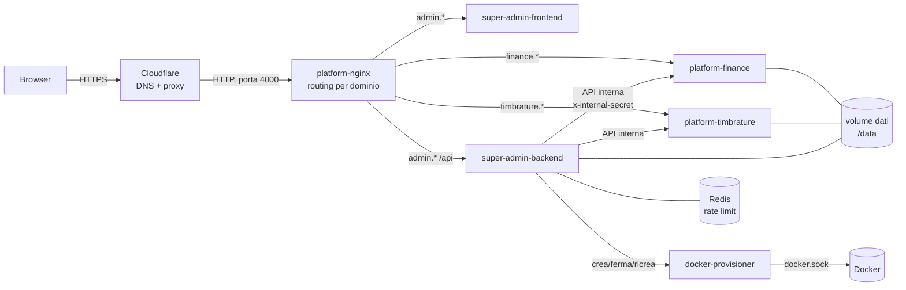
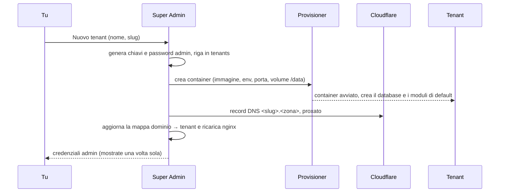
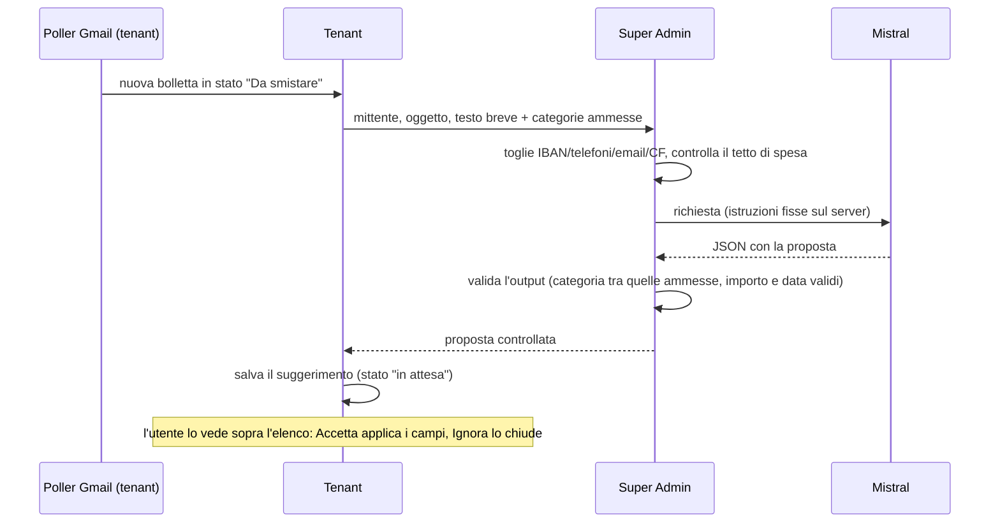

# Architettura

Come è fatto Platform 0.1. Per il perché vedi [`PLATFORM-VISIONE.md`](PLATFORM-VISIONE.md); per metterlo
online e mantenerlo vedi [`docs/OPERAZIONI.md`](docs/OPERAZIONI.md).

## In breve

Due tipi di processo:

- **Super Admin** (uno solo): crea e gestisce i tenant, ospita il Builder e la Libreria, fa i backup.
- **Tenant** (uno per progetto): la stessa immagine `platform-core` con un proprio database e i propri
  moduli. Finance è un tenant.

Un **provisioner** (piccolo servizio con accesso a Docker) è l'unico che crea e ferma i container dei tenant.



## Le parti

| Cartella | Cosa è | Tecnologia |
|---|---|---|
| `core/backend` | Il tenant: record, moduli, automazioni, utenti, backup, sito web | Node 22, Express, SQLite (better-sqlite3) |
| `core/frontend` | L'interfaccia del tenant: moduli, Builder, Libreria, impostazioni | React, Vite, Tailwind |
| `super-admin/backend` | Tenant, Libreria, backup, accessi, statistiche | Node 22, Express, SQLite |
| `super-admin/frontend` | Interfaccia di Super Admin | React, Vite, Tailwind |
| `super-admin/docker-provisioner` | Crea, ferma, ricrea i container dei tenant | Node 22, dockerode |
| `shared/` | Schema dei moduli (v3), rate limit, TOTP, utilità | JavaScript |
| `infra/nginx` | Router per dominio e mappa dominio → tenant | nginx |

L'immagine del tenant (`core/Dockerfile`) contiene nginx (serve il frontend e inoltra `/api`), il backend Node
e supervisord che li tiene su entrambi. Ascolta sulla porta 80 del container.

## I dati

Tutto vive nel volume `/data`, condiviso da Super Admin e dai tenant:

```
/data/super-admin-01.db        registro di Super Admin: tenant, Libreria, audit, backup
/data/<slug>.db                database di UN tenant (record, moduli, utenti)
/data/uploads/<slug>/          allegati del tenant (se non vanno su Google Drive)
/data/backups/<slug>/          copie di sicurezza del tenant
```

**Un tenant = un file SQLite.** I record stanno in una tabella `records` (`module_slug`, `data` JSON): la
struttura dei moduli sta in `modules.schema_json`, quindi cambiare un modulo non richiede migrazioni.

### Segreti di un tenant

Alla creazione Super Admin genera per ogni tenant una `ENCRYPTION_KEY` e un `JWT_SECRET`, li salva nel
proprio registro (`tenants.encryption_key`, `tenants.jwt_secret`) e li passa al container come variabili
d'ambiente. Non escono mai dalle API: l'elenco dei tenant li toglie e c'è un test che lo garantisce.

La chiave cifra i campi sensibili dei record (AES-256-GCM, valori che iniziano con `enc:`), con il nome
del tenant come sale. **Senza la chiave originale quei campi non si leggono più**: fa parte dei dati da
salvare insieme ai backup. Per riportare un tenant esistente sotto un nuovo Super Admin c'è "Registra
esistente", che importa il tenant con la sua chiave.

## Il ciclo di vita di un tenant



- **Stop / Start**: Start su un tenant senza container lo ricrea sullo stesso volume con le chiavi salvate.
- **Redeploy**: ricrea il container con l'immagine più recente; si ferma se qualcuno è collegato da meno di
  3 minuti (non forza).
- **Elimina**: backup di sicurezza, poi container e record DNS spariscono.
- **Registra esistente**: importa un tenant già esistente (da un vecchio `super-admin.db` o a mano).

## Moduli, Builder, Libreria

Un **modulo** è uno schema JSON (formato v3: una lista di blocchi `field`, `relation`, `workflow`,
`automation`, viste, permessi). Il motore (`core/backend/src/schema-v3.js`, condiviso con `shared/`) lo
interpreta; non c'è codice specifico per un tenant.

Il **Builder** modifica gli schemi. La **Libreria** (tabella `registry_modules` di Super Admin) conserva i
moduli con una versione: salvare di nuovo lo stesso modulo crea la versione successiva. **Installare = copiare**:
il tenant riceve una copia sua, ricorda da quale versione viene e mostra "Aggiorna" quando ne esiste una più
nuova (l'aggiornamento sovrascrive la copia locale, ed è avvisato prima).

## Parlare tra le parti

- **Browser → tenant**: JWT di sessione (24 ore), password con bcrypt, 2FA con TOTP facoltativo,
  limite ai tentativi di accesso (Redis).
- **Super Admin → tenant**: chiamate interne sulla rete Docker con `x-internal-secret`. Per il Builder e per
  "Apri →" Super Admin chiede al tenant un token amministrativo; il tenant firma da sé, Super Admin non
  conosce il suo `JWT_SECRET`.
- **Tenant → Super Admin**: lo stesso segreto interno, per elenco e installazione dei moduli della Libreria.
- Solo il **provisioner** ha accesso a `docker.sock`.

## Backup

Lo scheduler di Super Admin controlla ogni 15 minuti e fa una copia di ogni tenant secondo la sua frequenza
(di default ogni 24 ore, ne tiene 7) con `VACUUM INTO`: una copia coerente anche a container acceso.
Facoltativamente la copia viene sincronizzata fuori dal NAS (offsite) e verificata una volta a settimana.
Dal tenant, la voce **Export dati** scarica il database o un export JSON completo.

## Collegamenti esterni

Google (Gmail in lettura, Calendar, Drive) e WhatsApp (CallMeBot) si configurano per tenant dal dettaglio
di un modulo. L'elenco mostra solo i collegamenti attivi o richiesti dai moduli installati. Le credenziali
Google (Client ID e Secret, token) stanno nella tabella `connections` del tenant.

## Notifiche WhatsApp

L'invio passa da `core/backend/src/whatsapp.js`: legge la risposta di CallMeBot (che risponde 200 anche quando
rifiuta), riprova solo i problemi temporanei, manda i messaggi uno alla volta e registra l'esito vero per
destinatario; un messaggio non consegnato genera un avviso nell'app. Le automazioni dei moduli (`invia_notifica`,
`invia_report_periodico`) usano lo stesso invio.

Il **riepilogo del mattino** (`daily-digest.js`) è un lavoro a parte che gira ogni minuto e, all'ora italiana scelta,
manda un solo messaggio con le scadenze di oggi, domani e in ritardo. È spento di default.

## Assistente AI (Mistral)

Oggi c'è una funzione: lo **smistamento delle bollette** di Finance. L'AI **propone** (categoria, importo,
scadenza, fornitore) e tu accetti o ignori; non scrive mai da sola nei dati.



- Il **tenant non parla mai con Mistral** e non ha la chiave: chiede a Super Admin (`/api/tenant-ai/classify-bill`).
- I **dati personali** vengono tolti in un solo punto, in Super Admin (`lib/ai-redact.js`), prima di ogni invio.
- Le **istruzioni al modello** stanno sul server; il tenant manda solo dati.
- L'**output è controllato**: una categoria che non è tra le opzioni del modulo viene scartata, importi e date
  non validi diventano vuoti, una risposta che non è JSON viene rifiutata. All'accettazione la categoria è
  ricontrollata sul modulo.
- **Tetto di spesa mensile** (`lib/ai-budget.js`): si sommano i token del mese dal registro, convertiti in euro
  (di default mistral-small: 0,13 € in ingresso e 0,51 € in uscita per milione di token), e a tetto raggiunto
  nessuna chiamata parte. Avviso per email all'80% e al 100%. Tetto di default 10 €, regolabile con
  `AI_MONTHLY_BUDGET_EUR`.
- **Spento di default**: si accende da Impostazioni → Assistente AI. Le righe già presenti si possono
  sottoporre all'assistente anche con l'interruttore spento, dal riquadro in cima alla pagina Spese.

### Commento e spiegazione dei report

Stesso schema dello smistamento bollette, con una verifica in più. Il tenant (`core/backend/src/report-ai.js`) manda a
Super Admin (`/api/tenant-ai/explain-report`) i soli totali per gruppo; Super Admin (`lib/ai-report.js`) ripulisce i nomi,
calcola le variazioni percentuali, chiede il testo a Mistral con istruzioni sue e **controlla che ogni numero scritto
esista nei dati**, altrimenti risponde errore e il tenant non mostra nulla.

- **Commento mensile**: `invia_report_periodico` con `periodo: 'mese'` e `raggruppa_per`, se Impostazioni → Assistente AI →
  «Commento al report mensile» è acceso. Il report parte comunque se il commento non arriva.
- **Spiega questo report**: pulsante nel pannello Report (`ReportPanel.jsx`), rotta `POST /api/ai/explain-report`.

## Sicurezza, in sintesi

- Nessuna password fissa nel codice: la password admin iniziale è casuale o arriva da variabile d'ambiente.
- I segreti dei tenant non escono dalle API (test `tenant-import`).
- Gli endpoint interni richiedono il segreto condiviso e non sono esposti all'esterno (nginx risponde solo
  ai domini noti, il resto è chiuso con 444).
- I file `.env` e i database non entrano mai nel repository (`.gitignore`).
